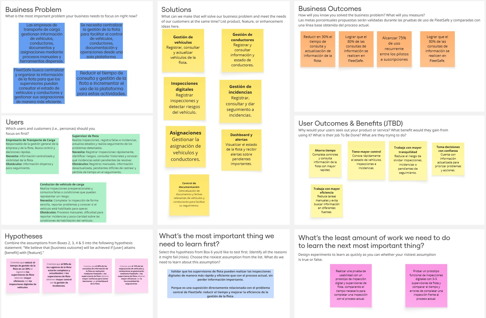

[← Student Outcome](README.md#student-outcome) · [Contenido](README.md#contenido) · [Capítulo II →](capitulo-2.md)

# Capítulo I: Introducción

## 1.1. Startup Profile

### 1.1.1. Descripción de la Startup

**FleetSafe** es una plataforma web de seguridad y control preventivo vehicular dirigida a empresas que operan vehículos de transporte de carga y necesitan verificar y controlar las condiciones de seguridad de sus unidades antes de iniciar una operación.

La plataforma permite que los conductores realicen **inspecciones preoperacionales digitales** sobre los vehículos asignados, registrando el estado de componentes, elementos de seguridad, documentación y observaciones.

A partir de los resultados obtenidos y de las reglas establecidas por la empresa, FleetSafe evalúa la condición del vehículo y determina si este se encuentra **habilitado, observado o no habilitado para operar**.

La plataforma está compuesta por:

- **Landing Page**
- **Web Application**
- **Backend RESTful API**

La Web Application manejará principalmente tres roles:

- **Administrador**
- **Supervisor de flota**
- **Conductor**

#### Misión

Desarrollar una plataforma web que permita a las empresas de transporte de carga controlar preventivamente las condiciones de seguridad de sus vehículos, mediante inspecciones preoperacionales digitales, evaluación de resultados, identificación de riesgos y seguimiento de incidencias.

#### Visión

Consolidar FleetSafe como una solución orientada al control preventivo y la habilitación operativa de vehículos de transporte de carga, facilitando que las empresas puedan verificar las condiciones de sus unidades antes de iniciar una operación y mantener un historial de su estado.

#### Modelo de Negocio

La propuesta inicial de FleetSafe no especifica un modelo de negocio, modalidad de suscripción ni estructura de precios. Por ello, estos aspectos quedan **pendientes de definición** y validación durante el desarrollo del proyecto.

#### Público Objetivo Principal

FleetSafe está dirigido principalmente a los siguientes segmentos:

- **Empresas de transporte de carga:** empresas que utilizan una flota de vehículos y necesitan controlar su condición de seguridad, documentación y mantenimiento preventivo.
- **Supervisores de flota:** responsables de revisar el estado de los vehículos, consultar las inspecciones realizadas, gestionar incidencias y verificar qué unidades se encuentran habilitadas para operar.
- **Conductores de vehículos de carga:** usuarios que realizan las inspecciones preoperacionales de los vehículos asignados y registran observaciones o evidencias cuando detectan problemas.

El principal valor de FleetSafe consiste en centralizar el control preventivo de los vehículos y permitir que, a partir de una inspección, el sistema evalúe su condición y determine si se encuentra habilitado, observado o no habilitado para operar.

FleetSafe no tiene como objetivo principal gestionar rutas, puntos de entrega o entregas de mercadería. Su responsabilidad se concentra principalmente en determinar y mantener la condición preventiva del vehículo antes y durante su ciclo de control.

---

### 1.1.2. Perfiles de integrantes del equipo

A continuación se presenta la ficha de cada integrante del equipo, indicando su código de estudiante, la carrera que cursa y un resumen de los principales conocimientos técnicos y habilidades que aporta al equipo.

| **Integrante** | Palacin Lazo, Gerardo Valentin |
|:---|:---|
| **Código del Estudiante** | U20211C201 |
| **Carrera** | Ingeniería de Software |
| **Descripción** | Me interesa mi mucho los avances que las soluciones de software han sido capaces de realizar en varias ramas de la vida. Me considero una persona curiosa que quiere seguir aprendiendo nuevos marcos de trabajo, lenguajes de programación y tecnologías emergentes. Me instrui en practicar C#, JavaScript,  HTML y CSS y aplicar mi conocimiento de base de datos relacionales y no relacionales. Este ciclo aprendo Angular y sus Materials guiandome de las fuentes originales. |
| **Foto** |  |

---

| **Integrante** | Rodrigo Fabrizio Aguilar Untiveros |
|:---|:---|
| **Código del Estudiante** | U202318309 |
| **Carrera** | Ingeniería de Software |
| **Descripción** | Me interesa el diseño de software orientado al dominio y la trazabilidad de las decisiones técnicas. Aporto conocimientos en Java con Spring Boot, C# con .NET, Python, JavaScript y TypeScript, además de bases de datos relacionales con PostgreSQL y MySQL, y no relacionales con MongoDB. Manejo control de versiones con Git y GitFlow, modelado con UML y C4, y contenedores con Docker. Procuro que lo que se afirma se pueda comprobar: verifico el comportamiento real de cada herramienta o producto en sus fuentes oficiales antes de darlo por cierto, y corrijo lo que no coincide con la evidencia. |
| **Foto** |  |

---

| **Integrante** | Elizabeth Noelia Apaza Bocanegra |
|:---|:---|
| **Código del Estudiante** | U20231c197 |
| **Carrera** | Ingeniería de Software |
| **Descripción** | Me interesa el desarrollo frontend con frameworks modernos, el diseño centrado en el usuario (UX/UI) y la implementación de arquitecturas limpias orientadas al dominio (DDD). En FleetSafe lideré el análisis, modelado e implementación del Bounded Context de Pre-Operational Inspection, definiendo los modelos de dominio con campos encapsulados, el Store reactivo con Angular Signals y la interfaz móvil responsiva con controles accesibles según pautas WCAG 2.1 AA. Aporto conocimientos sólidos en TypeScript, Angular, Angular Material, internacionalización con ngx-translate, consumo de servicios RESTful y control de versiones con Git y GitFlow bajo Conventional Commits. Procuro que las soluciones sean accesibles, intuitivas y cumplan con rigor normativo técnico. |
| **Foto** |  |

---

| **Integrante** | Alejandro Espino Flores |
|:---|:---|
| **Código del Estudiante** | U202122129 |
| **Carrera** | Ingeniería de Software |
| **Descripción** | Me interesa el diseño de software orientado al dominio y la trazabilidad de las decisiones técnicas. En FleetSafe asumí el modelado del dominio: la división en bounded contexts, el diseño de la base de datos por contexto, los diagramas C4 en Structurizr y los diagramas de clases. Aporto conocimientos en Java con Spring Boot, bases de datos relacionales con PostgreSQL, Git y GitFlow, y modelado con UML y C4. Procuro que lo que el informe afirma se pueda comprobar: durante el análisis competitivo verifiqué el comportamiento real de cada producto en sus fuentes oficiales y corregí una ventaja competitiva que el equipo había dado por cierta y era falsa. |
| **Foto** |  |

---

| **Integrante** | Juan Manuel Santos Torres |
|:---|:---|
| **Código del Estudiante** | U20221a371 |
| **Carrera** | Ingeniería de Software |
| **Descripción** | Me interesa el desarrollo frontend, el diseño de experiencia de usuario (UX/UI) y la construcción de interfaces web intuitivas y de alto rendimiento. En FleetSafe asumí la concepción visual y el desarrollo web inicial de la solución: estructuré el flujo de navegación y la arquitectura de información mediante wireframes de baja fidelidad, diseñé los mockups de alta fidelidad definiendo la identidad visual y guía de componentes, y programé la Landing Page responsiva orientada a la propuesta de valor y captación de clientes del sector transporte. Aporto conocimientos en maquetación y desarrollo web con HTML5 semántico, CSS3, Tailwind CSS y JavaScript, además de lenguajes como Python, C++ y Java, control de versiones con Git/GitFlow y despliegue continuo en GitHub Pages. Procuro que cada interfaz mantenga coherencia estética, accesibilidad y una implementación técnica limpia que asegure una navegación fluida en cualquier dispositivo. |
| **Foto** |  |

---

## 1.2. Solution Profile

**FleetSafe** es una plataforma web de seguridad y control preventivo vehicular desarrollada para empresas que operan vehículos de transporte de carga y necesitan verificar y controlar las condiciones de seguridad de sus unidades antes de iniciar una operación.

La solución permite realizar inspecciones preoperacionales digitales sobre los vehículos asignados, registrando el estado de componentes, elementos de seguridad, documentación y observaciones.

A partir de los resultados de la inspección y de las reglas establecidas por la empresa, FleetSafe evalúa la condición del vehículo y determina si se encuentra **habilitado, observado o no habilitado para operar**.

El núcleo de FleetSafe se encuentra en el siguiente flujo:

**Inspección → validación → evaluación → identificación de riesgos → habilitación → seguimiento.**

La pregunta principal que responde FleetSafe es:

> **¿Este vehículo cumple las condiciones necesarias para operar?**

FleetSafe no tiene como objetivo principal gestionar rutas, puntos de entrega o entregas de mercadería. Su responsabilidad termina principalmente en determinar y mantener la condición preventiva del vehículo antes y durante su ciclo de control.

---

### 1.2.1. Antecedentes y problemática

Las empresas de transporte de carga necesitan verificar y controlar las condiciones de seguridad de sus vehículos antes de iniciar una operación.

Actualmente, estos controles preventivos pueden realizarse mediante **formatos físicos, hojas de cálculo o procesos dispersos**, lo que dificulta disponer de una visión centralizada y actualizada sobre la condición de las unidades.

Esta situación dificulta conocer rápidamente:

- Qué vehículos fueron inspeccionados.
- Qué problemas fueron detectados.
- Qué unidades presentan riesgos.
- Qué documentos están próximos a vencer.
- Qué incidencias continúan pendientes.
- Qué vehículos requieren atención.
- Qué unidades cumplen las condiciones para operar.

FleetSafe busca centralizar esta información y permitir la toma de decisiones preventivas antes de iniciar una operación.

#### Análisis 5W + 2H

| Pregunta | Descripción |
|---|---|
| **Who - ¿Quiénes están involucrados?** | Empresas de transporte de carga, supervisores de flota y conductores de vehículos de carga. |
| **What - ¿Cuál es el problema?** | Las empresas pueden tener dificultades para controlar de manera centralizada las condiciones de seguridad, documentación, inspecciones e incidencias de sus vehículos. |
| **Where - ¿Dónde ocurre?** | En el proceso de control preventivo de los vehículos de transporte de carga, principalmente antes de iniciar una operación. |
| **When - ¿Cuándo ocurre?** | Durante las inspecciones preoperacionales y el seguimiento posterior de las condiciones e incidencias de los vehículos. |
| **Why - ¿Por qué representa un problema?** | Porque el uso de formatos físicos, hojas de cálculo o procesos dispersos dificulta conocer rápidamente el estado preventivo de las unidades y determinar cuáles cumplen las condiciones necesarias para operar. |
| **How - ¿Cómo se presenta el problema?** | Mediante información distribuida entre diferentes formatos o procesos, dificultando la consulta de inspecciones, problemas detectados, riesgos, documentos próximos a vencer e incidencias pendientes. |
| **How Much - ¿Cuál es su impacto?** | La propuesta inicial no establece una medida cuantitativa del impacto. Sin embargo, identifica dificultades para conocer rápidamente el estado de los vehículos y tomar decisiones preventivas antes de una operación. |

#### Enunciado del problema

Las empresas de transporte de carga necesitan verificar y controlar las condiciones de seguridad de sus vehículos antes de iniciar una operación. Sin embargo, cuando estos controles se realizan mediante formatos físicos, hojas de cálculo o procesos dispersos, resulta difícil conocer rápidamente qué vehículos fueron inspeccionados, qué problemas fueron detectados, qué unidades presentan riesgos y cuáles cumplen las condiciones necesarias para operar.

Los conductores necesitan realizar inspecciones preoperacionales sobre los vehículos asignados y registrar observaciones o evidencias cuando detectan problemas.

Los supervisores de flota necesitan consultar las inspecciones realizadas, revisar el estado de los vehículos, gestionar incidencias y verificar qué unidades se encuentran habilitadas para operar.

Esta situación genera la oportunidad de desarrollar una plataforma que centralice la información del control preventivo y permita evaluar la condición de los vehículos antes de iniciar una operación.

#### Puntos principales que debe resolver la solución

FleetSafe buscará abordar principalmente los siguientes puntos:

- Centralizar la información relacionada con las inspecciones preoperacionales.
- Registrar el estado de componentes y elementos de seguridad.
- Registrar documentación y observaciones relacionadas con los vehículos.
- Evaluar los resultados de las inspecciones mediante reglas establecidas por la empresa.
- Identificar los riesgos o problemas detectados durante las inspecciones.
- Determinar si un vehículo se encuentra habilitado, observado o no habilitado para operar.
- Registrar y realizar seguimiento de incidencias.
- Mantener un historial del estado preventivo de los vehículos.

#### Objetivos de la solución

- Permitir que los conductores realicen inspecciones preoperacionales digitales de los vehículos asignados.
- Registrar el estado de componentes, elementos de seguridad, documentación y observaciones.
- Evaluar los resultados de las inspecciones de acuerdo con las reglas establecidas por la empresa.
- Determinar la condición preventiva del vehículo.
- Facilitar a los supervisores la consulta de las inspecciones realizadas.
- Permitir gestionar y realizar seguimiento de las incidencias detectadas.
- Facilitar la identificación de las unidades habilitadas, observadas y no habilitadas para operar.
- Mantener un historial relacionado con el control preventivo de los vehículos.

#### Restricciones iniciales

Para mantener el enfoque definido para FleetSafe, se consideran inicialmente las siguientes restricciones:

- FleetSafe estará orientado principalmente a **vehículos de transporte de carga**.
- La solución será desarrollada como una **plataforma web**.
- La aplicación contará principalmente con los roles de **Administrador, Supervisor de flota y Conductor**.
- El sistema se centrará en el **control preventivo y la habilitación operativa de vehículos**.
- La gestión de rutas, puntos de entrega y entregas de mercadería no forma parte del objetivo principal de FleetSafe.
- La determinación de la condición del vehículo se realizará a partir de los resultados de las inspecciones y las reglas establecidas por la empresa.

---

### 1.2.2. Lean UX Process.

#### 1.2.2.1. Lean UX Problem Statements

FleetSafe corresponde a una iniciativa de producto digital (*Brand New Initiative*) concebida para transformar el control preventivo y la habilitación operativa de flotas de transporte terrestre de carga en el Perú, en alineamiento con la normativa vigente de SUTRAN y el MTC.

##### Problem Statement (Brand New Initiative Template)

> **The current state of** commercial road freight transportation in Peru **has focused mainly on** manual, paper-based inspection clipboards, fragmented spreadsheets, informal WhatsApp reporting, and reactive mechanical repairs, where:
> 
> * **Cargo Transport Enterprises** struggle with a lack of centralized auditability, elevated operational costs caused by preventable en-route vehicle breakdowns, and the constant risk of severe regulatory sanctions, fines, and vehicle impoundment imposed by SUTRAN due to unverified mechanical safety equipment or expired mandatory documentation (SOAT, CITV).
> * **Fleet Supervisors** suffer from chaotic, time-consuming morning dispatch routines, lacking real-time visibility and automated evaluation logic to immediately identify whether dozens of heavy units meet the statutory roadworthiness conditions to safely depart the terminal.
> * **Heavy Vehicle Drivers** are burdened by slow, repetitive paper forms that delay their daily journey start, while lacking a reliable, photographic mechanism to document pre-existing vehicle wear or cabin defects, leaving them vulnerable to unjustified liability during roadside inspections.
> 
> **What existing products/services fail to address is** a localized, domain-driven solution tailored to Peruvian transport regulations that integrates an automated, rule-based evaluation engine capable of instantly freezing non-compliant units (`NOT_ENABLED`) upon detecting critical safety faults, while providing an audit trail for authorized exceptions and photographic evidence.
> 
> **Our product/service will address this gap by** providing FleetSafe, a collaborative cloud-based platform composed of a responsive Mobile Web experience for drivers to execute pre-operational checklists in under 5 minutes with offline capability and photo evidence, an automated regulatory evaluation service that classifies operational readiness (`ENABLED`, `OBSERVED`, `NOT_ENABLED`), and a centralized Desktop Dashboard for fleet supervisors to manage authorizations, inspections history, and preventive maintenance follow-up.
> 
> **Our initial focus will be** formal interprovincial and urban freight transport companies operating medium and heavy fleets (tractor-trailers, semi-trailers, and cargo trucks) in Metropolitan Lima and the central transport corridor.
> 
> **We’ll know we are successful when we see:**
> 1. At least **90% of daily scheduled fleet trips** preceded by a digitally registered pre-operational inspection completed in under 5 minutes.
> 2. **100% of critical safety component failures** (brakes, steering, tires) triggering automatic vehicle dispatch blocking prior to terminal exit.
> 3. A **35% reduction in en-route roadside breakdowns** associated with preventable mechanical wear within the first 6 months of client deployment.
> 4. **Zero administrative fines or vehicle retentions** by SUTRAN resulting from lack of mandatory emergency equipment or expired regulatory documents among active clients.

#### 1.2.2.2. Lean UX Assumptions

Las suposiciones del proyecto se estructuran en cinco categorías conforme al marco de trabajo Lean UX (Gothelf & Seiden, 3.ª ed.), declarando las creencias fundamentales del negocio y los beneficios esperados:

##### Business Assumptions

* Creemos que existe una demanda comercial insatisfecha en el sector de transporte de carga peruano por soluciones digitales accesibles que automaticen el cumplimiento preventivo y fiscalizable de SUTRAN.
* Creemos que las empresas de transporte prefieren un modelo de suscripción mensual SaaS escalable por número de vehículos activos antes que costosos desarrollos a medida o software extranjero no adaptado a la regulación nacional.
* Creemos que centralizar las inspecciones preoperacionales y la documentación vehicular en una sola plataforma reduce significativamente el costo total de propiedad (TCO) y las primas de seguro de flota.
* Creemos que la capacidad de auditar fotográficamente los hallazgos críticos otorga a la empresa una ventaja competitiva determinante para retener contratos logísticos con clientes corporativos exigentes.

##### Business Outcome Assumptions (Métricas Cuantitativas y Medibles)

* **Disminución del tiempo de registro:** Reducir el tiempo promedio de registro y consolidación de inspecciones diarias de 25 minutos (en planillas de papel) a **menos de 5 minutos** por unidad mediante interfaz móvil optimizada.
* **Tasa de adopción digital:** Lograr una tasa de adopción del **95% de inspecciones registradas digitalmente** antes de la salida a ruta durante los primeros 90 días de implementación en empresas piloto.
* **Reducción de paradas no programadas:** Reducir en un **30% las paralizaciones de viaje** asociadas a fallas mecánicas prevenibles detectadas a tiempo en el patio de maniobras.
* **Cero penalidades regulatorias:** Mantener un índice de **0 multas graves o muy graves de SUTRAN** vinculadas a condiciones técnico-mecánicas no conformes en vehículos inspeccionados con FleetSafe.
* **Retención de clientes (B2B Churn):** Alcanzar una tasa de retención de clientes corporativos superior al **85%** al cabo del primer año de operación comercial.

##### User Assumptions

* Creemos que los **supervisores de flota** necesitan consolidar el estado de toda la flota en un panel centralizado con alertas visuales inmediatas antes de firmar la orden de salida matutina.
* Creemos que los **conductores de carga pesada** utilizan smartphones Android modernos en su jornada laboral y están dispuestos a usar una aplicación web ligera si cuenta con botones táctiles grandes, flujo guiado y no requiere digitación compleja.
* Creemos que los **administradores de empresa** necesitan reportes exportables en PDF con valor probatorio para sustentar el historial de mantenimiento ante fiscalizaciones o auditorías de clientes.

##### User Outcome and Benefit Assumptions (Beneficios y Valor Obtenido)

* **Para Empresas de Transporte:**
  * **Beneficio legal y probatorio:** Respaldo digital inalterable con fecha, hora, conductor y fotografías ante cualquier siniestro o auditoría de fiscalización.
  * **Ahorro financiero:** Mitigación de costos por reparaciones correctivas mayores al identificar desgastes menores de forma temprana.
* **Para Supervisores de Flota:**
  * **Automatización de decisiones:** Eliminación de la incertidumbre al recibir una condición operativa generada por reglas objetivas (`ENABLED`, `OBSERVED`, `NOT_ENABLED`), ahorrando más de 1 hora diaria de digitación de planillas.
  * **Trazabilidad de excepciones:** Capacidad de autorizar levantamientos de observación con registro de motivo y firma digital, delimitando responsabilidades operativas.
* **Para Conductores de Carga:**
  * **Agilidad operativa:** Completar el checklist matutino en menos de 5 minutos mediante controles táctiles ergonómicos de 48px sin perder tiempo en planillas físicas deterioradas.
  * **Protección y deslinde de responsabilidad:** Registro fotográfico de defectos preexistentes que garantiza que el conductor no sea culpado injustamente por daños previos de la unidad.

##### Feature Assumptions

* Creemos que implementar una **interfaz de checklist móvil con controles segmentados táctiles de 48x48 px (OK / OBS / FAIL)** incrementará la velocidad y precisión del registro preoperacional del conductor.
* Creemos que un **módulo de carga de evidencias fotográficas con validación obligatoria** para componentes críticos de seguridad (frenos, dirección, neumáticos) garantizará la veracidad de los reportes.
* Creemos que un **motor de evaluación automática de reglas normativas SUTRAN** que bloquee inmediatamente el vehículo (`NOT_ENABLED`) ante un fallo crítico garantizará que ninguna unidad peligrosa salga a ruta.
* Creemos que un **dashboard de supervisor con tarjetas KPI de flota y semáforos de condición** facilitará el control visual simultáneo de decenas de vehículos.
* Creemos que una **función de exportación de reportes de inspección en PDF** permitirá a la empresa cumplir con los requisitos documentales ante inspectores en carretera.

#### 1.2.2.3. Lean UX Hypothesis Statements

Los Hypothesis Statements de FleetSafe formalizan nuestras suposiciones de funcionalidad (*Feature Assumptions*) en enunciados verificables y contrastables, empleando la plantilla canónica de Lean UX formulada por Jeff Gothelf:

$$\textbf{We believe that } [\text{Business Outcome}] \textbf{ will be achieved if } [\text{User Persona / Segment}] \textbf{ successfully } [\text{User Benefit / Outcome}] \textbf{ with } [\text{Feature / Solution Idea}].$$

Cada enunciado vincula un indicador cuantificable de éxito del negocio con un beneficio tangible percibido por el usuario al interactuar con una capacidad del sistema:

##### Hypothesis Statement 1 — Pre-Operational Digital Inspection Checklist
> **We believe that** our customer fleets will reduce pre-dispatch verification turnaround times by at least 70% (from 25 minutes down to 7 minutes per unit) and eliminate 100% of illegible physical paper logs **if** heavy freight drivers (*Álvaro Torres*) **attain** a fast, frictionless, mobile-first inspection routine directly from their smartphone browser without paperwork friction **with** the **Pre-Operational Digital Inspection Module** (standardized 42-item checklist covering safety, mechanical components, and documentation).

##### Hypothesis Statement 2 — Rule-Based Automotive Safety Evaluation Engine
> **We believe that** transport companies will reduce roadside mechanical breakdown incidents and SUTRAN regulatory non-compliance infractions by 40% during the first 90 days **if** fleet supervisors (*Alessandra Nova*) and operations managers (*José Ramírez*) **attain** instantaneous, objective, and deterministic risk verdicts (*Enabled*, *Observed*, *Not Enabled*) without human subjective bias **with** the **Rule-Based Evaluation Engine** (evaluating findings against critical safety thresholds and automated stop-work rules).

##### Hypothesis Statement 3 — Operational Authorization & Traceable Exception Handling
> **We believe that** client organizations will eliminate 100% of undocumented verbal bypasses and ensure full legal accountability during occupational health and safety (SST) audits **if** fleet safety supervisors (*Alessandra Nova*) **attain** complete administrative control to issue conditional operating clearances with recorded justification, designated authorizer, and strict audit trails **with** the **Operational Authorization & Exception Management Feature**.

##### Hypothesis Statement 4 — Incident Lifecycle Tracking & Corrective Actions
> **We believe that** fleet maintenance operations will decrease Mean Time to Resolution (MTTR) for critical vehicle defects by 45% and prevent recurring mechanical defects **if** fleet supervisors and workshop coordinators **attain** real-time visibility over reported defects, assigned corrective tasks, photographic evidence, and repair sign-offs **with** the **Incident Tracking & Corrective Actions Module**.

##### Hypothesis Statement 5 — Centralized Fleet Status & Operational Dispatch Monitoring
> **We believe that** transport operations managers will increase active vehicle availability and on-time terminal departure dispatch rates by 30% **if** fleet operations managers (*José Ramírez*) **attain** an executive, consolidated real-time dashboard showing fleet compliance status, pending inspections, and blocked assets at a glance **with** the **Supervisor Fleet Monitoring & KPI Dashboard**.

##### Hypothesis Statement 6 — Auditable Preventive History & Compliance Reporting
> **We believe that** freight transport companies will achieve a 100% first-pass approval rate on customer homologation audits and mining/industrial contractor compliance verificaciones **if** safety auditors and fleet administrators **attain** immediate one-click generation of immutable, timestamped historical inspection records and supervisory approval certificates **with** the **Auditable Historical Control & Compliance Reporting Feature**.

---

#### <i>**1.2.2.4. Lean UX Canvas.**</i>

[Link del canvas](https://miro.com/app/board/uXjVEdPbI5Y=/?share_link_id=326777939411)

## 1.3. Segmentos objetivo

Los segmentos objetivo de FleetSafe se encuentran relacionados con las actividades de control preventivo y seguridad de los vehículos de transporte de carga.

La definición presentada en esta etapa corresponde a la información inicial establecida para FleetSafe. Las características específicas, comportamientos y necesidades de cada segmento deberán ser posteriormente validadas mediante investigación.

Los segmentos considerados inicialmente son las **empresas de transporte de carga**, los **supervisores de flota** y los **conductores de vehículos de carga**.

### Empresas de transporte de carga

Las empresas de transporte de carga constituyen el segmento organizacional al que se dirige principalmente FleetSafe.

Estas empresas utilizan una flota de vehículos y necesitan controlar su condición de seguridad, documentación y mantenimiento preventivo.

#### Características generales

- Empresas que operan vehículos de transporte de carga.
- Utilizan una flota de vehículos.
- Necesitan controlar la condición de seguridad de sus unidades.
- Necesitan controlar documentación relacionada con sus vehículos.
- Requieren realizar controles preventivos antes de iniciar operaciones.

#### Necesidades iniciales identificadas

- Controlar la condición de seguridad de los vehículos.
- Centralizar la información relacionada con las inspecciones.
- Conocer qué unidades presentan riesgos.
- Identificar qué vehículos requieren atención.
- Conocer qué unidades cumplen las condiciones para operar.

---

### Supervisores de flota

Los supervisores de flota representan uno de los principales usuarios de FleetSafe.

Son responsables de revisar el estado de los vehículos, consultar las inspecciones realizadas, gestionar incidencias y verificar qué unidades se encuentran habilitadas para operar.

#### Características del segmento

- Revisan el estado de los vehículos.
- Consultan las inspecciones realizadas.
- Gestionan incidencias.
- Verifican qué unidades se encuentran habilitadas para operar.
- Necesitan información sobre los riesgos y problemas detectados.

#### Necesidades iniciales identificadas

- Revisar las inspecciones realizadas.
- Conocer el estado de los vehículos.
- Identificar unidades que presentan riesgos.
- Gestionar incidencias.
- Verificar qué vehículos se encuentran habilitados para operar.

---

### Conductores de vehículos de carga

Los conductores de vehículos de carga constituyen uno de los principales usuarios operativos de FleetSafe.

Son los usuarios que realizan las inspecciones preoperacionales de los vehículos asignados y registran observaciones o evidencias cuando detectan problemas.

#### Características del segmento

- Operan vehículos de transporte de carga.
- Reciben vehículos asignados para realizar operaciones.
- Realizan inspecciones preoperacionales.
- Registran observaciones cuando detectan problemas.
- Pueden registrar evidencias relacionadas con las condiciones detectadas durante la inspección.

#### Necesidades iniciales identificadas

- Realizar inspecciones preoperacionales de los vehículos asignados.
- Registrar el estado de los componentes.
- Registrar el estado de los elementos de seguridad.
- Registrar información relacionada con la documentación.
- Registrar observaciones o evidencias cuando detectan problemas.

---

### Priorización inicial de los segmentos

A partir de la relación de cada segmento con las funciones principales de FleetSafe, se establece inicialmente la siguiente priorización:

| Segmento | Relación con FleetSafe | Prioridad inicial |
|---|---|---|
| **Supervisores de flota** | Revisan el estado de los vehículos, consultan inspecciones, gestionan incidencias y verifican las unidades habilitadas. | Muy alta |
| **Conductores de vehículos de carga** | Realizan las inspecciones preoperacionales y registran observaciones o evidencias. | Muy alta |
| **Empresas de transporte de carga** | Utilizan una flota de vehículos y necesitan controlar su condición de seguridad, documentación y mantenimiento preventivo. | Alta |

Los **supervisores de flota** y los **conductores de vehículos de carga** serán considerados inicialmente los principales usuarios de la aplicación debido a su participación directa en el control preventivo de los vehículos.

Las **empresas de transporte de carga** representan el segmento organizacional al que se dirige la solución, ya que necesitan controlar la condición de seguridad, documentación y mantenimiento preventivo de sus unidades.

Esta clasificación inicial podrá ser revisada después de realizar la investigación correspondiente con representantes reales de cada segmento.

---

[← Student Outcome](README.md#student-outcome) · [Contenido](README.md#contenido) · [Capítulo II →](capitulo-2.md)
