[← Capítulo I](capitulo-1.md) · [Contenido](README.md#contenido) · [Capítulo III →](capitulo-3.md)

# Capítulo II: Requirements Elicitation & Analysis

En este capítulo se desarrolla el proceso de levantamiento y análisis de información necesario para comprender con mayor profundidad el dominio en el que se desarrolla FleetSafe.

Para ello, el equipo realizará inicialmente un análisis de soluciones existentes que compiten directa o indirectamente con la propuesta. Posteriormente, se desarrollará un proceso de investigación mediante entrevistas a representantes de los segmentos objetivo.

La información obtenida permitirá validar o corregir las suposiciones planteadas inicialmente por el equipo y servirá como base para la posterior construcción de User Personas, User Task Matrix, User Journey Maps, Empathy Maps y demás artefactos del proceso de Needfinding.

---

## 2.1. Competidores

Con la finalidad de comprender el entorno competitivo en el cual se desarrollará FleetSafe, se identificaron las soluciones digitales que atienden necesidades relacionadas con la inspección preoperacional de vehículos, el control preventivo, la habilitación operativa y la gestión de incidencias.

El análisis del entorno competitivo permitió identificar **tres capas de competencia** con características distintas:

| Capa | Quiénes | Relación con FleetSafe |
|:---|:---|:---|
| **Competidores directos** | Fleetio, Whip Around, Vehicheck, Verizon Connect | Digitalizan la inspección de vehículos y, en distintos grados, determinan si la unidad puede operar |
| **Competidores indirectos** | Proveedores de telemática y gestión de flotas en Perú; plataformas genéricas de formularios digitales | Resuelven problemas adyacentes —rastreo, mantenimiento, digitalización de formatos— sin llegar a la habilitación operativa |
| **Alternativa vigente** | Formatos físicos, hojas de cálculo y formularios genéricos | Es la práctica actual en la mayoría de empresas y, en la práctica, la opción con la que se compara la adopción de FleetSafe |

Un hallazgo relevante del análisis es que **cada solución existente está construida alrededor del marco normativo de un país determinado**, del cual depende la evidencia que el cliente y el ente fiscalizador exigen. Esta observación resultó determinante para la definición de la ventaja competitiva de FleetSafe y se desarrolla en la sección 2.1.2.

### Competidor 1: Fleetio

**Fleetio** es una plataforma estadounidense de gestión de flotas que incluye funcionalidades de inspección de vehículos, mantenimiento y seguimiento de problemas.

Permite realizar inspecciones digitales personalizables, registrar fotografías y comentarios, generar alertas ante problemas detectados, mantener el historial de inspecciones y convertir los elementos fallidos en órdenes de trabajo.

Respecto de la habilitación del vehículo, Fleetio permite que un elemento fallido **cambie automáticamente el estado del vehículo a "Out of Service"** mediante la configuración de *workflows*. Es importante precisar que este no es el comportamiento predeterminado —de forma predeterminada únicamente se genera una incidencia— y que los *workflows* se encuentran disponibles en los planes Professional y Premium.

Su modelo de cumplimiento está orientado a la normativa federal estadounidense (DOT). Ofrece traducción al español en su aplicación móvil y en su centro de ayuda, aunque **no ofrece soporte telefónico ni acompañamiento de implementación en español**.

### Competidor 2: Whip Around

**Whip Around** es una plataforma estadounidense especializada en inspecciones de flota, mantenimiento y cumplimiento normativo.

Permite realizar inspecciones preoperacionales y postoperacionales desde dispositivos móviles, con formularios personalizables, registro de defectos con indicación de severidad y adjunto de fotografías.

Respecto de la habilitación del vehículo, cuando se registra un defecto la plataforma genera la orden de trabajo correspondiente y **mantiene la unidad fuera de servicio hasta que la reparación se encuentra documentada**. Para los defectos que afectan la operación segura, el vehículo no puede volver a operar hasta que un mecánico certificado o un representante autorizado del transportista firme la certificación correspondiente, conforme al procedimiento del *Driver Vehicle Inspection Report* (DVIR) estadounidense.

Su soporte de idiomas en el panel y la aplicación se realiza **mediante traducción automática**, no mediante una localización propia.

### Competidor 3: Vehicheck

**Vehicheck** es una solución colombiana orientada específicamente a la digitalización de la inspección preoperacional de flotas, y constituye el competidor directo más cercano a la propuesta de FleetSafe.

Permite que el conductor realice la inspección desde un dispositivo móvil generando evidencia digital con fotografías, firma y marca de tiempo, e incorpora **bloqueo automático de vehículos con fallas críticas**: cuando un elemento crítico se encuentra en mal estado, la inspección se marca como no aprobada. Incluye además alertas de vencimiento del SOAT y de la revisión técnico-mecánica.

La solución se presenta **alineada de forma exclusiva con el Plan Estratégico de Seguridad Vial (PESV) de Colombia** y se comercializa en ese mercado. No declara presencia en Perú ni en otros países, y no publica información de precios.

La existencia de Vehicheck confirma que el problema que aborda FleetSafe es real y comercialmente viable en el contexto latinoamericano, y evidencia al mismo tiempo que las soluciones de esta categoría se construyen alrededor del marco normativo del país al que se dirigen.

### Competidor 4: Verizon Connect

**Verizon Connect** es una plataforma estadounidense de gestión de flotas y telemática que incluye funcionalidades de *Driver Vehicle Inspection Reports* (DVIR).

Permite que los conductores realicen inspecciones mediante listas de componentes desde dispositivos móviles, registren defectos, agreguen comentarios y adjunten fotografías, manteniendo los registros disponibles para su consulta posterior.

A diferencia de las anteriores, su propuesta **requiere la instalación de equipamiento telemático en cada vehículo**, lo que implica una inversión inicial y un proceso de implementación considerablemente mayores.

### Competidores indirectos

**Proveedores de telemática y gestión de flotas en Perú.** El mercado peruano cuenta con proveedores consolidados orientados al monitoreo por GPS, el mantenimiento y la trazabilidad de la operación, entre los que se encuentran Zonar Systems Perú —certificado por SUTRAN—, MiX Telematics a través de PSTECH Perú, y Prolyam, que ofrece un ERP vehicular con presencia en Lima, Callao, Arequipa, Trujillo y Piura. Estas soluciones no tienen como núcleo la inspección preoperacional ni la determinación de la condición operativa del vehículo, pero atienden al mismo cliente y compiten por el mismo presupuesto.

**Plataformas genéricas de formularios digitales.** Soluciones como DataScope permiten crear y consolidar formularios de inspección de cualquier tipo. Resuelven la digitalización del formato, pero no incorporan reglas de evaluación, habilitación operativa ni seguimiento de incidencias asociado al vehículo.

**La alternativa vigente: el formato físico y la hoja de cálculo.** En la mayoría de empresas de transporte de carga el control preoperacional se realiza mediante formatos impresos que se archivan físicamente. Aunque no constituye un producto, es la opción con la que compite realmente FleetSafe en la decisión de compra: su costo directo es cero y su principal debilidad es que la información no está disponible cuando se requiere demostrarla.

---

### 2.1.1. Análisis competitivo

El análisis competitivo tiene como objetivo que BitMeisters conozca mejor a sus competidores, contrastando la idea inicial que el equipo tenía sobre ellos con la información verificable disponible en sus canales oficiales y de soporte.

#### Competitive Analysis Landscape

| **¿Por qué llevar a cabo este análisis?** |
|:---|
| Conocer cómo las soluciones existentes de inspección y control preventivo vehicular resuelven la habilitación operativa del vehículo, y determinar cómo puede FleetSafe diferenciarse para ofrecer una propuesta de valor adecuada a las empresas de transporte de carga en el Perú. |

| | |  **FleetSafe** |  **Fleetio** |  **Whip Around** |  **Vehicheck** |  **Verizon Connect** |
|:---|:---|:---|:---|:---|:---|:---|
| **Perfil** | Overview | Control preventivo y habilitación operativa de vehículos de carga, alineado al marco de cumplimiento peruano. | Gestión integral de flotas con inspecciones, mantenimiento y órdenes de trabajo. | Plataforma especializada en inspecciones DVIR, defectos y cumplimiento. | Inspección preoperacional digital alineada al PESV de Colombia. | Gestión de flotas y telemática con módulo DVIR. |
| | Ventaja competitiva ¿Qué valor ofrece a los clientes? | Produce la evidencia que exigen la normativa peruana de SST y las auditorías de homologación, y deja registro de quién autoriza cada excepción. | Amplitud funcional y automatización entre inspección, incidencia y mantenimiento. | Especialización en el ciclo de defectos y en el cumplimiento del DOT. | Cumplimiento del PESV sin papel, con bloqueo automático ante fallas críticas. | Integración de las inspecciones con telemática y rastreo en tiempo real. |
| **Perfil de Marketing** | Mercado objetivo | Empresas de transporte de carga en Perú, con énfasis en las que prestan servicio a clientes industriales y mineros. | Empresas que administran vehículos y activos, principalmente en Estados Unidos. | Flotas de cualquier tamaño; plan gratuito para un solo activo. | Empresas colombianas obligadas a cumplir el PESV. | Empresas que requieren rastreo, seguridad y gestión integral de flota. |
| | Estrategias de marketing | Landing Page, demostraciones, pruebas piloto y contacto directo con empresas de transporte. | Contenido digital, precios publicados y prueba gratuita. | Contenido sobre cumplimiento DOT, plan gratuito de entrada y calculadora de retorno de inversión. | Contacto directo por WhatsApp y demostración; producto en lanzamiento. | Fuerza comercial, cotización a medida y casos de éxito. |
| **Perfil de Producto** | Productos & Servicios | Inspección preoperacional, evaluación por reglas, habilitación operativa con registro de excepciones, gestión de incidencias, documentación vehicular e historial auditable. | Inspecciones, incidencias, órdenes de trabajo, mantenimiento, combustible e informes. | Inspecciones, defectos con severidad, órdenes de trabajo, mantenimiento y cumplimiento. | Inspección preoperacional, evidencia digital, bloqueo automático y alertas de SOAT y RTM. | DVIR, rastreo GPS, telemática, análisis de conducción y gestión de flota. |
| | Precios & Costos | Suscripción mensual por vehículo activo; estructura pendiente de validación. | Essential USD 4 por vehículo/mes con pago anual (USD 5 mensual); Professional USD 7; Premium USD 10. Mínimo de 5 vehículos. | Basic gratuito para 1 activo; Standard USD 5 por activo/mes; Pro USD 10 con pago anual; plan fijo ilimitado a medida. Sin mínimo de flota. | No publica precios. | No publica precios; cotización a medida. Estimaciones del sector entre USD 20 y USD 40 por vehículo/mes, además del equipamiento. |
| | Canales de distribución (Web y/o Móvil) | Plataforma web responsive, sin instalación. | Plataforma web y aplicación móvil. | Plataforma web y aplicación móvil. | Plataforma web y aplicación móvil. | Plataforma web, aplicación móvil y equipamiento instalado en el vehículo. |
| **Análisis SWOT** | Fortalezas | Enfoque exclusivo en control preventivo y habilitación; reglas configurables por la empresa; registro de la autorización de excepciones con responsable y justificación; historial orientado a las exigencias documentales locales; adopción sin hardware ni instalación. | Amplitud funcional y madurez; precios publicados y prueba gratuita; cambio automático del estado del vehículo mediante *workflows*. | Especialización en inspecciones; retiene la unidad fuera de servicio hasta documentar la reparación; plan gratuito y sin mínimo de flota; severidad declarada por el conductor. | Propuesta casi equivalente a la de FleetSafe; bloqueo automático; evidencia con fotografía, firma y marca de tiempo; alineamiento explícito con una normativa nacional. | Plataforma consolidada con telemática, rastreo y DVIR integrados; respaldo corporativo; información en tiempo real. |
| | Debilidades | Producto nuevo, sin clientes ni posicionamiento; menor amplitud funcional; recursos limitados del equipo; la inspección es autorreportada por el conductor, por lo que el sistema no puede garantizar que la revisión física se haya realizado. | El bloqueo del vehículo no es el comportamiento predeterminado y requiere configuración y un plan superior; cumplimiento orientado a la normativa estadounidense; sin soporte telefónico ni implementación en español. | El retorno a servicio se apoya en la figura del mecánico certificado del modelo DVIR estadounidense, ajena a la práctica peruana; soporte de idiomas mediante traducción automática. | Alcance limitado a Colombia y al PESV; producto en lanzamiento, sin precios publicados ni casos de éxito; canal comercial basado en contacto directo. | Requiere instalación de equipamiento en cada vehículo, con inversión inicial y tiempo de implementación; no publica precios; propuesta más extensa de lo que exige el control preventivo. |
| | Oportunidades | Ausencia de soluciones construidas sobre el marco de cumplimiento peruano; exigencia creciente de evidencia documentada en los procesos de homologación; predominio aún del formato físico; integración futura con mantenimiento, GPS o IoT. | Expansión hacia mercados hispanohablantes; mayor integración entre inspección y mantenimiento. | Crecimiento de la digitalización de inspecciones; demanda creciente de trazabilidad de defectos. | Expansión hacia otros países de la región con normativas de seguridad vial equivalentes. | Uso de datos telemáticos para anticipar fallas antes de la inspección. |
| | Amenazas | Entrada al mercado peruano de soluciones regionales ya operativas, como Vehicheck; incorporación de capacidades equivalentes por plataformas consolidadas; proveedores locales de telemática que añadan módulos de inspección; resistencia al cambio de procesos. | Competencia de soluciones especializadas y de menor complejidad; productos locales adaptados a marcos normativos específicos. | Plataformas de gestión de flotas que incorporan inspecciones; soluciones regionales adaptadas a normativas locales. | Aparición de soluciones locales en cada mercado al que pretenda expandirse; plataformas consolidadas que incorporen el bloqueo de forma predeterminada. | Soluciones sin hardware y de adopción inmediata; competidores especializados de menor costo. |

> **Nota sobre las fuentes.** Los precios y el comportamiento ante fallas de Fleetio y Whip Around corresponden a la información publicada en sus páginas de precios y en sus centros de ayuda; los datos de Vehicheck provienen de su sitio oficial; los rangos de Verizon Connect corresponden a estimaciones del sector, dado que la empresa no publica tarifas. Las referencias completas se encuentran en la sección de Bibliografía.

---

### 2.1.2. Estrategias y tácticas frente a competidores

El análisis competitivo permitió identificar un patrón determinante: **las soluciones existentes se construyen alrededor del marco normativo del país al que se dirigen**, porque de ese marco depende la evidencia que el cliente y el ente fiscalizador exigen.

| Solución | Marco de cumplimiento sobre el que está construida |
|:---|:---|
| Fleetio, Whip Around, Verizon Connect | *Driver Vehicle Inspection Report* y normativa federal de los Estados Unidos |
| Vehicheck | Plan Estratégico de Seguridad Vial (PESV) de Colombia |
| Proveedores peruanos de telemática | Rastreo y mantenimiento; no abordan la habilitación operativa |
| **FleetSafe** | **Normativa peruana de seguridad y salud en el trabajo, normativa de seguridad minera y homologación de proveedores** |

Sobre esta base, BitMeisters plantea las siguientes estrategias, que corresponden a una **estrategia competitiva de enfoque**: en lugar de competir por amplitud funcional frente a plataformas consolidadas, FleetSafe se especializa en atender de manera completa a un segmento y un marco de cumplimiento determinados.

#### Estrategia 1: Especialización en el marco de cumplimiento peruano

FleetSafe se posicionará como la solución de control preventivo diseñada para las exigencias documentales del mercado peruano, y no como una alternativa funcionalmente equivalente a las plataformas existentes.

**Tácticas:**

- Diseñar el historial y los reportes en función de la evidencia que solicitan las auditorías de homologación de clientes industriales y mineros.
- Estructurar el registro de inspecciones de modo que sirva como evidencia dentro del sistema de gestión de seguridad y salud en el trabajo de la empresa.
- Incorporar el control de vigencia de la documentación vehicular exigida en el ámbito local.
- Comunicar la propuesta en términos de cumplimiento y de continuidad operativa, no en términos de cantidad de funcionalidades.

#### Estrategia 2: Habilitación operativa con trazabilidad de las excepciones

Las soluciones analizadas plantean dos extremos: o el vehículo queda retenido hasta contar con la certificación de un mecánico, conforme al modelo estadounidense, o el bloqueo se limita al registro del defecto. En la práctica peruana, la excepción se autoriza de manera verbal y no queda constancia de ella.

FleetSafe permitirá la excepción, pero exigirá dejar registro de quién la autoriza y por qué.

**Tácticas:**

- Determinar automáticamente la condición del vehículo como habilitado, observado o no habilitado a partir de las reglas configuradas por la empresa.
- Permitir que un supervisor levante un bloqueo únicamente registrando responsable y justificación.
- Incorporar las excepciones autorizadas al historial y a los reportes de auditoría.
- Presentar al supervisor el indicador de excepciones autorizadas por periodo como información de control.

#### Estrategia 3: Adopción sin barreras de entrada

Frente a soluciones que requieren equipamiento telemático o la instalación de una aplicación, FleetSafe se ejecutará íntegramente en el navegador.

**Tácticas:**

- Desarrollar la Web Application con diseño responsive, apta para su uso desde el navegador de un teléfono móvil.
- No requerir hardware, instalación ni inversión inicial.
- Diseñar la puesta en marcha de modo que una empresa pueda registrar su flota y comenzar a inspeccionar el mismo día.
- Ofrecer un periodo de prueba antes de la contratación.

#### Estrategia 4: Experiencia mínima para el conductor

El conductor es el usuario que ejecuta la inspección y, a la vez, el que menos incentivos tiene para adoptarla. Si el proceso digital resulta más lento que el formato físico, el equipo prevé que se producirá un retorno al papel.

**Tácticas:**

- Reducir al mínimo la cantidad de pasos necesarios para completar una inspección.
- Presentar al conductor únicamente el vehículo que tiene asignado.
- Solicitar observación y evidencia únicamente cuando el resultado del elemento lo requiera.
- Validar el tiempo de ejecución con conductores reales durante las entrevistas de validación.

#### Estrategia 5: Localización y acompañamiento local

Las plataformas analizadas ofrecen traducción automática o traducción parcial, y ninguna ofrece acompañamiento de implementación en español.

**Tácticas:**

- Adoptar el español latinoamericano y el inglés como idiomas de la solución, con terminología propia del dominio local.
- Emplear la terminología del Ubiquitous Language definido en la sección 2.5 en toda la interfaz.
- Ofrecer acompañamiento en la configuración inicial del catálogo de inspección y de las reglas de evaluación.
- Incorporar progresivamente capacidades tecnológicas de mayor complejidad, como la integración con mantenimiento, GPS o telemática, cuando las necesidades de los usuarios lo justifiquen.

---

## 2.2. Entrevistas

El proceso de entrevistas permitirá a BitMeisters obtener información directamente de representantes de los segmentos objetivo de FleetSafe.

El propósito principal será comprender cómo se realizan actualmente las inspecciones y controles preventivos de los vehículos, identificar necesidades y frustraciones, conocer las herramientas utilizadas por los participantes y validar o refutar las assumptions formuladas durante el Lean UX Process.

Las entrevistas estarán orientadas a comprender la situación actual de los usuarios y no a confirmar que la solución propuesta por BitMeisters es correcta.

Los segmentos considerados para las entrevistas son:

1. Empresas de transporte de carga.
2. Supervisores o encargados de flota.
3. Conductores de vehículos de carga.

La información recopilada servirá posteriormente para realizar el análisis de entrevistas y construir los User Personas correspondientes a cada segmento.

### 2.2.1. Diseño de entrevistas

Las entrevistas serán de tipo semiestructurado. Se contará con un conjunto de preguntas principales previamente definido y preguntas complementarias que podrán utilizarse para profundizar en las respuestas de cada participante.

Antes de iniciar cada entrevista se solicitará autorización al participante para registrar la sesión en video con fines académicos.

Las preguntas evitarán presentar inicialmente FleetSafe o sugerir una determinada solución, debido a que el objetivo es conocer el comportamiento real de los participantes y los problemas que experimentan actualmente al realizar inspecciones y controlar las condiciones de seguridad de los vehículos.

#### Información general del entrevistado

Estas preguntas se realizarán a todos los participantes y permitirán recopilar información necesaria para la posterior construcción de los User Personas.

| # | Pregunta |
|---|---|
| 1 | ¿Cuál es su edad? |
| 2 | ¿En qué distrito reside? |
| 3 | ¿Cuál es su ocupación y qué función realiza actualmente? |
| 4 | ¿Cuánto tiempo lleva realizando esta actividad? |
| 5 | ¿Con quiénes suele coordinar durante su jornada de trabajo? |
| 6 | ¿Qué dispositivos tecnológicos utiliza con mayor frecuencia? |
| 7 | ¿Qué aplicaciones o servicios digitales utiliza habitualmente para trabajar o comunicarse? |
| 8 | ¿Desde qué dispositivo suele acceder a estos servicios: computadora, smartphone, tablet u otro? |
| 9 | ¿Qué tan cómodo se siente utilizando nuevas aplicaciones o herramientas digitales? |
| 10 | ¿Qué es lo que más valora en una herramienta tecnológica utilizada para su trabajo? |

---

#### Entrevista - Empresas de transporte de carga

**Objetivo:** comprender cómo las empresas gestionan actualmente el control preventivo y la seguridad de sus vehículos, qué dificultades experimentan y qué información necesitan para determinar si una unidad se encuentra en condiciones de operar.

##### Preguntas principales

| # | Pregunta |
| --- | --- |
| 1 | Cuénteme cómo se realiza normalmente el control de las condiciones de seguridad de los vehículos antes de iniciar una operación. |
| 2 | ¿Quiénes participan actualmente en la revisión de los vehículos antes de que comiencen a operar? |
| 3 | ¿Qué aspectos o componentes del vehículo suelen revisar durante una inspección? |
| 4 | ¿Cómo registran actualmente los resultados de las inspecciones realizadas? |
| 5 | Cuénteme sobre la última vez que durante una inspección se detectó un problema en un vehículo. ¿Qué ocurrió y cómo lo resolvieron? |
| 6 | ¿Cómo determinan actualmente si un vehículo está en condiciones de operar? |
| 7 | ¿Qué herramientas utilizan actualmente para gestionar las inspecciones y el estado de los vehículos? |
| 8 | ¿Qué parte del proceso de inspección o control preventivo les genera actualmente mayor dificultad o consume más tiempo? |
| 9 | ¿Cómo realizan el seguimiento de los problemas detectados en los vehículos? |
| 10 | ¿Qué cambios les gustaría conseguir en la manera en que actualmente controlan las condiciones de sus vehículos? |

##### Preguntas complementarias

| # | Pregunta |
| --- | --- |
| 1 | Aproximadamente, ¿cuántos vehículos forman parte de su flota? |
| 2 | ¿Con qué frecuencia realizan inspecciones a los vehículos? |
| 3 | ¿Quién es responsable de revisar los resultados de las inspecciones? |
| 4 | ¿Qué información considera más importante conocer sobre el estado de un vehículo? |
| 5 | ¿Qué ocurre cuando un vehículo presenta una condición que impide o dificulta su operación? |
| 6 | ¿Cómo registran actualmente las acciones correctivas realizadas sobre un vehículo? |

---

#### Entrevista - Supervisores o encargados de flota

**Objetivo:** conocer cómo los supervisores controlan actualmente las condiciones de los vehículos, revisan las inspecciones, gestionan incidencias y determinan qué unidades pueden operar.

##### Preguntas principales

| # | Pregunta |
| --- | --- |
| 1 | Cuénteme cómo comienza normalmente su jornada cuando debe verificar el estado de los vehículos de la flota. |
| 2 | ¿Cómo se realiza actualmente la inspección de un vehículo antes de iniciar una operación? |
| 3 | ¿Cómo sabe si una inspección fue realizada correctamente y qué resultados obtuvo? |
| 4 | ¿Qué información necesita revisar para determinar si un vehículo está en condiciones de operar? |
| 5 | Cuénteme sobre una situación reciente en la que se haya detectado un problema durante la inspección de un vehículo. ¿Qué ocurrió? |
| 6 | ¿Cómo registran actualmente las incidencias o problemas encontrados durante las inspecciones? |
| 7 | ¿Cómo realizan el seguimiento de una incidencia hasta que el problema es solucionado? |
| 8 | ¿Qué ocurre actualmente después de realizar una reparación o acción correctiva sobre un vehículo? |
| 9 | ¿Qué actividad relacionada con el control de la flota le consume más tiempo? |
| 10 | ¿Qué resultado le gustaría conseguir para mejorar el control preventivo y la seguridad de los vehículos? |

##### Preguntas complementarias

| # | Pregunta |
| --- | --- |
| 1 | ¿Con cuántos vehículos y conductores suele coordinar durante una jornada? |
| 2 | ¿Con qué frecuencia necesita revisar los resultados de las inspecciones? |
| 3 | ¿Qué medios utiliza actualmente para comunicarse con los conductores? |
| 4 | ¿Qué ocurre cuando necesita consultar la información de una inspección realizada días o semanas atrás? |
| 5 | ¿Qué tipo de problema o incidencia detectan con mayor frecuencia durante las inspecciones? |
| 6 | ¿Desde qué dispositivo preferiría consultar la información sobre el estado de los vehículos mientras trabaja? |

---

#### Entrevista - Conductores de vehículos de carga

**Objetivo:** comprender cómo los conductores realizan actualmente las inspecciones de sus vehículos, cómo registran las condiciones encontradas y cómo comunican los problemas al responsable de la flota.

##### Preguntas principales

| # | Pregunta |
| --- | --- |
| 1 | Cuénteme cómo realiza normalmente la revisión de su vehículo antes de comenzar una jornada de trabajo. |
| 2 | ¿Qué elementos o componentes del vehículo revisa antes de iniciar una operación? |
| 3 | ¿Cómo sabe qué aspectos debe revisar durante la inspección? |
| 4 | ¿Cómo registra actualmente el resultado de una inspección? |
| 5 | Cuénteme sobre la última vez que encontró un problema o condición insegura durante una inspección. ¿Qué ocurrió y qué hizo? |
| 6 | ¿Cómo comunica actualmente al supervisor los problemas encontrados en el vehículo? |
| 7 | ¿Qué dificultades suele encontrar al realizar una inspección antes de iniciar una operación? |
| 8 | ¿Qué herramientas o aplicaciones utiliza actualmente durante el proceso de inspección? |
| 9 | ¿Existe alguna actividad relacionada con la inspección o el registro de problemas que considere incómoda o que le tome demasiado tiempo? |
| 10 | ¿Qué resultado le ayudaría a realizar las inspecciones de una manera más rápida y organizada? |

##### Preguntas complementarias

| # | Pregunta |
| --- | --- |
| 1 | ¿Utiliza su propio teléfono durante el trabajo o la empresa le proporciona uno? |
| 2 | ¿Con qué frecuencia necesita comunicarse con el supervisor después de realizar una inspección? |
| 3 | ¿Qué hace cuando encuentra una condición que considera insegura en el vehículo? |
| 4 | ¿Qué ocurre cuando el vehículo necesita una reparación antes de poder continuar operando? |
| 5 | ¿Cómo demuestra actualmente que realizó una inspección? |
| 6 | ¿En qué situaciones le resulta difícil utilizar el teléfono mientras realiza una inspección? |

---

#### Información complementaria para construcción de arquetipos

Además de las respuestas relacionadas directamente con las inspecciones y el control preventivo de vehículos, durante las entrevistas se buscará recopilar información que permita comprender mejor las características de cada participante.

La información considerada incluirá:

- Datos demográficos.
- Ocupación y experiencia.
- Contexto laboral.
- Personalidad y comportamiento.
- Habilidades relacionadas con su actividad.
- Herramientas y marcas tecnológicas utilizadas.
- Dispositivos de preferencia.
- Navegadores utilizados.
- Canales digitales de interacción.
- Objetivos personales relacionados con su actividad.
- Frustraciones.
- Motivaciones.
- Contexto o background del participante.

Esta información será analizada posteriormente y únicamente se utilizarán aquellas características que puedan ser respaldadas por los datos obtenidos durante las entrevistas.

---

#### Consideraciones para la realización de las entrevistas

Las entrevistas deberán realizarse con representantes reales de cada segmento objetivo. Durante la sesión el entrevistador deberá procurar que las preguntas sean abiertas y permitan al participante explicar experiencias reales.

Se evitarán preguntas que induzcan una respuesta determinada, tales como "¿Le gustaría utilizar una aplicación que haga...?". En su lugar, se priorizarán preguntas sobre experiencias anteriores, por ejemplo: "Cuénteme sobre la última vez que encontró un problema durante la inspección de un vehículo".

Las entrevistas deberán registrarse en video para conservar evidencia del proceso de investigación y permitir posteriormente el análisis de las respuestas obtenidas.

### 2.2.2. Registro de entrevistas.

En esta sección se presenta el registro detallado de las entrevistas semiestructuradas realizadas a representantes reales de los tres segmentos objetivo definidos para FleetSafe: **Empresas de transporte de carga**, **Supervisores o encargados de flota** y **Conductores de vehículos de carga**. Cada ficha contiene los datos demográficos, laborales, tecnológicos y el resumen de los hallazgos levantados, acompañados de su evidencia fotográfica enlazada y el enlace de la grabación en video.

---

#### Segmento 1: Empresas de transporte de carga

##### Entrevista 1 — Lucho Palacin Lope
* **Segmento:** Empresas de transporte de carga
* **Cargo / Ocupación:** Gerente de Operaciones
* **Empresa / Flota:** Transportes San Valentin S.A.C. (Flota de 5 tractocamiones y 2 semirremolques)
* **Edad:** 52 años
* **Distrito de residencia:** Santa Anita, Lima
* **Tiempo en la actividad:** 20 años en el sector logístico de carga pesada
* **Dispositivos y marcas:** Laptop Dell Vostro 15 (Windows 11), Smartphone Samsung Galaxy S21 (Android 14)
* **Aplicaciones y herramientas habituales:** Microsoft Excel, WhatsApp Business, Gmail, ERP contable local y plataforma  Frotcom GPS de telemática vehicular
* **Fecha y hora:** 18 de septiembre de 2026 — 10:30 h
* **Duración:** 10 minutos con 41 segundos
* **URL de la grabación:** [Link de la entrevista](https://upcedupe-my.sharepoint.com/:v:/g/personal/u20211c201_upc_edu_pe/IQCJleaXrBM_QZ0QqnURlQFRAT_Ipzg_Y2VJIaNpfJOwU6c?nav=eyJyZWZlcnJhbEluZm8iOnsicmVmZXJyYWxBcHAiOiJPbmVEcml2ZUZvckJ1c2luZXNzIiwicmVmZXJyYWxBcHBQbGF0Zm9ybSI6IldlYiIsInJlZmVycmFsTW9kZSI6InZpZXciLCJyZWZlcnJhbFZpZXciOiJNeUZpbGVzTGlua0NvcHkifX0&e=S93Wea) (Timestamp: `00:01 - 10:37`)
* **Evidencia de la sesión:**
  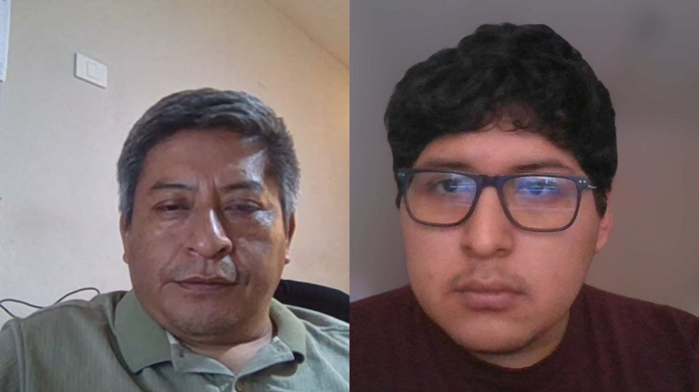

* **Resumen de respuestas clave:**
   
  El entrevistado, Luis Palacín López, de 51 años, residente en Santa Anita y con 20 años de experiencia. Durante su trabajo coordina principalmente con auxiliares y clientes y utiliza celular, laptop, PC y monitores. Está familiarizado con herramientas digitales y utiliza Frotcom para monitorear la flota en tiempo real.
  Actualmente, los conductores realizan un checklist diario de seguridad, cuyos resultados se registran en formatos físicos y posteriormente se digitalizan en Excel. El seguimiento de fallas se realiza mediante comunicación con supervisores y talleres externos, registrando posteriormente los mantenimientos y eventos. Identifica el checklist como una de las actividades que más tiempo consume y manifiesta interés en contar con un mantenimiento más predictivo que permita prevenir fallas y evitar interrupciones en las operaciones.

---

##### Entrevista 2 — Fernando Quispe Huamán
* **Segmento:** Empresas de transporte de carga
* **Cargo / Ocupación:** Administrador General
* **Empresa / Flota:** Inversiones Logísticas del Sur E.I.R.L. (Flota de 15 camiones rígidos y furgones)
* **Edad:** 52 años
* **Distrito de residencia:** Callao
* **Tiempo en la actividad:** 20 años en administración de flotas de carga regional
* **Dispositivos y marcas:** PC de escritorio Lenovo ThinkCentre (Windows 10), Smartphone Xiaomi Redmi Note 12 (Android 13)
* **Aplicaciones y herramientas habituales:** Google Sheets, WhatsApp, banca por internet y software de facturación electrónica
* **Fecha y hora:** 18 de septiembre de 2026 — 15:00 h
* **Duración:** 15 minutos con 20 segundos
* **URL de la grabación:** _Link pendiente_ (Timestamp: `00:00 - 15:20`)
* **Evidencia de la sesión:**
  

* **Resumen de respuestas clave:**
  * *Control preventivo actual:* Cada chofer tiene un talonario autocopiativo de revisión básica. La copia amarilla queda en portería y la blanca va a administración a fin de mes.
  * *Punto de dolor crítico:* Pérdida total de trazabilidad histórica. Ante una falla mecánica en carretera, no pueden probar si el defecto era preexistente o negligencia del chofer. Además, mantener el control manual de fechas de SOAT y Revisión Técnica de 15 vehículos genera descuidos frecuentes.
  * *Expectativa:* Una herramienta web ligera que no exija instalar equipos caros y que permita saber desde el navegador si un vehículo tiene sus papeles en regla y la inspección aprobada antes de asignarle un viaje.

---

##### Entrevista 3 — Martín Solís Carrión
* **Segmento:** Empresas de transporte de carga
* **Cargo / Ocupación:** Jefe de Transporte y Distribución
* **Empresa / Flota:** Carga Pesada Andina S.A.C. (Flota de 30 unidades articuladas)
* **Edad:** 45 años
* **Distrito de residencia:** Villa El Salvador, Lima
* **Tiempo en la actividad:** 12 años liderando transporte terrestre interprovincial
* **Dispositivos y marcas:** Laptop HP Pavilion 14 (Windows 11), Smartphone Motorola Moto G72 (Android 13)
* **Aplicaciones y herramientas habituales:** SAP Business One, WhatsApp, Google Chrome y plataforma de rastreo GPS
* **Fecha y hora:** 19 de septiembre de 2026 — 09:15 h
* **Duración:** 18 minutos con 10 segundos
* **URL de la grabación:** _Link pendiente_ (Timestamp: `00:00 - 18:10`)
* **Evidencia de la sesión:**
  

* **Resumen de respuestas clave:**
  * *Control preventivo actual:* El conductor pasa por garita y un inspector anota las observaciones en una tabla compartida en Excel.
  * *Punto de dolor crítico:* El tiempo de cuello de botella en patio (hasta 30 minutos por camión en horas pico de salida matutina) y la imposibilidad de adjuntar fotos de evidencia de fisuras o desgastes de frenos.
  * *Riesgo legal:* En auditorías de homologación de clientes industriales, el 40% de las observaciones recibidas se deben a la falta de firmas legibles o fechas inconsistentes en las hojas de inspección física.

---

#### Segmento 2: Supervisores o encargados de flota

##### Entrevista 4 — Roberto Salazar Vega
* **Segmento:** Supervisores de flota
* **Cargo / Ocupación:** Supervisor de Seguridad y Salud en el Trabajo (SST) de Flota
* **Empresa / Flota:** Transportes San José S.A.C.
* **Edad:** 38 años
* **Distrito de residencia:** San Juan de Lurigancho, Lima
* **Tiempo en la actividad:** 7 años en supervisión de transporte pesado y prevención de riesgos
* **Dispositivos y marcas:** Smartphone Samsung Galaxy A54 5G (Android 14), Laptop corporativa Lenovo ThinkPad (Windows 11)
* **Aplicaciones y herramientas habituales:** Microsoft Teams, Excel, WhatsApp, Google Drive y lector de PDF
* **Fecha y hora:** 19 de septiembre de 2026 — 11:45 h
* **Duración:** 17 minutos con 30 segundos
* **URL de la grabación:** _Link pendiente_ (Timestamp: `00:00 - 17:30`)
* **Evidencia de la sesión:**
  

* **Resumen de respuestas clave:**
  * *Rutina diaria:* Inicia a las 06:00 h revisando qué camiones tienen servicio programado. Debe validar visualmente los formatos que los choferes dejan en la casilla de operaciones.
  * *Punto de dolor:* Pasa más de 2 horas al día pasando datos de papel a Excel para generar el reporte de unidades operativas. Si un chofer anota una falla leve en la noche, el supervisor se entera recién al mediodía siguiente.
  * *Habilitación del vehículo:* Requiere que el sistema aplique reglas estrictas: si una llanta de tracción está lisa o faltan los extintores vigentes, la unidad debe bloquearse automáticamente (*No Habilitada*), sin margen de duda.

---

##### Entrevista 5 — Carmen Dávila Rengifo
* **Segmento:** Supervisores de flota
* **Cargo / Ocupación:** Coordinadora de Despacho y Monitoreo de Seguridad Vial
* **Empresa / Flota:** Inversiones Logísticas del Sur E.I.R.L.
* **Edad:** 35 años
* **Distrito de residencia:** Los Olivos, Lima
* **Tiempo en la actividad:** 5 años en coordinación de patio y despacho de carga
* **Dispositivos y marcas:** Smartphone Apple iPhone 12 (iOS 17), PC Lenovo (Windows 10)
* **Aplicaciones y herramientas habituales:** WhatsApp Web, Google Drive, Excel y portal de fiscalización de SUTRAN
* **Fecha y hora:** 20 de septiembre de 2026 — 14:20 h
* **Duración:** 04 minutos con 30 segundos
* **URL de la grabación:** https://youtu.be/MmIpEMgCFwY (Timestamp: `00:00 - 04:30`)
* **Evidencia de la sesión:**
  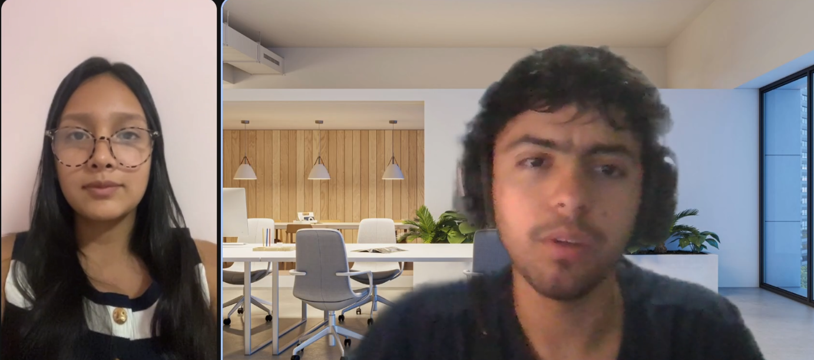

* **Resumen de respuestas clave:**
  * *Gestión de incidencias:* Cuando un vehículo tiene una falla mecánica leve, se genera una orden manual para el taller mecánico de la empresa, pero no hay seguimiento en tiempo real de si la pieza fue reparada antes de que el camión vuelva a circular.
  * *Presión operativa:* Cuando un cliente exige el despacho urgente, el gerente suele presionar para que el camión salga con "observaciones menores". Carmen exige que, si se va a autorizar esa excepción, el sistema registre el nombre del directivo que lo autorizó para proteger su responsabilidad profesional.

---

##### Entrevista 6 — Walter Huamán Córdova
* **Segmento:** Supervisores de flota
* **Cargo / Ocupación:** Supervisor de Mantenimiento y Patio
* **Empresa / Flota:** Carga Pesada Andina S.A.C.
* **Edad:** 42 años
* **Distrito de residencia:** Chorrillos, Lima
* **Tiempo en la actividad:** 9 años en talleres y patios de maniobras de transporte pesado
* **Dispositivos y marcas:** Smartphone Xiaomi Poco X5 Pro (Android 13), Tablet Samsung Galaxy Tab A8 (Android 13)
* **Aplicaciones y herramientas habituales:** WhatsApp, Telegram, Google Sheets, visor de planos de despiece automotriz
* **Fecha y hora:** 20 de septiembre de 2026 — 16:30 h
* **Duración:** 16 minutos con 15 segundos
* **URL de la grabación:** https://shorturl.at/pkaow
* **Evidencia de la sesión:**
  

* **Resumen de respuestas clave:**
  * *Verificación de inspección:* Señala que muchos conductores marcan "OK" en todo el checklist de papel en 3 minutos sin bajarse a mirar la quinta rueda ni las luces de frenos.
  * *Necesidad de evidencia fotográfica:* Si el sistema obligara a tomar fotografía del elemento observado (por ejemplo, corte en neumático o fuga de aire), el conductor tendría que acercarse físicamente a inspeccionar y no podría falsear la revisión.

---

#### Segmento 3: Conductores de vehículos de carga

##### Entrevista 7 — Jorge Rivas Mendoza
* **Segmento:** Conductores de vehículos de carga
* **Cargo / Ocupación:** Conductor profesional de transporte pesado (Tractocamión Volvo FH 540)
* **Empresa:** Conductor asignado en Transportes San José S.A.C. (Ruta Lima - Arequipa)
* **Edad:** 37 años
* **Distrito de residencia:** Comas, Lima
* **Tiempo en la actividad:** 14 años de experiencia con Licencia A-IIIB y A-IIIC
* **Dispositivos y marcas:** Smartphone Samsung Galaxy A14 (Android 13), cargador de cabina de 12V
* **Herramientas de trabajo:** Manómetro analógico de neumáticos, martillo de llantas, linterna de mano, libreta de notas
* **Aplicaciones habituales:** WhatsApp, Waze, YouTube (en paradas de descanso)
* **Fecha y hora:** 21 de septiembre de 2026 — 08:30 h
* **Duración:** 6 minutos con 11 segundos
* **URL de la grabación:** https://youtu.be/RmQbap_IL3E (Timestamp: `00:00 - 06:11`)
* **Evidencia de la sesión:**
  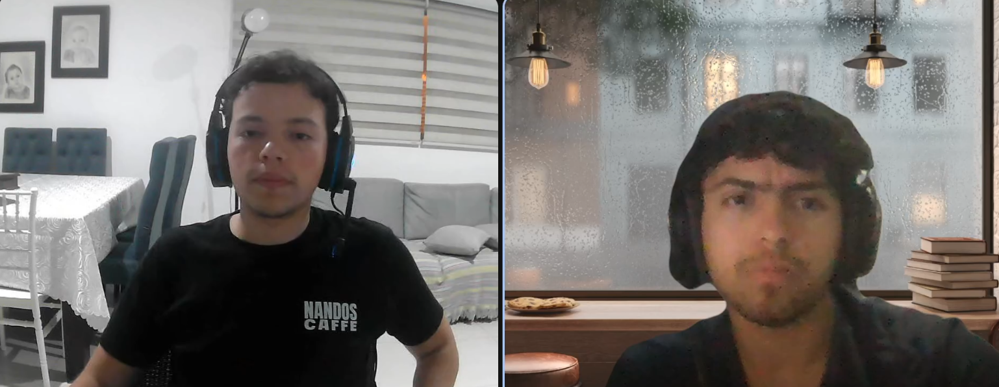

* **Resumen de respuestas clave:**
  * *Proceso actual:* Revisa luces, presión de llantas, niveles de refrigerante y aceite, y llena la hoja de papel de 30 preguntas que le entrega el despachador.
  * *Frustración principal:* Si la hoja se moja con lluvia o aceite en la cabina, le hacen volver a llenarla. Además, le toma hasta 25 minutos porque tiene que escribir textos largos a mano.
  * *Preferencia tecnológica:* Desea una aplicación sencilla en el celular donde solo tenga que pulsar botones grandes de "Conforme" o "Falla", y que le permita tomar una foto rápida si encuentra una luna rajada o un faro roto para deslindar su responsabilidad.

---

##### Entrevista 8 — Pedro Morales Huaccachi
* **Segmento:** Conductores de vehículos de carga
* **Cargo / Ocupación:** Conductor de tractocamión articulado (Scania R450)
* **Empresa:** Conductor de ruta nacional en Inversiones Logísticas del Sur E.I.R.L.
* **Edad:** 51 años
* **Distrito de residencia:** San Martín de Porres, Lima
* **Tiempo en la actividad:** 20 años en transporte de carga interprovincial
* **Dispositivos y marcas:** Smartphone Xiaomi Redmi 10C (Android 12), radio CB de dos vías en cabina
* **Herramientas de trabajo:** Calibrador de profundidad de cocada, kit de herramientas manuales, medidor de aceite
* **Aplicaciones habituales:** WhatsApp y llamadas telefónicas
* **Fecha y hora:** 21 de septiembre de 2026 — 11:00 h
* **Duración:** 14 minutos con 25 segundos
* **URL de la grabación:** https://shorturl.at/lUVY6
* **Evidencia de la sesión:**
  

* **Resumen de respuestas clave:**
  * *Dificultad con la tecnología:* No le gustan los sistemas complicados ni las letras pequeñas porque en patio hay poca luz y suele tener las manos con guantes o polvo.
  * *Temor a responsabilidades ajenas:* En más de una ocasión le han reclamado por una llanta de repuesto vencida que ya estaba así antes de su turno. Exige que la inspección digital guarde la hora exacta y fotos para demostrar qué fallas eran previas a su viaje.

---

##### Entrevista 9 — Miguel Ángel Ramos Castro
* **Segmento:** Conductores de vehículos de carga
* **Cargo / Ocupación:** Conductor de semirremolque y plataforma (Freightliner Columbia)
* **Empresa:** Conductor de transporte de materiales en Carga Pesada Andina S.A.C.
* **Edad:** 39 años
* **Distrito de residencia:** Puente Piedra, Lima
* **Tiempo en la actividad:** 10 años en transporte de carga minera e industrial
* **Dispositivos y marcas:** Smartphone Motorola Moto E22 (Android 12)
* **Herramientas de trabajo:** Linterna frontal LED, medidor digital de presión de neumáticos, wincha de amarre
* **Aplicaciones habituales:** WhatsApp, Google Maps, Facebook
* **Fecha y hora:** 22 de septiembre de 2026 — 09:40 h
* **Duración:** 16 minutos con 05 segundos
* **URL de la grabación:** _Link pendiente_ (Timestamp: `00:00 - 16:05`)
* **Evidencia de la sesión:**
  

* **Resumen de respuestas clave:**
  * *Exigencias de clientes mineros:* En ruta minera los estándares son estrictos; si un extintor está despresurizado o falta una cinta reflectiva, no le permiten ingresar a mina y la empresa pierde el viaje.
  * *Facilidad de uso:* Si el checklist digital está organizado por partes (primero cabina, luego motor, luego luces y neumáticos) y le avisa si el vehículo está 100% autorizado para salir, le ahorraría discusiones con los supervisores de garita.

---

### 2.2.3. Análisis de entrevistas.

El análisis de las entrevistas realizadas a los nueve representantes de los tres segmentos objetivo permitió extraer hallazgos cualitativos y patrones cuantitativos fundamentales para validar las hipótesis iniciales de negocio y redefinir los requisitos funcionales de FleetSafe.

#### 1. Análisis Cuantitativo Consolidado

A partir de la codificación sistemática de las respuestas de los 9 entrevistados (3 por segmento), se obtuvieron los siguientes indicadores porcentuales clave:

| Indicador / Hallazgo Evaluado | Muestra Total (N=9) | Empresas (N=3) | Supervisores (N=3) | Conductores (N=3) | Porcentaje Consolidado |
|:---|:---:|:---:|:---:|:---:|:---:|
| Uso exclusivo de formatos en papel para inspección preoperacional | 9 / 9 | 3 / 3 | 3 / 3 | 3 / 3 | **100.0%** |
| Retrasos en despacho de patio atribuibles al llenado de papel (20 a 30 min) | 7 / 9 | 2 / 3 | 2 / 3 | 3 / 3 | **77.8%** |
| Ocurrencia de autorizaciones de salida verbales ("de palabra") sin sustento auditable | 8 / 9 | 3 / 3 | 3 / 3 | 2 / 3 | **88.9%** |
| Multas de SUTRAN u observaciones en auditorías por formatos ilegibles o incompletos | 6 / 9 | 2 / 3 | 3 / 3 | 1 / 3 | **66.7%** |
| Sospecha o confirmación de "marcado automático / por compromiso" sin revisión física | 8 / 9 | 3 / 3 | 3 / 3 | 2 / 3 | **88.9%** |
| Disposición de smartphone propio con acceso a datos móviles en patio de maniobras | 9 / 9 | 3 / 3 | 3 / 3 | 3 / 3 | **100.0%** |
| Sistema operativo móvil predominante (Android) | 8 / 9 | 3 / 3 | 2 / 3 | 3 / 3 | **88.9%** (Android) / 11.1% (iOS) |

#### 2. Análisis Cualitativo por Segmento

##### A. Segmento Empresas de Transporte de Carga
* **Dolor de pérdida económica y legal:** Los gerentes y administradores perciben el control preventivo en papel no como una medida de seguridad real, sino como un "trámite administrativo engorroso". Sin embargo, asumen costos elevados cuando las unidades son multadas o inmovilizadas en carretera por SUTRAN debido a fallas que pudieron detectarse antes de salir.
* **Falta de visibilidad ejecutiva en tiempo real:** Ninguna de las empresas entrevistadas cuenta con un tablero centralizado donde la gerencia pueda verificar en tiempo real cuántas unidades están habilitadas para salir al iniciar la mañana. Dependen enteramente de llamadas telefónicas y reportes en Excel desactualizados.
* **Necesidad de cumplimiento en homologaciones:** Las auditorías de homologación de clientes de gran envergadura (minería, consumo masivo, retail) exigen evidencias fotográficas y firmas fechadas. La falta de este respaldo digital reduce su competitividad comercial y frena la adjudicación de contratos de largo plazo.

##### B. Segmento Supervisores de Flota y Seguridad (SST)
* **Sobrecarga operativa y digitación duplicada:** Los supervisores invierten entre 1.5 y 2.5 horas diarias transcribiendo manualmente las observaciones de las hojas de papel a hojas de cálculo. Este tiempo burocrático les resta capacidad de inspección física en patio.
* **Dilema ético y presión operativa ante excepciones:** Todos los supervisores admitieron recibir presiones constantes de las áreas comerciales para autorizar la salida de unidades con fallas leves para no perder turnos de carga. Manifiestan la necesidad urgente de que el sistema exija registrar la justificación y el responsable directo de la excepción, blindando su responsabilidad profesional ante siniestros.
* **Ausencia de trazabilidad en las reparaciones:** Una vez que un elemento mecánico no conforme es reportado, no existe un canal cerrado para verificar si el taller mecánico corrigió el desperfecto antes de que el vehículo sea reasignado a otro conductor.

##### C. Segmento Conductores de Vehículos de Carga
* **Demanda de simplicidad y botones táctiles grandes:** Los conductores rechazan formularios web con textos largos, campos obligatorios de texto libre o interfaces recargadas. Señalan que en el patio de maniobras la iluminación es variable, el sol refleja en las pantallas y operan con manos sucias o guantes. Requieren botones de gran tamaño (mínimo 48 × 48 px) con opciones directas (*Conforme* / *Falla*) y flujo guiado paso a paso.
* **Protección ante culpas por fallas mecánicas preexistentes:** El conductor ve con gran entusiasmo la capacidad de adjuntar fotografías obligatorias a los hallazgos con marca de tiempo. Esto les proporciona un escudo probatorio frente a los dueños de la empresa, evitando que se les descuente de sus sueldos roturas o desgastes que ya estaban presentes al iniciar su turno.
* **Tiempo de llenado reducido:** Consideran aceptable un tiempo de inspección digital de entre 5 y 7 minutos. Cualquier proceso digital que tome más de 10 minutos generará resistencia al cambio y tentación de volver al llenado ficticio.

#### 3. Validación y Contraste de las Lean UX Assumptions

Los hallazgos de las entrevistas permitieron validar y calibrar las suposiciones iniciales planteadas en la sección 1.2.2.2:

1. **Suposición validada:** *Las empresas necesitan eliminar el formato físico para asegurar la trazabilidad preventiva.* Confirmado al 100%. El papel físico es la causa raíz de la pérdida de información y del incumplimiento en auditorías de homologación.
2. **Suposición validada:** *La clasificación del vehículo debe ser automática y determinística.* Confirmado. Los supervisores respaldan que el sistema clasifique la unidad en *Habilitado*, *Observado* o *No Habilitado* según reglas predefinidas, eliminando interpretaciones subjetivas.
3. **Suposición ajustada:** *Las excepciones operacionales deben permitirse bajo estricta trazabilidad.* Inicialmente se contempló un bloqueo rígido e inamovible ante cualquier falla. La investigación demostró que la realidad operativa peruana exige permitir el despacho condicional con fallas no críticas, siempre y cuando se registre el autorizador y la justificación técnica en el historial auditable.
4. **Suposición técnica validada:** *La solución debe ejecutarse en el navegador móvil sin requerir hardware telemático instalado.* Confirmado. El 100% de los conductores y supervisores opera smartphones con navegadores web modernos (Chrome, Safari), haciendo inviable e innecesaria la adquisición de equipos telemáticos propietarios.

---

## 2.3. Needfinding.

**Segmento objetivo #1: Empresas de transporte de carga**

Buscan centralizar y visualizar el estado de su flota para tomar decisiones preventivas y reducir riesgos durante las operaciones.

**Segmento objetivo #2: Supervisores de flota**

Necesitan controlar las inspecciones, identificar problemas y dar seguimiento a las incidencias para mantener los vehículos aptos para operar.

**Segmento objetivo #3: Conductores de vehículos de carga**

Necesitan realizar inspecciones pre-operacionales de forma rápida, registrar evidencias y reportar problemas antes de iniciar sus recorridos.

### 2.3.1. User Personas.
*User Persona Segmento 1:*
José Ramirez, de 37 años, es empresario y administrador de una empresa de transporte de carga en Huancayo, con 10 años de experiencia en el rubro. Es responsable de supervisar que su flota se encuentre en condiciones adecuadas y necesita tener una visión clara y centralizada del estado de los vehículos para tomar decisiones rápidas, reducir riesgos y evitar que unidades con problemas inicien una operación.
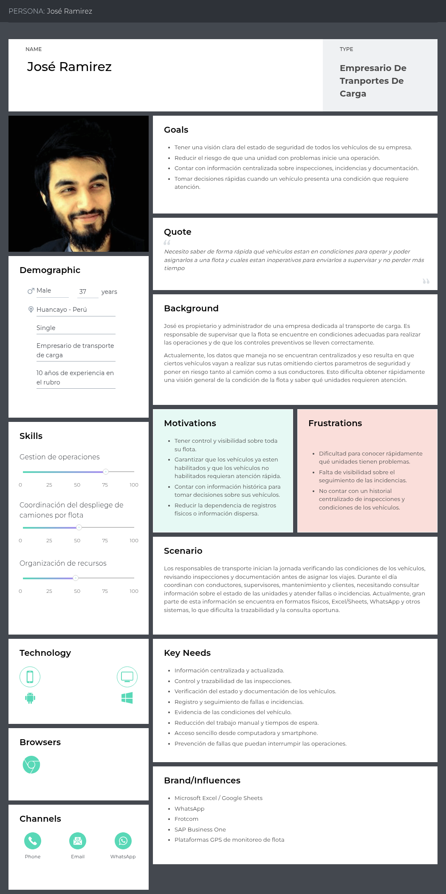
Ver en UXpressia: https://uxpressia.com/w/v8FzI/p/NrqyE?tagId=nXgEG

*User Persona Segmento 2:*
Alessandra Nova, de 35 años, es supervisora de operaciones y encargada de flota en Lima, con 8 años de experiencia. Su trabajo consiste en revisar las inspecciones, verificar el estado de los vehículos y realizar seguimiento a las incidencias hasta su resolución. Utiliza herramientas como Excel, WhatsApp y Google Drive, pero necesita reducir el trabajo manual y contar con información actualizada para identificar rápidamente qué vehículos están habilitados y cuáles requieren atención.
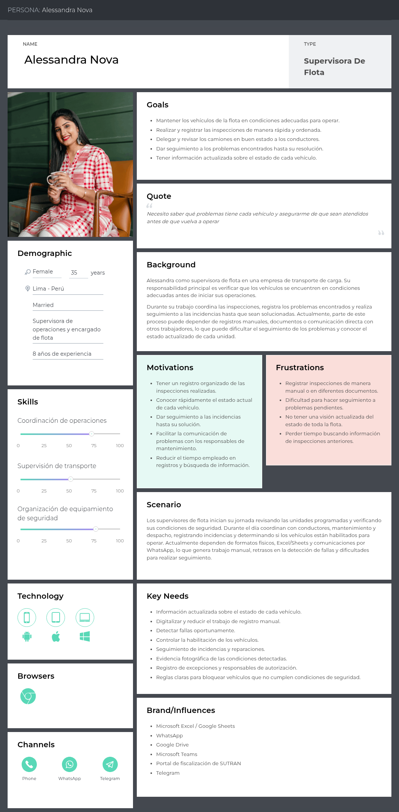
Ver en UXpressia: https://uxpressia.com/w/v8FzI/p/6hEDO?tagId=nXgEG

*User Persona Segmento 3:*
Álvaro Torres, de 45 años, es conductor de transporte de carga en Tacna, con 3 años de experiencia en rutas nacionales. Antes de iniciar una operación verifica las condiciones del vehículo y comunica cualquier falla o condición insegura. Utiliza principalmente smartphone y herramientas de comunicación como WhatsApp, y necesita realizar inspecciones de manera sencilla, registrar evidencias y conocer el estado del vehículo sin depender de procesos manuales o poco claros.
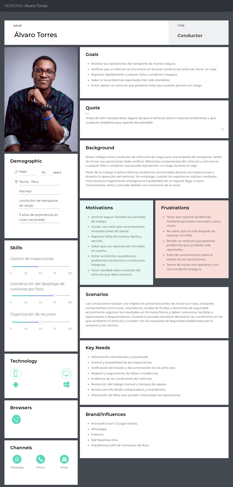
Ver en UXpressia: https://uxpressia.com/w/v8FzI/p/rnMBZ?tagId=nXgEG

### 2.3.2. User Task Matrix.

### 2.3.2. User Task Matrix.

La User Task Matrix mapea las tareas operativas cotidianas que los usuarios representativos de los tres segmentos objetivo realizan en el mundo real dentro del proceso de control preventivo y despacho de carga, **independientemente de la existencia de una solución de software**. Para cada tarea se evalúa la frecuencia de ejecución (*Always*, *Often*, *Sometimes*, *Rarely*, *Never*) y su nivel de criticidad o importancia (*High*, *Medium*, *Low*):

| **USER TASK (Actividades del Negocio)** | **José Ramírez** *(Gerente / Dueño)* | | **Alessandra Nova** *(Supervisora SST)* | | **Álvaro Torres** *(Conductor de Carga)* | |
|:---|:---:|:---:|:---:|:---:|:---:|:---:|
| | **Frequency** | **Importance** | **Frequency** | **Importance** | **Frequency** | **Importance** |
| Inspeccionar visualmente el estado exterior de la carrocería y luces | Rarely | Low | Often | High | Always | High |
| Medir presión y profundidad de cocada de neumáticos con manómetro físico | Never | Low | Sometimes | High | Always | High |
| Verificar niveles de fluidos de motor (aceite, refrigerante, frenos) con varilla | Never | Low | Rarely | Medium | Always | High |
| Constatar presencia y vigencia de equipos de emergencia (extintor, conos, botiquín) | Never | Low | Often | High | Always | High |
| Llenar la hoja de checklist preoperacional en papel físico o talonario de garita | Never | Low | Sometimes | High | Always | High |
| Redactar observaciones mecánicas o anomalías detectadas en la libreta de ruta | Never | Low | Often | High | Always | High |
| Tomar fotografías con el teléfono personal para evidenciar averías preexistentes | Rarely | Medium | Often | High | Often | High |
| Entregar el formato físico firmado al despachador en la caseta de control de patio | Never | Low | Often | High | Always | High |
| Digitar manualmente los reportes de papel en hojas de cálculo (Excel) | Rarely | Medium | Always | High | Never | Low |
| Verificar vigencia física de documentos en cabina (SOAT, CITV, tarjeta de propiedad) | Sometimes | High | Always | High | Often | High |
| Autorizar verbalmente la salida en ruta de una unidad con fallas no críticas | Often | High | Often | High | Never | Low |
| Coordinar el ingreso de vehículos con desperfectos mecánicos al taller interno | Often | High | Always | High | Sometimes | Medium |
| Consolidar el estatus matutino de vehículos disponibles vs. inmovilizados para despacho | Always | High | Always | High | Never | Low |
| Presentar carpetas físicas de mantenimiento e inspecciones ante auditorías de clientes | Often | High | Often | High | Never | Low |

#### Análisis de la User Task Matrix

El análisis de la matriz evidencia una clara división de responsabilidades operativas entre los tres arquetipos y fundamenta los requisitos funcionales de FleetSafe:

1. **Tareas críticas del Conductor (Álvaro Torres):** Su rutina diaria se concentra en la revisión física directa de los sistemas de seguridad del camión (neumáticos, fluidos, luces y extintores) y en el llenado manual del checklist en papel con frecuencia *Always* y criticidad *High*. La entrega física de la hoja y la necesidad de tomar fotos personales demuestran que el conductor asume un esfuerzo manual duplicado para protegerse ante sanciones por averías que él no provocó.
2. **Cuello de botella de la Supervisora (Alessandra Nova):** Su tarea más demandante (*Always* / *High*) es la digitación de planillas de papel a Excel y el control de vigencia documental. Esta carga burocrática le consume tiempo valioso que debería dedicar a la inspección aleatoria en patio y a la gestión del taller mecánico. Asimismo, la tarea de autorizar excepciones verbales refleja el conflicto operativo entre seguridad y presión por despachar.
3. **Visión estratégica del Gerente (José Ramírez):** No interviene en la revisión mecánica de patio, pero requiere con frecuencia diaria (*Always* / *High*) la consolidación del estatus de flota para asignar viajes y responder comercialmente ante clientes y fiscalizaciones de SUTRAN.

---

### 2.3.3. User Journey Mapping.

**Segmento 1**
José inicia su recorrido planificando las operaciones y verificando la disponibilidad de la flota. Luego revisa las condiciones de seguridad y los resultados de las inspecciones para identificar vehículos que presentan problemas o requieren atención. Finalmente, utiliza esta información para decidir qué unidades pueden operar y cuáles deben ser atendidas. Durante el proceso, la información dispersa y la falta de actualización generan preocupación y dificultad para tomar decisiones oportunas.

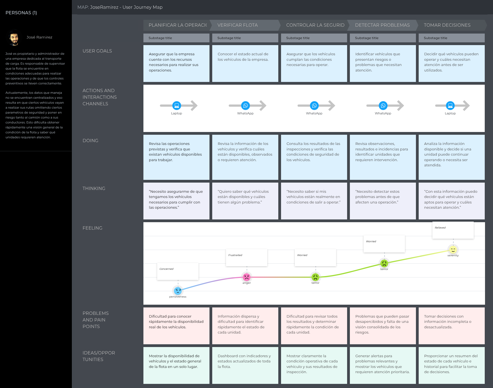
Ver en UXpressia: https://uxpressia.com/w/v8FzI/m/f6aJG?tagId=nXgEG

**Segmento 2**
Alessandra comienza revisando las operaciones y el estado de los vehículos, para luego verificar los resultados de las inspecciones y determinar qué unidades están habilitadas. Cuando encuentra incidencias, registra y realiza seguimiento de los problemas hasta su resolución. Finalmente, consulta el historial y los cambios realizados en los vehículos. Sus principales dificultades son el trabajo manual, la información dispersa y la falta de trazabilidad, por lo que necesita información centralizada y actualizada.

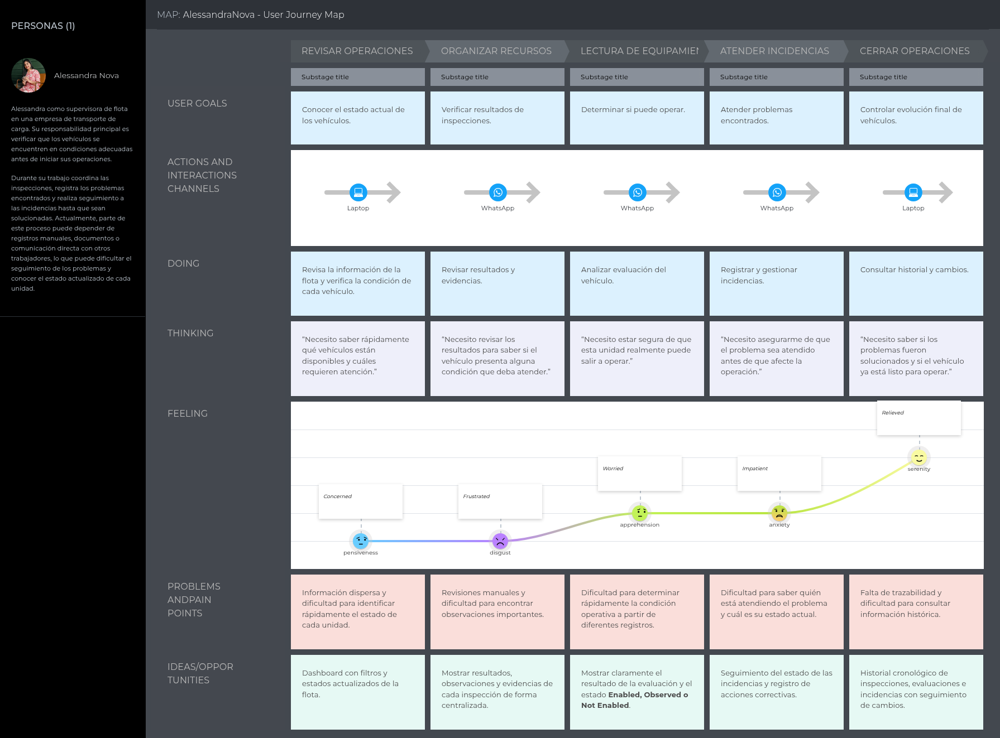
Ver en UXpressia: https://uxpressia.com/w/v8FzI/m/etpoc?tagId=nXgEG

**Segmento 3**
Álvaro inicia su jornada realizando la inspección preoperacional y revisando las condiciones de seguridad del vehículo. Luego registra cualquier problema encontrado y adjunta evidencias cuando es necesario. Al finalizar, necesita conocer si el vehículo está habilitado para operar y posteriormente consultar qué ocurrió con los problemas que reportó. Sus principales dificultades son realizar inspecciones manuales, registrar evidencias rápidamente y no conocer inmediatamente el resultado o seguimiento de sus reportes.

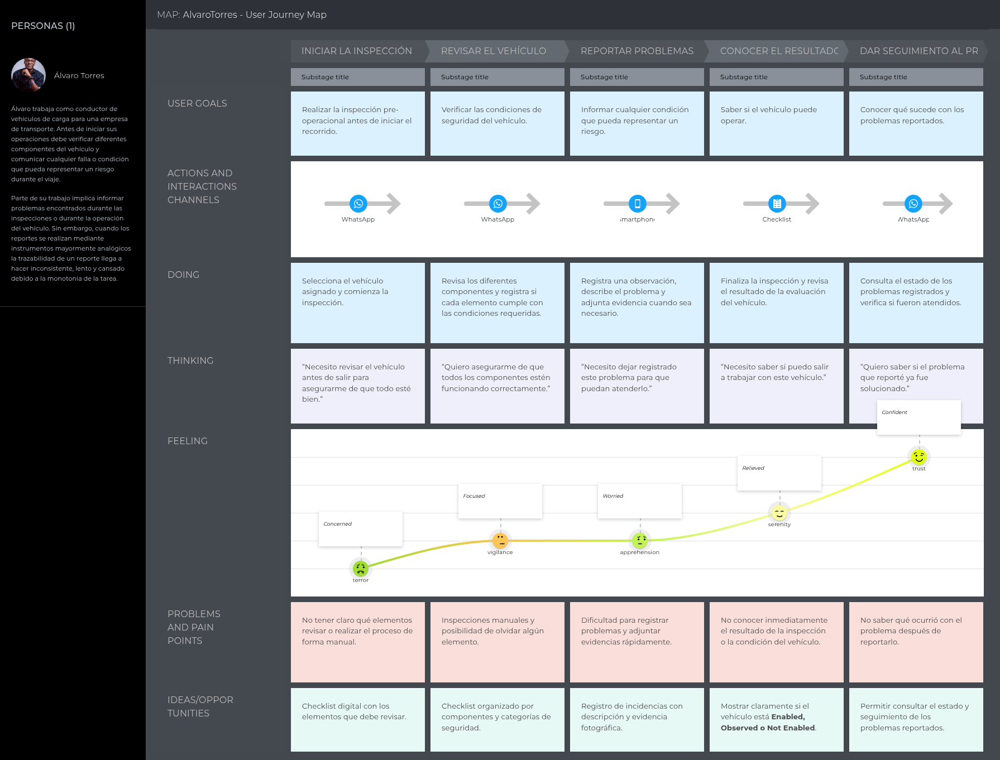
Ver en UXpressia: https://uxpressia.com/w/v8FzI/m/YmOSO?tagId=nXgEG

### 2.3.4. Empathy Mapping.

**Segmento 1**
José necesita conocer el estado actualizado de su flota para identificar riesgos y decidir qué vehículos pueden operar. Su principal frustración es la información dispersa y la dificultad para detectar problemas a tiempo.

Ver en UXpressia: https://uxpressia.com/w/v8FzI/p/QRFhq?tagId=nXgEG
**Segmento 2**
Alessandra necesita revisar inspecciones, identificar vehículos con problemas y dar seguimiento a las incidencias. Le preocupa no detectar problemas a tiempo y valora contar con información centralizada y actualizada.

Ver en UXpressia: https://uxpressia.com/w/v8FzI/p/W05Q5?tagId=nXgEG

**Segmento 3**
Álvaro necesita realizar inspecciones rápidas, registrar problemas y saber si su vehículo está listo para operar. Sus principales frustraciones son los procesos manuales, la dificultad para registrar evidencias y no conocer inmediatamente el resultado de la inspección.

Ver en UXpressia: https://uxpressia.com/w/v8FzI/p/mnJos?tagId=nXgEG

## 2.4. Big Picture EventStorming.

Big Picture Event Storming es una técnica colaborativa que nos permitirá comprender el funcionamiento global de FLEETSAFE. Se basará en visualizar eventos clave del dominio(domain events), fomentar el diálogo entre roles (actores) diversos y detectar oportunidades de mejora. El proceso se divide en tres fases principales:

**Primera Etapa: OPEN**
Aqui colocamos todos los eventos de dominio que se nos ocurra

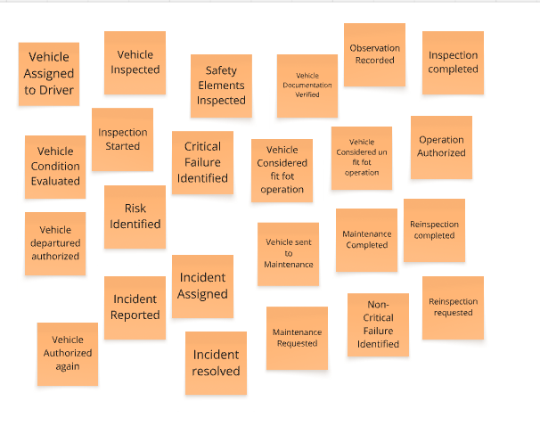

**Segunda Etapa: EXPLORE**
Identificamos actores y pain points que luego cuestionamos, y lo más importante crear una secuencia entre los eventos de dominio.

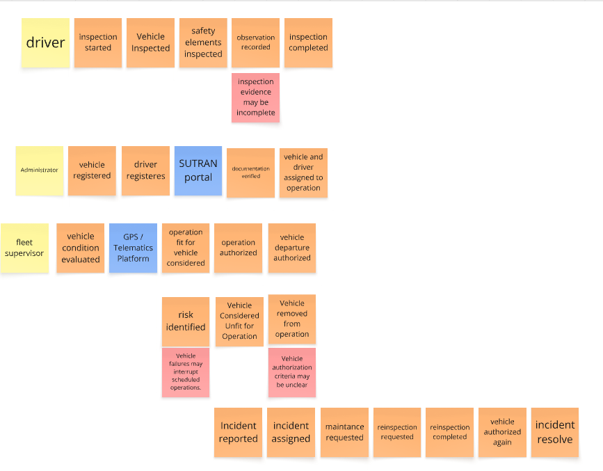

**Tercera Etapa: CLOSE**
Identificamos problemas que hayamos encontrado, temas a investigar más a fondo y declaramos que esta fuera de nuestro alcance actual.

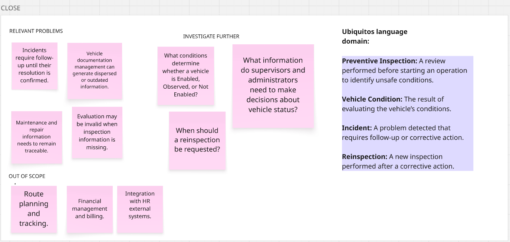

Enlace hacia el Big Picture Eventstorming: 

## 2.5. Ubiquitous Language.

El Ubiquitous Language es el glosario de términos y conceptos del dominio del negocio que todos los miembros del equipo y los interesados emplean sin ambigüedad. Los términos que se presentan a continuación corresponden al dominio del control preventivo y la seguridad de vehículos de transporte de carga, y no a conceptos técnicos de la ingeniería de software.

Cada término se define en inglés, que es el idioma adoptado para la nomenclatura del producto y del modelo de dominio, acompañado de su equivalente en español entre paréntesis. Las definiciones se enfocan en los conceptos propios de FleetSafe y en las actividades relacionadas con la inspección, evaluación, habilitación y seguimiento de las condiciones de los vehículos.

Este glosario busca establecer una terminología común entre los miembros del equipo y los interesados, evitando ambigüedades al referirse a los vehículos, inspecciones, condiciones de seguridad, riesgos, incidencias y acciones correctivas que forman parte del dominio de FleetSafe.

**Términos del control de flota**

| Término | Definición |
|:---|:---|
| **Fleet** (Flota) | Conjunto de vehículos de transporte de carga administrados por una empresa para realizar sus operaciones. |
| **Vehicle** (Vehículo) | Unidad de transporte de carga que forma parte de una flota y cuya condición de seguridad debe ser controlada antes de iniciar una operación. |
| **Driver** (Conductor) | Persona responsable de operar un vehículo de transporte de carga y realizar las inspecciones preventivas correspondientes antes de iniciar una operación. |
| **Fleet Supervisor** (Supervisor de flota) | Persona responsable de revisar el estado de los vehículos, consultar las inspecciones, gestionar incidencias y verificar qué unidades se encuentran habilitadas para operar. |
| **Operating Condition** (Condición operativa) | Estado en el que se encuentra un vehículo respecto al cumplimiento de las condiciones necesarias para realizar una operación de transporte de forma segura. |
| **Operational Authorization** (Habilitación operativa) | Determinación de que un vehículo cumple las condiciones establecidas y puede iniciar una operación de transporte. |

**Términos de inspección preventiva**

| Término | Definición |
|:---|:---|
| **Pre-Operational Inspection** (Inspección preoperacional) | Revisión realizada antes de iniciar una operación para verificar las condiciones de seguridad y operación de un vehículo. |
| **Inspection Item** (Elemento de inspección) | Componente, elemento de seguridad o aspecto de documentación que debe ser revisado durante una inspección. |
| **Safety Component** (Elemento de seguridad) | Elemento del vehículo cuya condición puede afectar directamente la seguridad de la operación y que debe ser verificado durante la inspección. |
| **Inspection Result** (Resultado de inspección) | Resultado obtenido para cada elemento revisado durante una inspección, indicando la condición encontrada. |
| **Inspection** (Inspección) | Registro de la revisión realizada a un vehículo, incluyendo los elementos evaluados, sus resultados, observaciones y evidencias cuando corresponda. |
| **Observation** (Observación) | Descripción realizada por el conductor o supervisor sobre una condición detectada durante la inspección que requiere ser considerada en la evaluación del vehículo. |
| **Evidence** (Evidencia) | Registro que permite respaldar una condición detectada durante una inspección, como una fotografía u otra información asociada al problema identificado. |

**Términos de evaluación y seguridad**

| Término | Definición |
|:---|:---|
| **Safety Condition** (Condición de seguridad) | Estado de un elemento del vehículo respecto al cumplimiento de las condiciones necesarias para operar de manera segura. |
| **Risk** (Riesgo) | Situación o condición detectada en un vehículo que puede afectar la seguridad de la operación. |
| **Evaluation Rule** (Regla de evaluación) | Criterio establecido para determinar cómo una condición detectada durante una inspección afecta el estado del vehículo. |
| **Vehicle Status** (Estado del vehículo) | Clasificación resultante de la evaluación de una inspección, que determina la condición operativa del vehículo. |
| **Enabled** (Habilitado) | Estado de un vehículo que cumple las condiciones necesarias para realizar una operación. |
| **Observed** (Observado) | Estado de un vehículo que presenta condiciones que requieren atención o seguimiento, pero que no necesariamente impiden su operación según las reglas establecidas. |
| **Not Enabled** (No habilitado) | Estado de un vehículo que presenta una condición que impide que sea considerado apto para operar. |

**Términos de gestión de incidencias**

| Término | Definición |
|:---|:---|
| **Incident** (Incidencia) | Problema detectado en un vehículo durante una inspección o durante su operación que requiere registro, revisión o seguimiento. |
| **Incident Type** (Tipo de incidencia) | Clasificación utilizada para identificar la naturaleza de una incidencia detectada en un vehículo. |
| **Corrective Action** (Acción correctiva) | Acción realizada para solucionar o reducir el efecto de una condición o problema detectado en un vehículo. |
| **Repair** (Reparación) | Trabajo realizado sobre un vehículo para corregir una condición que afecta su seguridad o capacidad de operación. |
| **Incident Status** (Estado de incidencia) | Estado que indica la situación actual de una incidencia, desde su registro hasta su resolución. |
| **Incident Follow-up** (Seguimiento de incidencia) | Proceso mediante el cual el supervisor revisa una incidencia, registra las acciones realizadas y verifica si el problema ha sido solucionado. |
| **Resolution** (Resolución) | Resultado final de la gestión de una incidencia, indicando la acción adoptada para solucionar el problema identificado. |

**Términos de documentación vehicular**

| Término | Definición |
|:---|:---|
| **Vehicle Document** (Documento vehicular) | Documento relacionado con un vehículo que debe mantenerse vigente para cumplir las condiciones establecidas para su operación. |
| **Document Expiration** (Vencimiento de documento) | Fecha en la que un documento vehicular deja de encontrarse vigente y puede requerir atención antes de permitir la operación del vehículo. |
| **Document Status** (Estado del documento) | Condición que indica si un documento vehicular se encuentra vigente, próximo a vencer o vencido. |

---

[← Capítulo I](capitulo-1.md) · [Contenido](README.md#contenido) · [Capítulo III →](capitulo-3.md)
