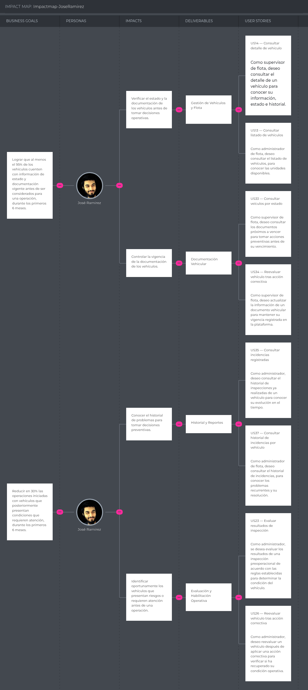
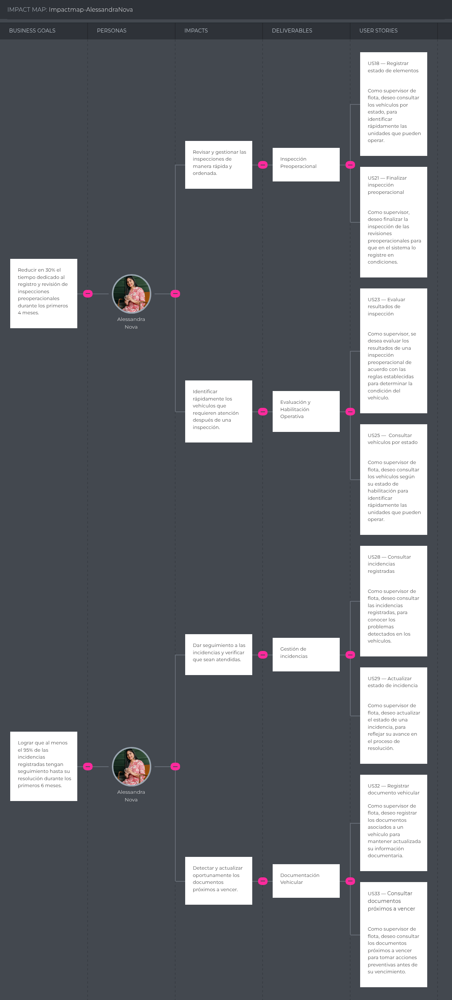
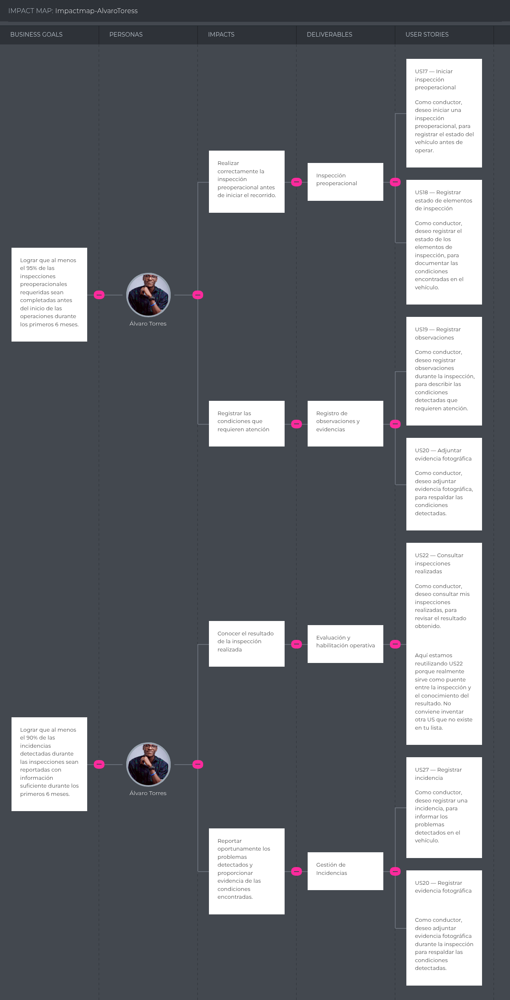
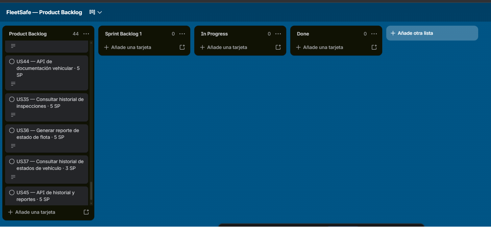

[← Capítulo II](capitulo-2.md) · [Contenido](README.md#contenido) · [Capítulo IV →](capitulo-4.md)

# Capítulo III: Requirements Specification

## 3.1. User Stories.

A continuación se presenta el conjunto de Epics y User Stories definidos para FleetSafe, elaborados a partir de la información recopilada durante el proceso de Requirements Elicitation & Analysis. Cada User Story incluye sus respectivos Criterios de Aceptación redactados en formato Gherkin (Given-When-Then), en tiempo presente y tercera persona, evitando referencias a detalles de interfaz de usuario.

Se han considerado User Stories para los tres productos que conforman la solución: el sitio web estático (Landing Page), la Aplicación Web y el Backend RESTful API. En el caso de la Landing Page, se utiliza el rol **Visitante** (y sus subconjuntos por segmento cuando corresponde). Para el RESTful API, se utiliza el rol **Developer** y los criterios de aceptación reflejan escenarios de interacción request/response.

Las Epics definidas agrupan las User Stories por área funcional del dominio de FleetSafe:

**Epic ID 01 - Landing Page** 
Sitio web estático de presentación de FleetSafe, con secciones informativas dirigidas a los segmentos objetivo.
 
**Epic ID 02 - Gestión de Usuarios y Roles** 
Administración de usuarios, autenticación y asignación de roles dentro de la plataforma.
 
**Epic ID 03 - Gestión de Vehículos y Flota** 
Registro, consulta y administración de los vehículos que conforman la flota.
 
**Epic ID 04 - Inspección Preoperacional** 
Registro digital de inspecciones preoperacionales realizadas por los conductores.
 
**Epic ID 05 - Evaluación y Habilitación Operativa** 
Evaluación de resultados de inspección y determinación de la condición del vehículo.
 
**Epic ID 06 - Gestión de Incidencias** 
Registro, seguimiento y resolución de incidencias detectadas en los vehículos.
 
**Epic ID 07 - Documentación Vehicular** 
Control de documentos vehiculares y sus vencimientos.
 
**Epic ID 08 - Historial y Reportes** 
Consulta de historial de inspecciones, incidencias y estados de vehículos.
 
**Epic ID 09 - Backend RESTful API** 
Servicios RESTful que exponen la lógica de negocio de FleetSafe.

A continuación se presenta el cuadro consolidado de Epics y User Stories:

| Epic / Story ID | Título | Descripción | Criterios de Aceptación | Relacionado con (Epic ID) |
|:---|:---|:---|:---|:---|
| EP01 | Landing Page | Como visitante, deseo acceder a un sitio web informativo que me permita conocer FleetSafe, sus funcionalidades y beneficios, para evaluar si la solución se ajusta a las necesidades de mi empresa. | No aplica (Epic) | — |
| US01 | Visualizar página de inicio | Como Visitor, deseo conocer la propuesta de valor de FleetSafe para comprender el propósito de la solución. | **Escenario 1:** Dado que el visitante accede al sitio de FleetSafe, cuando el contenido informativo está disponible, entonces se proporciona información sobre la propuesta de valor de FleetSafe. **Escenario 2:** Dado que el sitio contiene información sobre FleetSafe, cuando el visitante consulta su contenido principal, entonces se proporcionan sus beneficios, funcionalidades y medios de contacto. | EP01 |
| US02 | Conocer funcionalidades del producto | Como visitante, deseo conocer las funcionalidades principales de FleetSafe para determinar si cubren las necesidades de control preventivo de mi flota. | **Escenario 1:** Dado que el Visitor consulta FleetSafe, cuando solicita información sobre sus funcionalidades, entonces se proporcionan las funcionalidades de inspección preoperacional, evaluación de condiciones, habilitación operativa y gestión de incidencias. **Escenario 2:** Dado que el Visitor consulta una funcionalidad, cuando solicita información sobre ella, entonces se proporciona su propósito y beneficio para el control preventivo de la flota. | EP01 |
| US03 | Conocer beneficios por segmento | Como visitante del segmento empresa de transporte de carga, deseo conocer los beneficios de FleetSafe para mi tipo de organización para evaluar su adopción. | **Escenario 1:** Dado que el visitante pertenece a un segmento objetivo, cuando consulta los beneficios de FleetSafe, entonces se proporcionan beneficios relacionados con las necesidades de su segmento. **Escenario 2:** Dado que existen los segmentos Administrator, Fleet Supervisor y Driver, cuando el visitante consulta sus beneficios, entonces se proporciona información diferenciada para cada segmento. | EP01 |
| US04 | Solicitar contacto o demostración | Como visitante, deseo solicitar una demostración o contacto con el equipo de FleetSafe para recibir más información sobre la plataforma. | **Escenario 1:** Dado que el visitante proporciona datos válidos, cuando registra una solicitud de contacto o demostración, entonces la solicitud queda registrada correctamente. **Escenario 2:** Dado que faltan datos obligatorios o contienen valores inválidos, cuando el visitante registra la solicitud, entonces el sistema rechaza el registro. | EP01 |
| US05 | Navegar entre secciones | Como visitante, deseo navegar entre las secciones del sitio web para acceder rápidamente a la información que me interesa. | **Escenario 1:** Dado que existen diferentes contenidos informativos, cuando el visitante solicita una sección determinada, entonces se proporciona el contenido correspondiente. **Escenario 2:** Dado que una sección solicitada no contiene información disponible, cuando el visitante la consulta, entonces el sistema indica que no existe contenido disponible. | EP01 |
| US06 | Visualizar información de contacto y redes | Como visitante, deseo visualizar la información de contacto y redes sociales de FleetSafe para comunicarme con la empresa. | **Escenario 1:** Dado que FleetSafe tiene medios de contacto registrados, cuando el visitante solicita esta información, entonces se proporcionan los datos de contacto disponibles. **Escenario 2:** Dado que FleetSafe tiene canales externos registrados, cuando el visitante solicita estos canales, entonces se proporcionan referencias válidas a dichos canales. | EP01 |
| EP02 | Gestión de Usuarios y Roles | Como administrador, deseo gestionar los usuarios y roles de la plataforma para controlar el acceso a las funcionalidades de FleetSafe. | No aplica (Epic) | — |
| US07 | Registrar nuevo usuario | Como administrador, deseo registrar nuevos usuarios en la plataforma para que puedan acceder a las funcionalidades según su rol. | **Escenario 1:** Dado que el administrador ingresa los datos requeridos de un nuevo usuario, cuando confirma el registro, entonces el sistema crea el usuario y le asigna el rol seleccionado. **Escenario 2:** Dado que el administrador intenta registrar un usuario con un correo ya existente, cuando confirma el registro, entonces el sistema rechaza la operación y muestra un mensaje indicando que el correo ya está registrado. | EP02 |
| US08 | Asignar rol a usuario | Como administrador, deseo asignar roles a los usuarios para definir sus permisos dentro de la plataforma. | **Escenario 1:** Dado que el administrador selecciona un usuario existente, cuando le asigna uno de los roles Administrador, Supervisor de flota o Conductor, entonces el sistema actualiza el rol del usuario. **Escenario 2:** Dado que el administrador intenta asignar un rol inválido, cuando confirma la acción, entonces el sistema rechaza la operación y muestra un mensaje de error. | EP02 |
| US09 | Iniciar sesión | Como usuario, deseo iniciar sesión en la plataforma para acceder a las funcionalidades según mi rol. | **Escenario 1:** Dado que el usuario ingresa credenciales válidas, cuando confirma el inicio de sesión, entonces el sistema le otorga acceso a la plataforma y muestra las funcionalidades correspondientes a su rol. **Escenario 2:** Dado que el usuario ingresa credenciales inválidas, cuando confirma el inicio de sesión, entonces el sistema rechaza el acceso y muestra un mensaje de error. | EP02 |
| US10 | Cerrar sesión | Como usuario, deseo cerrar sesión en la plataforma para proteger el acceso a mi cuenta. | **Escenario 1:** Dado que el usuario se encuentra autenticado, cuando selecciona la opción de cerrar sesión, entonces el sistema finaliza la sesión y redirige a la pantalla de inicio de sesión. **Escenario 2:** Dado que el usuario cerró sesión, cuando intenta acceder a una funcionalidad protegida, entonces el sistema solicita nuevamente autenticación. | EP02 |
| US11 | Consultar listado de usuarios | Como administrador, deseo consultar el listado de usuarios registrados para gestionar su información y roles. | **Escenario 1:** Dado que el administrador accede al módulo de usuarios, cuando la vista carga, entonces se muestra el listado de usuarios con su información básica y rol asignado. **Escenario 2:** Dado que el administrador aplica un filtro por rol, cuando confirma el filtro, entonces el sistema muestra únicamente los usuarios que cumplen el criterio seleccionado. | EP02 |
| EP03 | Gestión de Vehículos y Flota | Como supervisor de flota, deseo gestionar los vehículos de la flota para mantener actualizada la información de las unidades. | No aplica (Epic) | — |
| US12 | Registrar vehículo | Como supervisor de flota, deseo registrar nuevos vehículos en la plataforma para incorporarlos al control preventivo de la flota. | **Escenario 1:** Dado que el supervisor ingresa los datos requeridos de un vehículo, cuando confirma el registro, entonces el sistema crea el vehículo y lo asocia a la flota. **Escenario 2:** Dado que el supervisor intenta registrar un vehículo con una placa ya existente, cuando confirma el registro, entonces el sistema rechaza la operación y muestra un mensaje indicando que la placa ya está registrada. | EP03 |
| US13 | Consultar listado de vehículos | Como supervisor de flota, deseo consultar el listado de vehículos de la flota para conocer las unidades disponibles. | **Escenario 1:** Dado que el supervisor accede al módulo de vehículos, cuando la vista carga, entonces se muestra el listado de vehículos con su información básica y estado actual. **Escenario 2:** Dado que el supervisor aplica un filtro por estado, cuando confirma el filtro, entonces el sistema muestra únicamente los vehículos que cumplen el criterio seleccionado. | EP03 |
| US14 | Consultar detalle de vehículo | Como supervisor de flota, deseo consultar el detalle de un vehículo para conocer su información, estado e historial. | **Escenario 1:** Dado que el supervisor selecciona un vehículo del listado, cuando la vista carga, entonces se muestra la información completa del vehículo, su estado actual y su historial de inspecciones. **Escenario 2:** Dado que el vehículo no tiene inspecciones registradas, cuando el supervisor consulta su detalle, entonces el sistema muestra un mensaje indicando que no existen inspecciones registradas. | EP03 |
| US15 | Actualizar información de vehículo | Como supervisor de flota, deseo actualizar la información de un vehículo para mantener sus datos vigentes. | **Escenario 1:** Dado que el supervisor modifica los datos de un vehículo existente, cuando confirma la actualización, entonces el sistema guarda los cambios realizados. **Escenario 2:** Dado que el supervisor ingresa datos inválidos, cuando confirma la actualización, entonces el sistema rechaza la operación y muestra un mensaje de error. | EP03 |
| US16 | Asignar vehículo a conductor | Como supervisor de flota, deseo asignar un vehículo a un conductor para que este pueda realizar la inspección preoperacional correspondiente. | **Escenario 1:** Dado que el supervisor selecciona un vehículo y un conductor, cuando confirma la asignación, entonces el sistema registra la asignación y el conductor puede acceder al vehículo asignado. **Escenario 2:** Dado que el supervisor intenta asignar un vehículo no habilitado a un conductor, cuando confirma la asignación, entonces el sistema rechaza la operación y muestra un mensaje indicando que el vehículo no se encuentra habilitado. | EP03 |
| EP04 | Inspección Preoperacional | Como conductor, deseo realizar inspecciones preoperacionales digitales de los vehículos asignados para registrar su estado antes de iniciar una operación. | No aplica (Epic) | — |
| US17 | Iniciar inspección preoperacional | Como conductor, deseo iniciar una inspección preoperacional de un vehículo asignado para registrar su estado antes de operar. | **Escenario 1:** Dado que el conductor tiene un vehículo asignado y selecciona la opción de iniciar inspección, cuando la inspección se crea, entonces el sistema genera un registro de inspección en estado "en progreso". **Escenario 2:** Dado que el conductor ya tiene una inspección en progreso para el mismo vehículo, cuando intenta iniciar una nueva inspección, entonces el sistema rechaza la operación y muestra un mensaje indicando que existe una inspección en progreso. | EP04 |
| US18 | Registrar estado de elementos de inspección | Como conductor, deseo registrar el estado de los elementos de inspección para documentar las condiciones encontradas en el vehículo. | **Escenario 1:** Dado que el conductor se encuentra realizando una inspección, cuando registra el estado de un elemento como conforme, entonces el sistema almacena el resultado asociado a la inspección. **Escenario 2:** Dado que el conductor registra el estado de un elemento como no conforme, cuando confirma el registro, entonces el sistema solicita una observación o evidencia que respalde la condición detectada. | EP04 |
| US19 | Registrar observaciones | Como conductor, deseo registrar observaciones durante la inspección para describir las condiciones detectadas que requieren atención. | **Escenario 1:** Dado que el conductor se encuentra realizando una inspección, cuando ingresa una observación y confirma el registro, entonces el sistema almacena la observación asociada a la inspección. **Escenario 2:** Dado que el conductor intenta registrar una observación vacía, cuando confirma el registro, entonces el sistema rechaza la operación y muestra un mensaje indicando que la observación no puede estar vacía. | EP04 |
| US20 | Adjuntar evidencia fotográfica | Como conductor, deseo adjuntar evidencia fotográfica durante la inspección para respaldar las condiciones detectadas. | **Escenario 1:** Dado que el conductor se encuentra realizando una inspección, cuando adjunta una imagen válida y confirma el registro, entonces el sistema almacena la evidencia asociada a la inspección. **Escenario 2:** Dado que el conductor intenta adjuntar un archivo con formato no permitido, cuando confirma el registro, entonces el sistema rechaza la operación y muestra un mensaje indicando los formatos permitidos. | EP04 |
| US21 | Finalizar inspección preoperacional | Como conductor, deseo finalizar la inspección preoperacional para que el sistema evalúe las condiciones del vehículo. | **Escenario 1:** Dado que el conductor completó todos los elementos de inspección, cuando confirma la finalización, entonces el sistema cambia el estado de la inspección a "completada" e inicia la evaluación del vehículo. **Escenario 2:** Dado que el conductor no completó todos los elementos de inspección, cuando intenta finalizar, entonces el sistema rechaza la operación y muestra un mensaje indicando los elementos pendientes. | EP04 |
| US22 | Consultar inspecciones realizadas | Como conductor, deseo consultar las inspecciones que he realizado para revisar su estado y resultados. | **Escenario 1:** Dado que el conductor accede al listado de sus inspecciones, cuando la vista carga, entonces se muestra el listado de inspecciones realizadas con su fecha, vehículo y estado. **Escenario 2:** Dado que el conductor selecciona una inspección, cuando la vista carga, entonces se muestra el detalle de la inspección con los resultados registrados. | EP04 |
| EP05 | Evaluación y Habilitación Operativa | Como sistema, se desea evaluar los resultados de las inspecciones preoperacionales y determinar la condición operativa del vehículo. | No aplica (Epic) | — |
| US23 | Evaluar resultados de inspección | Como sistema, se desea evaluar los resultados de una inspección preoperacional de acuerdo con las reglas establecidas para determinar la condición del vehículo. | **Escenario 1:** Dado que una inspección ha sido finalizada, cuando el sistema procesa sus resultados aplicando las reglas de evaluación, entonces determina la condición del vehículo. **Escenario 2:** Dado que la inspección contiene al menos un elemento no conforme asociado a una regla de no habilitación, cuando el sistema evalúa los resultados, entonces determina que el vehículo se encuentra no habilitado. | EP05 |
| US24 | Determinar estado del vehículo | Como sistema, se desea determinar si un vehículo se encuentra habilitado, observado o no habilitado para operar a partir de la evaluación de la inspección. | **Escenario 1:** Dado que la evaluación de la inspección no identificó condiciones de riesgo, cuando el sistema determina el estado, entonces el vehículo se clasifica como habilitado. **Escenario 2:** Dado que la evaluación identificó condiciones que requieren atención pero no impiden la operación, cuando el sistema determina el estado, entonces el vehículo se clasifica como observado. **Escenario 3:** Dado que la evaluación identificó condiciones que impiden la operación, cuando el sistema determina el estado, entonces el vehículo se clasifica como no habilitado. | EP05 |
| US25 | Consultar vehículos por estado | Como supervisor de flota, deseo consultar los vehículos según su estado de habilitación para identificar rápidamente las unidades que pueden operar. | **Escenario 1:** Dado que el supervisor accede al módulo de estados, cuando la vista carga, entonces se muestra el listado de vehículos agrupados por estado habilitado, observado y no habilitado. **Escenario 2:** Dado que el supervisor aplica un filtro por estado, cuando confirma el filtro, entonces el sistema muestra únicamente los vehículos que se encuentran en el estado seleccionado. | EP05 |
| US26 | Reevaluar vehículo tras acción correctiva | Como supervisor de flota, deseo reevaluar un vehículo después de aplicar una acción correctiva para verificar si ha recuperado su condición operativa. | **Escenario 1:** Dado que un vehículo se encuentra no habilitado y se registra una acción correctiva, cuando el supervisor solicita la reevaluación, entonces el sistema actualiza el estado del vehículo según los resultados de la nueva evaluación. **Escenario 2:** Dado que el vehículo aún presenta condiciones que impiden la operación, cuando el sistema reevalúa, entonces el vehículo mantiene el estado no habilitado. | EP05 |
| EP06 | Gestión de Incidencias | Como supervisor de flota, deseo gestionar las incidencias detectadas en los vehículos para realizar su seguimiento hasta su resolución. | No aplica (Epic) | — |
| US27 | Registrar incidencia | Como conductor, deseo registrar una incidencia cuando detecto un problema en el vehículo para que sea atendida por el supervisor. | **Escenario 1:** Dado que el conductor detecta un problema durante la inspección, cuando registra la incidencia con su descripción y tipo, entonces el sistema crea la incidencia asociada al vehículo y a la inspección. **Escenario 2:** Dado que el conductor intenta registrar una incidencia sin descripción, cuando confirma el registro, entonces el sistema rechaza la operación y muestra un mensaje indicando que la descripción es obligatoria. | EP06 |
| US28 | Consultar incidencias registradas | Como supervisor de flota, deseo consultar las incidencias registradas para conocer los problemas detectados en los vehículos. | **Escenario 1:** Dado que el supervisor accede al módulo de incidencias, cuando la vista carga, entonces se muestra el listado de incidencias con su estado, vehículo asociado y fecha de registro. **Escenario 2:** Dado que el supervisor aplica un filtro por estado o por vehículo, cuando confirma el filtro, entonces el sistema muestra únicamente las incidencias que cumplen el criterio seleccionado. | EP06 |
| US29 | Actualizar estado de incidencia | Como supervisor de flota, deseo actualizar el estado de una incidencia para reflejar su avance en el proceso de resolución. | **Escenario 1:** Dado que el supervisor selecciona una incidencia registrada, cuando actualiza su estado a "en revisión", entonces el sistema guarda el nuevo estado de la incidencia. **Escenario 2:** Dado que el supervisor intenta actualizar una incidencia ya resuelta, cuando confirma la operación, entonces el sistema rechaza la actualización y muestra un mensaje indicando que la incidencia se encuentra cerrada. | EP06 |
| US30 | Registrar acción correctiva | Como supervisor de flota, deseo registrar la acción correctiva aplicada a una incidencia para documentar la solución del problema detectado. | **Escenario 1:** Dado que el supervisor selecciona una incidencia en revisión, cuando registra la acción correctiva realizada y confirma, entonces el sistema almacena la acción asociada a la incidencia. **Escenario 2:** Dado que el supervisor registra la acción correctiva, cuando confirma la resolución de la incidencia, entonces el sistema cambia el estado de la incidencia a "resuelta". | EP06 |
| US31 | Consultar historial de incidencias por vehículo | Como supervisor de flota, deseo consultar el historial de incidencias de un vehículo para conocer los problemas recurrentes y su resolución. | **Escenario 1:** Dado que el supervisor consulta el detalle de un vehículo, cuando accede a la sección de incidencias, entonces se muestra el historial de incidencias asociadas al vehículo con su estado y resolución. **Escenario 2:** Dado que el vehículo no tiene incidencias registradas, cuando el supervisor consulta su historial, entonces el sistema muestra un mensaje indicando que no existen incidencias registradas. | EP06 |
| EP07 | Documentación Vehicular | Como supervisor de flota, deseo gestionar la documentación vehicular para controlar la vigencia de los documentos requeridos para operar. | No aplica (Epic) | — |
| US32 | Registrar documento vehicular | Como supervisor de flota, deseo registrar los documentos asociados a un vehículo para mantener actualizada su información documentaria. | **Escenario 1:** Dado que el supervisor ingresa los datos de un documento vehicular, cuando confirma el registro, entonces el sistema almacena el documento asociado al vehículo. **Escenario 2:** Dado que el supervisor intenta registrar un documento sin fecha de vencimiento, cuando confirma el registro, entonces el sistema rechaza la operación y muestra un mensaje indicando que la fecha es obligatoria. | EP07 |
| US33 | Consultar documentos próximos a vencer | Como supervisor de flota, deseo consultar los documentos próximos a vencer para tomar acciones preventivas antes de su vencimiento. | **Escenario 1:** Dado que el supervisor accede al módulo de documentación, cuando la vista carga, entonces se muestra el listado de documentos con su estado de vigencia. **Escenario 2:** Dado que un documento se encuentra próximo a vencer según el umbral establecido, cuando el supervisor consulta el listado, entonces el documento se muestra resaltado como próximo a vencer. | EP07 |
| US34 | Actualizar documento vehicular | Como supervisor de flota, deseo actualizar la información de un documento vehicular para mantener su vigencia registrada en la plataforma. | **Escenario 1:** Dado que el supervisor modifica la fecha de vencimiento de un documento, cuando confirma la actualización, entonces el sistema guarda los cambios y recalcula su estado de vigencia. **Escenario 2:** Dado que el supervisor ingresa una fecha de vencimiento anterior a la fecha actual, cuando confirma la actualización, entonces el sistema marca el documento como vencido. | EP07 |
| EP08 | Historial y Reportes | Como supervisor de flota, deseo consultar el historial y los reportes de control preventivo para analizar el estado de la flota. | No aplica (Epic) | — |
| US35 | Consultar historial de inspecciones | Como supervisor de flota, deseo consultar el historial de inspecciones de un vehículo para conocer su evolución en el tiempo. | **Escenario 1:** Dado que el supervisor consulta el detalle de un vehículo, cuando accede a la sección de historial, entonces se muestra el listado de inspecciones realizadas con su fecha y resultado. **Escenario 2:** Dado que el supervisor selecciona una inspección del historial, cuando la vista carga, entonces se muestra el detalle completo de la inspección seleccionada. | EP08 |
| US36 | Generar reporte de estado de flota | Como supervisor de flota, deseo generar un reporte del estado de la flota para analizar la condición de los vehículos. | **Escenario 1:** Dado que el supervisor solicita un reporte de estado de flota, cuando el sistema procesa la solicitud, entonces se genera un reporte con la clasificación de vehículos por estado. **Escenario 2:** Dado que el supervisor aplica un rango de fechas al reporte, cuando el sistema procesa la solicitud, entonces el reporte considera únicamente la información del periodo seleccionado. | EP08 |
| US37 | Consultar historial de estados de vehículo | Como supervisor de flota, deseo consultar el historial de estados de un vehículo para conocer los cambios en su condición operativa. | **Escenario 1:** Dado que el supervisor consulta el detalle de un vehículo, cuando accede a la sección de historial de estados, entonces se muestra la evolución de su estado a lo largo del tiempo. **Escenario 2:** Dado que el vehículo cambió de estado tras una reevaluación, cuando el supervisor consulta el historial, entonces se muestra el cambio de estado registrado con su fecha. | EP08 |
| EP09 | Backend RESTful API | Como developer, se desea exponer los servicios RESTful que soportan las funcionalidades de FleetSafe. | No aplica (Epic) | — |
| US38 | API de autenticación | Como developer, se desea exponer un endpoint de autenticación para que los usuarios puedan iniciar sesión en la plataforma. | **Escenario 1:** Dado que el developer envía una solicitud POST al endpoint `/api/v1/auth/login` con credenciales válidas, cuando el servidor procesa la solicitud, entonces responde con código 200 y un token de acceso. **Escenario 2:** Dado que el developer envía una solicitud POST al endpoint `/api/v1/auth/login` con credenciales inválidas, cuando el servidor procesa la solicitud, entonces responde con código 401 y un mensaje de error. | EP09 |
| US39 | API de gestión de usuarios | Como developer, se desea exponer endpoints CRUD para la gestión de usuarios. | **Escenario 1:** Dado que el developer envía una solicitud POST al endpoint `/api/v1/users` con datos válidos, cuando el servidor procesa la solicitud, entonces responde con código 201 y los datos del usuario creado. **Escenario 2:** Dado que el developer envía una solicitud GET al endpoint `/api/v1/users`, cuando el servidor procesa la solicitud, entonces responde con código 200 y el listado de usuarios. **Escenario 3:** Dado que el developer envía una solicitud GET al endpoint `/api/v1/users/{id}` con un identificador inexistente, cuando el servidor procesa la solicitud, entonces responde con código 404 y un mensaje de error. | EP09 |
| US40 | API de gestión de vehículos | Como developer, se desea exponer endpoints CRUD para la gestión de vehículos. | **Escenario 1:** Dado que el developer envía una solicitud POST al endpoint `/api/v1/vehicles` con datos válidos, cuando el servidor procesa la solicitud, entonces responde con código 201 y los datos del vehículo creado. **Escenario 2:** Dado que el developer envía una solicitud GET al endpoint `/api/v1/vehicles?status=NOT_ENABLED`, cuando el servidor procesa la solicitud, entonces responde con código 200 y el listado de vehículos con dicho estado. **Escenario 3:** Dado que el developer envía una solicitud PUT al endpoint `/api/v1/vehicles/{id}` con datos válidos, cuando el servidor procesa la solicitud, entonces responde con código 200 y los datos actualizados del vehículo. | EP09 |
| US41 | API de inspecciones preoperacionales | Como developer, se desea exponer endpoints para el registro y consulta de inspecciones preoperacionales. | **Escenario 1:** Dado que el developer envía una solicitud POST al endpoint `/api/v1/inspections` con datos válidos, cuando el servidor procesa la solicitud, entonces responde con código 201 y los datos de la inspección creada. **Escenario 2:** Dado que el developer envía una solicitud GET al endpoint `/api/v1/inspections/{id}`, cuando el servidor procesa la solicitud, entonces responde con código 200 y el detalle de la inspección. **Escenario 3:** Dado que el developer envía una solicitud PATCH al endpoint `/api/v1/inspections/{id}/complete`, cuando el servidor procesa la solicitud, entonces responde con código 200 y el estado actualizado de la inspección. | EP09 |
| US42 | API de evaluación y habilitación | Como developer, se desea exponer endpoints para la evaluación de inspecciones y la consulta del estado de habilitación de vehículos. | **Escenario 1:** Dado que el developer envía una solicitud POST al endpoint `/api/v1/inspections/{id}/evaluate`, cuando el servidor procesa la solicitud, entonces responde con código 200 y el estado determinado para el vehículo. **Escenario 2:** Dado que el developer envía una solicitud GET al endpoint `/api/v1/vehicles/{id}/status`, cuando el servidor procesa la solicitud, entonces responde con código 200 y el estado actual del vehículo. | EP09 |
| US43 | API de gestión de incidencias | Como developer, se desea exponer endpoints CRUD para la gestión de incidencias. | **Escenario 1:** Dado que el developer envía una solicitud POST al endpoint `/api/v1/incidents` con datos válidos, cuando el servidor procesa la solicitud, entonces responde con código 201 y los datos de la incidencia creada. **Escenario 2:** Dado que el developer envía una solicitud PATCH al endpoint `/api/v1/incidents/{id}/status` con un nuevo estado válido, cuando el servidor procesa la solicitud, entonces responde con código 200 y el estado actualizado de la incidencia. **Escenario 3:** Dado que el developer envía una solicitud GET al endpoint `/api/v1/incidents?vehicleId={id}`, cuando el servidor procesa la solicitud, entonces responde con código 200 y el listado de incidencias del vehículo indicado. | EP09 |
| US44 | API de documentación vehicular | Como developer, se desea exponer endpoints para la gestión de documentos vehiculares. | **Escenario 1:** Dado que el developer envía una solicitud POST al endpoint `/api/v1/vehicles/{id}/documents` con datos válidos, cuando el servidor procesa la solicitud, entonces responde con código 201 y los datos del documento creado. **Escenario 2:** Dado que el developer envía una solicitud GET al endpoint `/api/v1/vehicles/{id}/documents`, cuando el servidor procesa la solicitud, entonces responde con código 200 y el listado de documentos del vehículo. **Escenario 3:** Dado que el developer envía una solicitud GET al endpoint `/api/v1/documents/expiring`, cuando el servidor procesa la solicitud, entonces responde con código 200 y el listado de documentos próximos a vencer. | EP09 |
| US45 | API de historial y reportes | Como developer, se desea exponer endpoints para la consulta de historial y generación de reportes. | **Escenario 1:** Dado que el developer envía una solicitud GET al endpoint `/api/v1/vehicles/{id}/history`, cuando el servidor procesa la solicitud, entonces responde con código 200 y el historial de inspecciones y estados del vehículo. **Escenario 2:** Dado que el developer envía una solicitud GET al endpoint `/api/v1/reports/fleet-status` con un rango de fechas, cuando el servidor procesa la solicitud, entonces responde con código 200 y el reporte de estado de la flota en el periodo indicado. | EP09 |

---

## 3.2. Impact Mapping.

**Impact Map Segmento 1**

Ver en UXpressia: https://uxpressia.com/w/v8FzI/i/FwgcL?tagId=nXgEG
**Impact Map Segmento 2**

Ver en UXpressia: https://uxpressia.com/w/v8FzI/i/qVjTP?tagId=nXgEG
**Impact Map Segmento 3**

Ver en UXpressia: https://uxpressia.com/w/v8FzI/i/P4jiN?tagId=nXgEG

## 3.3. Product Backlog.

El Product Backlog de FleetSafe ha sido elaborado considerando el valor que cada User Story aporta al negocio. Cada ítem está trazado con su Epic correspondiente de la sección 3.1, priorizado según el método MoSCoW y estimado con la serie Fibonacci (1, 2, 3, 5, 8).

### Criterios de priorización (MoSCoW)

| Prioridad | Criterio |
|:---|:---|
| **Must have** | Sin esto el producto no cumple su propuesta de valor: inspección preoperacional, evaluación por reglas y habilitación operativa. |
| **Should have** | Necesario para que el flujo funcione en producción, pero no bloquea la validación inicial: gestión de vehículos, incidencias y autenticación. |
| **Could have** | Aporta valor pero puede postergarse: documentación vehicular, reportes e historial extendido. |
| **Won't have (this time)** | Fuera del alcance actual: integración con GPS, IoT y mantenimiento. |

### Product Backlog consolidado

| # Orden | User Story Id | Epic Id | Título | Descripción | Prioridad (MoSCoW) | Story Points | Sprint |
|:---|:---|:---|:---|:---|:---|:---|:---|
| 1 | US01 | EP01 | Visualizar página de inicio | Como visitante, deseo visualizar la página de inicio de FleetSafe para conocer la propuesta de valor de la plataforma. | Must have | 2 | Sprint 1 |
| 2 | US02 | EP01 | Conocer funcionalidades del producto | Como visitante, deseo conocer las funcionalidades principales de FleetSafe para determinar si cubren las necesidades de control preventivo de mi flota. | Must have | 3 | Sprint 1 |
| 3 | US03 | EP01 | Conocer beneficios por segmento | Como visitante del segmento empresa de transporte de carga, deseo conocer los beneficios de FleetSafe para mi tipo de organización para evaluar su adopción. | Must have | 2 | Sprint 1 |
| 4 | US04 | EP01 | Solicitar contacto o demostración | Como visitante, deseo solicitar una demostración o contacto con el equipo de FleetSafe para recibir más información sobre la plataforma. | Must have | 3 | Sprint 1 |
| 5 | US05 | EP01 | Navegar entre secciones | Como visitante, deseo navegar entre las secciones del sitio web para acceder rápidamente a la información que me interesa. | Should have | 2 | Sprint 1 |
| 6 | US06 | EP01 | Visualizar información de contacto y redes | Como visitante, deseo visualizar la información de contacto y redes sociales de FleetSafe para comunicarme con la empresa. | Could have | 1 | Sprint 1 |
| 7 | US07 | EP02 | Registrar nuevo usuario | Como administrador, deseo registrar nuevos usuarios en la plataforma para que puedan acceder a las funcionalidades según su rol. | Must have | 3 | Sprint 3 |
| 8 | US08 | EP02 | Asignar rol a usuario | Como administrador, deseo asignar roles a los usuarios para definir sus permisos dentro de la plataforma. | Must have | 3 | Sprint 3 |
| 9 | US09 | EP02 | Iniciar sesión | Como usuario, deseo iniciar sesión en la plataforma para acceder a las funcionalidades según mi rol. | Must have | 5 | Sprint 3 |
| 10 | US10 | EP02 | Cerrar sesión | Como usuario, deseo cerrar sesión en la plataforma para proteger el acceso a mi cuenta. | Should have | 1 | Sprint 3 |
| 11 | US11 | EP02 | Consultar listado de usuarios | Como administrador, deseo consultar el listado de usuarios registrados para gestionar su información y roles. | Should have | 3 | Sprint 3 |
| 12 | US38 | EP09 | API de autenticación | Como developer, se desea exponer un endpoint de autenticación para que los usuarios puedan iniciar sesión en la plataforma. | Must have | 5 | Sprint 3 |
| 13 | US12 | EP03 | Registrar vehículo | Como supervisor de flota, deseo registrar nuevos vehículos en la plataforma para incorporarlos al control preventivo de la flota. | Must have | 5 | Sprint 3 |
| 14 | US13 | EP03 | Consultar listado de vehículos | Como supervisor de flota, deseo consultar el listado de vehículos de la flota para conocer las unidades disponibles. | Must have | 3 | Sprint 2 |
| 15 | US14 | EP03 | Consultar detalle de vehículo | Como supervisor de flota, deseo consultar el detalle de un vehículo para conocer su información, estado e historial. | Should have | 3 | Sprint 3 |
| 16 | US15 | EP03 | Actualizar información de vehículo | Como supervisor de flota, deseo actualizar la información de un vehículo para mantener sus datos vigentes. | Should have | 3 | Sprint 3 |
| 17 | US16 | EP03 | Asignar vehículo a conductor | Como supervisor de flota, deseo asignar un vehículo a un conductor para que este pueda realizar la inspección preoperacional correspondiente. | Must have | 3 | Sprint 3 |
| 18 | US40 | EP09 | API de gestión de vehículos | Como developer, se desea exponer endpoints CRUD para la gestión de vehículos. | Must have | 5 | Sprint 3 |
| 19 | US17 | EP04 | Iniciar inspección preoperacional | Como conductor, deseo iniciar una inspección preoperacional de un vehículo asignado para registrar su estado antes de operar. | Must have | 3 | Sprint 2 |
| 20 | US18 | EP04 | Registrar estado de elementos de inspección | Como conductor, deseo registrar el estado de los elementos de inspección para documentar las condiciones encontradas en el vehículo. | Must have | 5 | Sprint 2 |
| 21 | US19 | EP04 | Registrar observaciones | Como conductor, deseo registrar observaciones durante la inspección para describir las condiciones detectadas que requieren atención. | Must have | 3 | Sprint 3 |
| 22 | US20 | EP04 | Adjuntar evidencia fotográfica | Como conductor, deseo adjuntar evidencia fotográfica durante la inspección para respaldar las condiciones detectadas. | Should have | 3 | Sprint 3 |
| 23 | US21 | EP04 | Finalizar inspección preoperacional | Como conductor, deseo finalizar la inspección preoperacional para que el sistema evalúe las condiciones del vehículo. | Must have | 3 | Sprint 3 |
| 24 | US22 | EP04 | Consultar inspecciones realizadas | Como conductor, deseo consultar las inspecciones que he realizado para revisar su estado y resultados. | Should have | 3 | Sprint 3 |
| 25 | US41 | EP09 | API de inspecciones preoperacionales | Como developer, se desea exponer endpoints para el registro y consulta de inspecciones preoperacionales. | Must have | 5 | Sprint 3 |
| 26 | US23 | EP05 | Evaluar resultados de inspección | Como sistema, se desea evaluar los resultados de una inspección preoperacional de acuerdo con las reglas establecidas para determinar la condición del vehículo. | Must have | 8 | Sprint 3 |
| 27 | US24 | EP05 | Determinar estado del vehículo | Como sistema, se desea determinar si un vehículo se encuentra habilitado, observado o no habilitado para operar a partir de la evaluación de la inspección. | Must have | 5 | Sprint 3 |
| 28 | US25 | EP05 | Consultar vehículos por estado | Como supervisor de flota, deseo consultar los vehículos según su estado de habilitación para identificar rápidamente las unidades que pueden operar. | Must have | 5 | Sprint 3 |
| 29 | US42 | EP09 | API de evaluación y habilitación | Como developer, se desea exponer endpoints para la evaluación de inspecciones y la consulta del estado de habilitación de vehículos. | Must have | 8 | Sprint 3 |
| 30 | US26 | EP05 | Reevaluar vehículo tras acción correctiva | Como supervisor de flota, deseo reevaluar un vehículo después de aplicar una acción correctiva para verificar si ha recuperado su condición operativa. | Should have | 5 | Sprint 4 |
| 31 | US27 | EP06 | Registrar incidencia | Como conductor, deseo registrar una incidencia cuando detecto un problema en el vehículo para que sea atendida por el supervisor. | Must have | 3 | Sprint 2 |
| 32 | US28 | EP06 | Consultar incidencias registradas | Como supervisor de flota, deseo consultar las incidencias registradas para conocer los problemas detectados en los vehículos. | Should have | 3 | Sprint 2 |
| 33 | US29 | EP06 | Actualizar estado de incidencia | Como supervisor de flota, deseo actualizar el estado de una incidencia para reflejar su avance en el proceso de resolución. | Should have | 3 | Sprint 4 |
| 34 | US30 | EP06 | Registrar acción correctiva | Como supervisor de flota, deseo registrar la acción correctiva aplicada a una incidencia para documentar la solución del problema detectado. | Should have | 3 | Sprint 2 |
| 35 | US31 | EP06 | Consultar historial de incidencias por vehículo | Como supervisor de flota, deseo consultar el historial de incidencias de un vehículo para conocer los problemas recurrentes y su resolución. | Could have | 3 | Sprint 4 |
| 36 | US43 | EP09 | API de gestión de incidencias | Como developer, se desea exponer endpoints CRUD para la gestión de incidencias. | Should have | 5 | Sprint 3 |
| 37 | US32 | EP07 | Registrar documento vehicular | Como supervisor de flota, deseo registrar los documentos asociados a un vehículo para mantener actualizada su información documentaria. | Could have | 3 | Sprint 2 |
| 38 | US33 | EP07 | Consultar documentos próximos a vencer | Como supervisor de flota, deseo consultar los documentos próximos a vencer para tomar acciones preventivas antes de su vencimiento. | Could have | 5 | Sprint 2 |
| 39 | US34 | EP07 | Actualizar documento vehicular | Como supervisor de flota, deseo actualizar la información de un documento vehicular para mantener su vigencia registrada en la plataforma. | Could have | 3 | Sprint 2 |
| 40 | US44 | EP09 | API de documentación vehicular | Como developer, se desea exponer endpoints para la gestión de documentos vehiculares. | Could have | 5 | Sprint 3 |
| 41 | US35 | EP08 | Consultar historial de inspecciones | Como supervisor de flota, deseo consultar el historial de inspecciones de un vehículo para conocer su evolución en el tiempo. | Should have | 5 | Sprint 4 |
| 42 | US36 | EP08 | Generar reporte de estado de flota | Como supervisor de flota, deseo generar un reporte del estado de la flota para analizar la condición de los vehículos. | Could have | 5 | Sprint 4 |
| 43 | US37 | EP08 | Consultar historial de estados de vehículo | Como supervisor de flota, deseo consultar el historial de estados de un vehículo para conocer los cambios en su condición operativa. | Could have | 3 | Sprint 4 |
| 44 | US45 | EP09 | API de historial y reportes | Como developer, se desea exponer endpoints para la consulta de historial y generación de reportes. | Could have | 5 | Sprint 4 |

### Resumen de estimación

| Story Points | Cantidad de User Stories | Total de puntos |
|:---|:---|:---|
| 1 | 3 | 3 |
| 2 | 3 | 6 |
| 3 | 22 | 66 |
| 5 | 13 | 65 |
| 8 | 2 | 16 |
| **Total** | **44** | **156** |

### Distribución por Sprint

| Sprint | User Stories | Puntos | Enfoque |
|:---|:---|:---|:---|
| **Sprint 1** | US01 – US06 | 13 | Landing Page |
| **Sprint 2** | US13, US17 – US18, US27 – US28, US30, US32 – US34 | 31 | Web Application: inspección, incidencias, documentación vehicular y flota |
| **Sprint 3** | US07 – US12, US14 – US16, US19 – US25, US38, US40 – US44 | 92 | Backend RESTful API de cada bounded context; identidad, evaluación y el resto de inspección y flota en la Web Application |
| **Sprint 4** | US26, US29, US31, US35 – US37, US45 | 29 | Seguimiento de incidencias, reevaluación, historial y reportes |

> **Nota sobre el Sprint 1.** El Sprint Planning 1 de la sección 5.2.1.1 declara una velocity de 8 y una suma de Story Points de 27. La revisión del backlog muestra que las User Stories efectivamente planificadas para ese sprint (US01 a US06) suman 13 puntos. Se recomienda alinear ambas cifras en la próxima revisión del informe.

### Gestión del Product Backlog en Trello

El Product Backlog se gestiona en **Trello**, conforme a las herramientas indicadas en el enunciado. El tablero es **público** y puede consultarse en la siguiente dirección:

**https://trello.com/b/LnAD1sH3/fleetsafe-product-backlog**

El tablero se organiza en cuatro listas que reflejan el estado de avance de cada User Story:

| Lista | Contenido |
|:---|:---|
| **Product Backlog** | Las 44 User Stories del cuadro anterior, en el mismo orden de priorización |
| **Sprint Backlog 1** | Las User Stories seleccionadas para el Sprint 1 |
| **In Progress** | Las User Stories en desarrollo durante el sprint en curso |
| **Done** | Las User Stories que cumplen la definición de terminado |

Cada tarjeta conserva el identificador de la User Story, su Epic asociado, su título, sus Story Points, su prioridad MoSCoW y la descripción en formato *"Como… deseo… para…"*, además del bounded context al que pertenece, de modo que el tablero y la sección 3.1 del informe se mantengan consistentes entre sí.

---

[← Capítulo II](capitulo-2.md) · [Contenido](README.md#contenido) · [Capítulo IV →](capitulo-4.md)
