[← Capítulo IV](capitulo-4.md) · [Contenido](README.md#contenido) · [Conclusiones →](conclusiones.md)

<a id="capitulo-v-product-implementation-validation-deployment"></a>
# Capítulo V: Product Implementation, Validation & Deployment

<a id="51-software-configuration-management"></a>
## 5.1. Software Configuration Management.

En esta sección se establecen las decisiones y convenciones que permiten mantener la consistencia del producto a lo largo de su ciclo de vida. Son acuerdos de equipo, no preferencias individuales: su valor está en que los cinco integrantes trabajen sobre los mismos repositorios, con las mismas herramientas y las mismas convenciones, de modo que cualquiera pueda continuar el trabajo de otro sin renegociar cómo se hace.

<a id="511-software-development-environment-configuration"></a>
### 5.1.1. Software Development Environment Configuration.

A continuación se detallan los productos de software que el equipo utiliza, organizados por tipo de actividad, indicando el propósito de uso en el proyecto y la ruta de referencia para los servicios en la nube o de descarga para los productos que se ejecutan en el computador de cada integrante.

#### Project Management

| Producto | Propósito de uso en el proyecto | Ruta de referencia |
|:---|:---|:---|
| **Trello** | Gestión del Product Backlog y de los Sprint Backlogs. Cada User Story se registra como una tarjeta con su identificador, descripción y Story Points, y las listas representan el estado de avance dentro de cada sprint. | https://trello.com |
| **GitHub Projects** | Seguimiento de las tareas de implementación asociadas a cada rama de trabajo. | https://github.com/features/issues |
| **Discord** | Comunicación diaria del equipo y coordinación de las sesiones de trabajo remoto. | https://discord.com/download |

#### Requirements Management

| Producto | Propósito de uso en el proyecto | Ruta de referencia |
|:---|:---|:---|
| **UXPressia** | Elaboración de los User Personas, User Journey Maps, Empathy Maps e Impact Mapping de las secciones 2.3 y 3.2. | https://uxpressia.com |
| **Microsoft Stream** | Alojamiento de los videos de entrevistas de needfinding y de validación, enlazados desde el informe. | https://www.microsoft365.com/launch/stream |

#### Product UX/UI Design

| Producto | Propósito de uso en el proyecto | Ruta de referencia |
|:---|:---|:---|
| **Figma** | Elaboración de los wireframes, mock-ups y prototipos navegables del Landing Page y de la Web Application, y definición del design system descrito en la sección 4.1. | https://www.figma.com |
| **FigJam** | Elaboración de los wireflow diagrams, user flow diagrams y de las sesiones de EventStorming de las secciones 2.4 y 4.6.1. | https://www.figma.com/figjam |

#### Software Development

| Producto | Propósito de uso en el proyecto | Ruta de referencia o de descarga |
|:---|:---|:---|
| **IntelliJ IDEA** | Entorno de desarrollo del Backend RESTful API en Java con Spring Boot. | https://www.jetbrains.com/idea/download |
| **WebStorm** | Entorno de desarrollo de la Frontend Web Application en Angular y TypeScript. | https://www.jetbrains.com/webstorm/download |
| **Visual Studio Code** | Edición del Landing Page en HTML5, CSS3 y JavaScript, y del informe en Markdown. | https://code.visualstudio.com/download |
| **JDK 21 (LTS)** | Plataforma de ejecución y compilación del Backend RESTful API. | https://adoptium.net/temurin/releases |
| **Apache Maven** | Gestión de dependencias y construcción del Backend RESTful API. | https://maven.apache.org/download.cgi |
| **Node.js LTS y npm** | Entorno de ejecución y gestión de dependencias de la Frontend Web Application. | https://nodejs.org/en/download |
| **Angular CLI** | Generación de componentes, servicios y módulos, y construcción de la Web Application. | https://angular.dev/tools/cli |
| **PostgreSQL** | Motor de base de datos relacional de la solución, según el diseño de la sección 4.8. | https://www.postgresql.org/download |
| **Git** | Sistema de control de versiones distribuido. | https://git-scm.com/downloads |
| **Postman** | Verificación manual de los endpoints del Backend RESTful API durante el desarrollo. | https://www.postman.com/downloads |

#### Software Deployment

| Producto | Propósito de uso en el proyecto | Ruta de referencia |
|:---|:---|:---|
| **GitHub Pages** | Publicación del Landing Page y de la Frontend Web Application como sitios estáticos a partir de sus repositorios. | https://pages.github.com |
| **Render** | Publicación temporal de la API simulada con json-server que consume la Web Application mientras el Backend RESTful API no está desplegado. | https://render.com |
| **Docker** | Empaquetado del Backend RESTful API como imagen de contenedor con su propio entorno de ejecución de Java, y base de datos PostgreSQL local con Docker Compose. | https://www.docker.com/products/docker-desktop |
| **GitHub Container Registry** | Registro de la imagen del Backend RESTful API, publicada desde el propio repositorio `Web-Services`. | https://docs.github.com/packages |
| **Azure Container Apps** | Ejecución del Backend RESTful API a partir de su imagen de contenedor, con dirección pública HTTPS. | https://azure.microsoft.com/products/container-apps |
| **Azure Database for PostgreSQL** | Instancia gestionada de PostgreSQL que soporta la persistencia de la solución. | https://azure.microsoft.com/products/postgresql |
| **Azure CLI** | Creación del entorno y de la aplicación de Azure Container Apps desde la terminal. | https://learn.microsoft.com/cli/azure/install-azure-cli |
| **GitHub Actions** | Automatización de la construcción, las pruebas y la publicación de cada producto al integrar cambios en la rama correspondiente. | https://github.com/features/actions |

**Decisión de diseño: un proveedor por naturaleza de la carga.** El Landing Page y la Web Application son, una vez construidos, sitios estáticos, y se publican en GitHub Pages, que forma parte de la misma plataforma donde residen los repositorios. La Web Application requiere un proceso de construcción de Angular, que ejecuta un flujo de trabajo de GitHub Actions antes de publicarla. El Backend RESTful API es un proceso Java persistente con una base de datos relacional detrás, y GitHub Pages no lo admite, por lo que se aloja en **Azure**, donde Azure Container Apps y Azure Database for PostgreSQL cubren ambas necesidades en la misma suscripción. El backend se publica como imagen de contenedor: la imagen incluye su propio entorno de ejecución de Java, de modo que el despliegue no depende de las versiones de Java que ofrezca la plataforma, y la misma imagen que se prueba en local es la que se ejecuta en Azure. La imagen se construye y se publica en GitHub Container Registry desde el repositorio `Web-Services`, junto al código que la origina. El equipo dispone de acceso mediante Azure for Students. Hasta que el Backend RESTful API esté desplegado, la Web Application consume una API simulada con json-server alojada en **Render**, que sirve los mismos recursos bajo el prefijo `/api/v1`.

#### Software Documentation

| Producto | Propósito de uso en el proyecto | Ruta de referencia |
|:---|:---|:---|
| **GitHub** | Alojamiento del informe en formato Markdown, que constituye el entregable evaluado, y de los repositorios de los tres productos. | https://github.com |
| **Structurizr** | Elaboración de los diagramas C4 de la sección 4.6 a partir del archivo `workspace.dsl`. | https://structurizr.com |
| **Mermaid** | Elaboración de los diagramas de clases de la sección 4.7 y de los diagramas de base de datos de la sección 4.8, versionados junto al informe. | https://mermaid.js.org |
| **OpenAPI y Swagger UI** | Documentación de los endpoints del Backend RESTful API, generada mediante springdoc-openapi y accesible desde el propio servicio. | https://swagger.io/tools/swagger-ui |

---

<a id="512-source-code-management"></a>
### 5.1.2. Source Code Management.

El equipo utiliza **Git** como sistema de control de versiones y **GitHub** como plataforma de alojamiento. Todos los repositorios pertenecen a la organización pública **`1ASI0729-2620-16692-BitMeisters`**.

#### Repositorios del proyecto

| Producto | Repositorio |
|:---|:---|
| Landing Page | https://github.com/1ASI0729-2620-16692-BitMeisters/Landing-Page |
| Frontend Web Application | https://github.com/1ASI0729-2620-16692-BitMeisters/Frontend-Web-Application |
| Web Services | https://github.com/1ASI0729-2620-16692-BitMeisters/Web-Services |
| Informe | https://github.com/1ASI0729-2620-16692-BitMeisters/Report |
| Curso de Java (trabajo de responsabilidad social) | https://github.com/1ASI0729-2620-16692-BitMeisters/java-fundamentals-course-bitmeisters |

El repositorio de **Web Services** contiene el proyecto de Spring Boot junto con sus pruebas unitarias y de integración, organizadas bajo `src/test/java` conforme a la estructura estándar de Maven. Las pruebas de integración se ejecutan contra una base PostgreSQL real, tanto en local como en el flujo de entrega continua.

#### Implementación de GitFlow

Se adopta **GitFlow**, según el modelo descrito por Vincent Driessen, con las siguientes ramas:

| Rama | Propósito | Origen | Destino |
|:---|:---|:---|:---|
| `main` | Contiene únicamente versiones publicadas y estables. Cada integración recibe un tag de versión. | — | — |
| `develop` | Rama de integración del trabajo en curso. Es el punto de partida y de llegada de toda funcionalidad. | `main` | `main` (vía `release`) |
| `feature/*` | Una rama por cada funcionalidad o sección en desarrollo. | `develop` | `develop` |
| `release/*` | Preparación de una versión: correcciones finales y actualización de la documentación. | `develop` | `main` y `develop` |
| `hotfix/*` | Corrección urgente sobre una versión ya publicada. | `main` | `main` y `develop` |

**Convenciones de nombres de rama.** El nombre se compone del tipo, una barra y una descripción breve en inglés, en minúsculas y con guiones como separador. Además de `feature/*`, las ramas de trabajo que parten de `develop` usan el mismo tipo que sus commits cuando no añaden funcionalidad: `fix/*`, `refactor/*` y `chore/*`. Ejemplos tomados de los repositorios:

```
feature/<descripción-breve>      feature/vehicle-documentation
                                 feature/iam-sign-in
fix/<descripción-breve>          fix/microsecond-timestamps
refactor/<descripción-breve>     refactor/evaluation-persistence
chore/<descripción-breve>        chore/mock-vehicle-uuids
release/<versión>                release/1.1.0
```

Las ramas `hotfix/<descripción-breve>` se reservan para corregir una versión ya publicada; hasta ahora no ha hecho falta ninguna.

**Ninguna funcionalidad se integra directamente en `main` ni en `develop`.** Cada repositorio tiene la regla `dev-policy`, que protege ambas ramas: impide borrarlas y reescribir su historia, y exige que todo cambio entre mediante un Pull Request. Una versión se publica con una rama `release/<versión>` que se integra en `main` por Pull Request; sobre ese merge se crea el tag `v<versión>` y su GitHub Release, y un último Pull Request de `main` a `develop` devuelve la versión a la rama de integración.

#### Semantic Versioning

Las versiones publicadas se nombran conforme a **Semantic Versioning 2.0.0**, con el formato `MAJOR.MINOR.PATCH`:

| Componente | Se incrementa cuando |
|:---|:---|
| `MAJOR` | se introduce un cambio incompatible con la versión anterior |
| `MINOR` | se añade funcionalidad manteniendo la compatibilidad |
| `PATCH` | se corrige un defecto sin alterar la funcionalidad |

Cada producto lleva su propia versión, porque cada uno cambia a su ritmo. El Landing Page, publicado desde la primera entrega, está en `1.x` (`v1.1.0` incorporó la traducción por claves y las páginas legales); la Web Application y el Backend RESTful API, todavía en construcción, están en `0.x` (`v0.3.0` y `v0.1.0`) y pasarán a `1.0.0` cuando completen sus bounded contexts. El informe registra sus propias versiones en el registro de versiones.

#### Conventional Commits

Los mensajes de commit siguen la especificación **Conventional Commits**, con la estructura `<tipo>(<alcance>): <descripción>`. La descripción se redacta en **inglés**, en modo imperativo, en minúsculas y sin punto final.

| Tipo | Se utiliza para |
|:---|:---|
| `feat` | funcionalidad nueva perceptible por el usuario |
| `fix` | corrección de un defecto |
| `refactor` | cambio que no altera el comportamiento |
| `docs` | cambios en el informe o en la documentación |
| `test` | incorporación o modificación de pruebas |
| `build` | dependencias, configuración de construcción o despliegue |
| `chore` | tareas que no encajan en las anteriores |

El alcance identifica el bounded context o el producto afectado —`inspection`, `evaluation`, `fleet`, `landing`— y no la capa técnica. Ejemplos tomados del histórico de los repositorios del proyecto:

```
feat(documentation): register vehicle documents and list the ones about to expire
feat(iam): sign in with the platform account and protect the routes
fix(inspection): expose the audit timestamps of inspection items
refactor(documentation): keep the calendar out of the rest layer and cover the daily recalculation
docs(openapi): add the vehicle documentation contract
chore(config): set the vehicle documentation time zone and status recalculation schedule
```

---

<a id="513-source-code-style-guide-and-conventions"></a>
### 5.1.3. Source Code Style Guide and Conventions.

El equipo adopta guías de estilo ya establecidas en lugar de definir convenciones propias, de modo que el código resulte familiar para cualquier desarrollador ajeno al equipo y las decisiones de formato no sean objeto de discusión.

| Lenguaje o artefacto | Guía adoptada | Referencia |
|:---|:---|:---|
| HTML | HTML Style Guide and Coding Conventions · Google HTML/CSS Style Guide | https://www.w3schools.com/html/html5_syntax.asp · https://google.github.io/styleguide/htmlcssguide.html |
| CSS | Google HTML/CSS Style Guide | https://google.github.io/styleguide/htmlcssguide.html |
| JavaScript | Google JavaScript Style Guide | https://google.github.io/styleguide/jsguide.html |
| TypeScript | Google TypeScript Style Guide · Angular coding style guide | https://google.github.io/styleguide/tsguide.html · https://angular.dev/style-guide |
| Java | Google Java Style Guide · Spring Boot Features | https://google.github.io/styleguide/javaguide.html · https://docs.spring.io/spring-boot/reference/features |
| Criterios de aceptación | Gherkin Conventions for Readable Specifications | https://cucumber.io/docs/bdd/better-gherkin |

#### Nomenclatura

**Todo el código se escribe en inglés**: nombres de clases, métodos, variables, archivos, ramas, tablas, columnas y endpoints. Los nombres del dominio proceden del Ubiquitous Language de la sección 2.5, de modo que un mismo concepto se llama igual en la interfaz, en la API y en la base de datos.

| Elemento | Convención | Ejemplo |
|:---|:---|:---|
| Clase Java | `PascalCase`, sustantivo singular | `OperationalAuthorization` |
| Método Java | `camelCase`, verbo en infinitivo | `evaluateInspection()` |
| Constante Java | `UPPER_SNAKE_CASE` | `MAX_INSPECTION_ITEMS` |
| Paquete Java | minúsculas, por bounded context | `pe.bitmeisters.fleetsafe.inspection` |
| Tabla de base de datos | `snake_case`, plural | `operational_authorizations` |
| Columna de base de datos | `snake_case`, singular | `override_reason` |
| Endpoint REST | `kebab-case`, sustantivo plural | `/api/v1/operational-authorizations` |
| Componente Angular | `kebab-case` en el archivo, `PascalCase` en la clase | `inspection-form.component.ts` · `InspectionFormComponent` |
| Servicio Angular | sufijo `Service` | `InspectionService` |
| Clase CSS | `kebab-case` | `.inspection-item-row` |
| Identificador HTML | `kebab-case` | `id="vehicle-status"` |

#### Convenciones propias de la solución

- **Los endpoints se versionan** bajo el prefijo `/api/v1`, de modo que un cambio incompatible pueda publicarse sin romper a los consumidores existentes.
- **Los paquetes del backend se organizan por bounded context**, no por capa técnica, en coherencia con el diagrama de componentes de la sección 4.6.4. Cada paquete contiene sus propias capas en el interior.
- **Los textos de la interfaz no se escriben en el marcado**: se resuelven mediante los archivos de traducción de `en_US` y `es_419`, conforme a lo establecido en la sección 4.1.2.
- **Los criterios de aceptación se redactan en Gherkin**, en tiempo presente y tercera persona, sin referencias a detalles de interfaz, según la sección 3.1.

---

<a id="514-software-deployment-configuration"></a>
### 5.1.4. Software Deployment Configuration.

A continuación se especifican los pasos necesarios para lograr, a partir de los repositorios de código fuente, la publicación de cada uno de los productos de la solución.

#### Landing Page — GitHub Pages

El Landing Page es un sitio estático compuesto por HTML5, CSS3 y JavaScript, por lo que se publica directamente desde su repositorio sin proceso de construcción.

1. En el repositorio `Landing-Page`, acceder a **Settings › Pages**.
2. En *Build and deployment*, seleccionar como origen la rama **`main`** y la carpeta **`/ (root)`**.
3. Confirmar con *Save*. GitHub Pages construye y publica el sitio, y devuelve la URL pública `https://1asi0729-2620-16692-bitmeisters.github.io/Landing-Page/`.
4. Cada integración en `main` vuelve a publicar el sitio de forma automática.

#### Frontend Web Application — GitHub Pages con GitHub Actions

La Web Application requiere un proceso de construcción previo. Un flujo de trabajo de GitHub Actions, versionado en el propio repositorio, la construye y la publica en GitHub Pages.

1. En el repositorio `Frontend-Web-Application`, acceder a **Settings › Pages** y seleccionar como origen **GitHub Actions**. A diferencia del Landing Page, no se publica una rama tal cual, sino el resultado de la construcción.
2. Versionar el flujo de trabajo `.github/workflows/deploy.yml`, que se ejecuta con cada integración en `main` y también a demanda (`workflow_dispatch`). Consta de dos trabajos:
   - **build**: prepara Node.js 24 con caché de npm, instala las dependencias con `npm ci`, construye la aplicación con `ng build --base-href /Frontend-Web-Application/` —la aplicación se publica en una subruta del dominio de la organización—, copia `index.html` como `404.html` para que una ruta interna de Angular, como `/inspections/new`, cargue la aplicación al recargar la página, y sube `dist/frontend-web-application/browser` como artefacto de Pages.
   - **deploy**: publica el artefacto en el entorno `github-pages` mediante `actions/deploy-pages`.
3. Registrar en `src/environments/environment.ts`, que es el archivo de configuración de producción, la dirección del API en `platformProviderApiBaseUrl`. Cada recurso se configura en el mismo archivo con su ruta, por ejemplo `platformProviderInspectionsEndpointPath: '/inspections'`.
4. Publicar una versión: integrar la rama `release/*` en `main` mediante un Pull Request. El flujo de trabajo construye y publica la aplicación en `https://1asi0729-2620-16692-bitmeisters.github.io/Frontend-Web-Application/`, y la versión se etiqueta en GitHub con su número de SemVer.

#### API simulada — Render

Mientras el Backend RESTful API no está desplegado, la Web Application consume una API simulada con **json-server**, construida a partir de `server/db.json` y `server/routes.json` del mismo repositorio.

1. Iniciar sesión en Render con la cuenta de GitHub y crear un **Web Service** a partir del repositorio `Frontend-Web-Application`, rama `main`.
2. Configurar el servicio:
   - *Runtime*: **Node**
   - *Build Command*: `npm ci`
   - *Start Command*: `npx json-server server/db.json --routes server/routes.json --host 0.0.0.0 --port $PORT`
   - *Instance Type*: **Free**, en la región **Virginia**, la más cercana a Perú entre las disponibles.
3. Render publica el servicio en `https://fleetsafe-api.onrender.com`, y los recursos quedan disponibles bajo `https://fleetsafe-api.onrender.com/api/v1`. Esa es la dirección registrada en `platformProviderApiBaseUrl`.
4. `server/routes.json` reescribe el prefijo con la regla `"/api/v1/*": "/$1"`, de modo que `/api/v1/inspections/{id}` llega a la colección `inspections`. Una ruta particular, como `/api/v1/drivers/me/vehicle-assignment`, se declara antes de esa regla general.

La API simulada no persiste los cambios entre reinicios del servicio, y en el plan gratuito se suspende tras quince minutos sin uso, por lo que la primera petición posterior tarda en responder. Ambas limitaciones son aceptables para la demostración de la Web Application y desaparecen al sustituirla por el Backend RESTful API.

#### Web Services — Azure Container Apps

El Backend RESTful API se empaqueta como una imagen de contenedor, se publica en GitHub Container Registry y se ejecuta en Azure Container Apps, con la persistencia en Azure Database for PostgreSQL. Todos los recursos de Azure se agrupan en el grupo de recursos `rg-fleetsafe`, en la región `Chile Central`, la más cercana a Perú, y llevan las etiquetas `project`, `component`, `environment` y `course` para identificar su coste.

**Preparación de la suscripción**

1. En *Subscription › Resource providers*, comprobar que están registrados `Microsoft.DBforPostgreSQL`, `Microsoft.App` y `Microsoft.OperationalInsights`.

**Preparación de la base de datos**

1. Crear un servidor **Azure Database for PostgreSQL – Flexible Server** con PostgreSQL 18, la misma versión que la base local, en el nivel *Burstable* `Standard_B1ms` con 32 GiB de almacenamiento, sin alta disponibilidad ni crecimiento automático del almacenamiento.
2. Elegir la autenticación **PostgreSQL authentication only**, con un usuario administrador y su contraseña.
3. En *Networking*, habilitar el acceso público y la regla **Allow public access from any Azure service within Azure to this server**, de modo que Azure Container Apps pueda alcanzar la base. No se añade la regla `0.0.0.0 – 255.255.255.255`, que la abriría a cualquier dirección.
4. Crear la base de datos `fleetsafe` en *Settings › Databases*. El esquema descrito en la sección 4.8 lo genera Spring Data JPA a partir de las entidades al arrancar el servicio.

**Publicación de la imagen**

1. El `Dockerfile` del repositorio compila el proyecto con un JDK 27 y ejecuta el `.jar` sobre un JRE 27 con un usuario sin privilegios, en el puerto 8080.
2. El flujo de trabajo `delivery.yml` ejecuta las pruebas contra una base PostgreSQL 18 temporal en cada Pull Request y en cada integración en `develop` o `main`. Si las pruebas pasan, construye la imagen y la publica en `ghcr.io/1asi0729-2620-16692-bitmeisters/web-services`, con la etiqueta `develop` para la rama de desarrollo y con la versión de Semantic Versioning para cada release.
3. Hacer **pública** la visibilidad del paquete, para que Azure Container Apps pueda descargar la imagen sin credenciales. La imagen no contiene secretos: las credenciales de la base se entregan en tiempo de ejecución.

**Publicación del servicio**

1. Crear el entorno de Azure Container Apps, que genera también su espacio de trabajo de Log Analytics para los registros:

   ```bash
   az containerapp env create --name cae-fleetsafe --resource-group rg-fleetsafe --location chilecentral
   ```

2. Crear la aplicación a partir de la imagen, con la contraseña de la base registrada como **secreto** y referenciada desde la variable de entorno:

   ```bash
   az containerapp create --name fleetsafe-api --resource-group rg-fleetsafe --environment cae-fleetsafe \
     --image ghcr.io/1asi0729-2620-16692-bitmeisters/web-services:develop \
     --target-port 8080 --ingress external --cpu 0.5 --memory 1.0Gi --min-replicas 0 --max-replicas 1 \
     --secrets db-password=<contraseña> \
     --env-vars "DATABASE_URL=jdbc:postgresql://<servidor>.postgres.database.azure.com:5432/fleetsafe?sslmode=require" \
       DATABASE_USER=<usuario> DATABASE_PASSWORD=secretref:db-password
   ```

   | Variable | Valor |
   |:---------|:------|
   | `DATABASE_URL` | `jdbc:postgresql://<servidor>.postgres.database.azure.com:5432/fleetsafe?sslmode=require` |
   | `DATABASE_USER` | usuario administrador del servidor |
   | `DATABASE_PASSWORD` | referencia al secreto `db-password` |
   | `CORS_ALLOWED_ORIGINS` | opcional; por defecto admite `https://1asi0729-2620-16692-bitmeisters.github.io` y `http://localhost:4200` |

3. Verificar que la documentación OpenAPI queda accesible en `https://<aplicación>/swagger-ui/index.html`.
4. Registrar la dirección pública resultante en `platformProviderApiBaseUrl` de `src/environments/environment.ts` de la Web Application, en sustitución de la API simulada.

**Nota sobre la suscripción.** El despliegue se realiza con **Azure for Students**, que no requiere tarjeta de crédito. El servidor `Standard_B1ms` con 32 GiB entra en la capa gratuita de PostgreSQL Flexible Server, y la aplicación se configura con un mínimo de cero réplicas, de modo que se detiene cuando no recibe peticiones y no consume crédito mientras tanto. La primera petición después de un periodo sin uso tarda unos segundos más, mientras la réplica arranca.

#### Consideraciones comunes

- **Ningún secreto se versiona.** Las credenciales y cadenas de conexión se registran como variables de entorno en la plataforma de despliegue, y los archivos `.env` figuran en el `.gitignore` de cada repositorio.
- **Solo `main` publica a producción.** GitHub Pages no ofrece despliegues de vista previa por rama, por lo que el trabajo de `feature/*` y `develop` se verifica en local, contra la API simulada, antes de integrarse.
- **Cada versión publicada lleva su tag de SemVer**, de modo que una publicación pueda revertirse volviendo al tag anterior.

<a id="52-landing-page-services-applications-implementation"></a>
## 5.2. Landing Page, Services & Applications Implementation.

<a id="521-sprint-1"></a>
### 5.2.1. Sprint 1

<a id="5211-sprint-planning-1"></a>
#### 5.2.1.1. Sprint Planning 1.

| Sprint 1 | Sprint 1 |
|---|---|
| **Sprint Planning Background** | |
| **Date** | 2026-09-18 |
| **Time** | 11:00 pm |
| **Location** | Via discord |
| **Prepared By** | Palacin Lazo, Gerardo Valentin |
| **Attendees to planning meeting** | Palacin Lazo, Gerardo Valentin; Santos Torres, Juan Manuel; Apaza Bocanegra, Elizabeth Noelia; Aguilar Untiveros, Rodrigo Fabrizio; Espino Flores, Alejandro |
| **Sprint 1 Review Summary** | Durante este sprint el equipo avanzó en la construcción de la base del producto FleetSafe. Se completó la documentación de arquitectura y diseño, incluyendo los diagramas C4 de contexto, contenedores y componentes, los diagramas de clases organizados por bounded context y los diagramas de base de datos correspondientes a los contextos del dominio. Asimismo, se desarrolló el wireframe y el mock-up de alta fidelidad de la Landing Page, definiendo sus diez secciones en versión Desktop. La Landing Page fue implementada como parte del producto y se documentó su configuración para el despliegue mediante GitHub Pages. |
| **Sprint 1 Retrospective Summary** | Durante la retrospectiva el equipo identificó que una parte importante del tiempo del sprint se concentró en completar y corregir la documentación técnica y el diseño del producto. A partir de la autocrítica realizada, se corrigieron aspectos del análisis competitivo, del diseño de base de datos, de la arquitectura C4 y del diseño orientado a objetos. También se identificó la necesidad de cerrar previamente el diseño de las funcionalidades antes de iniciar su implementación, así como considerar el esfuerzo de documentación dentro de la estimación del trabajo del sprint. |
| **Sprint Goal & User Stories** | |
| **Sprint 1 Goal** | Establecer una base sólida para el desarrollo de FleetSafe mediante la definición de la arquitectura, el diseño orientado a objetos, el diseño de base de datos y la construcción de la Landing Page, dejando preparados los artefactos necesarios para continuar con la implementación de las funcionalidades principales de la plataforma. |
| **Sprint 1 Velocity** | 8 |
| **Sum of Story Points** | 27 |

<a id="5212-aspect-leader-and-colaborators"></a>
#### 5.2.1.2. Aspect Leader and Colaborators.

Durante este sprint, el equipo BitMeisters se enfocó principalmente en consolidar la propuesta de FleetSafe, priorizando la resolución de errores y observaciones identificadas en los avances previos, el fortalecimiento de la arquitectura y el diseño del producto, así como el refinamiento de las funcionalidades planteadas para la plataforma.

Con el objetivo de optimizar la organización y la colaboración del equipo, se actualizó la matriz de Liderazgo y Colaboración (LACX), la cual asigna responsabilidades y roles específicos a cada miembro del equipo en relación con los aspectos abordados durante este sprint.

| Team Member (Last Name, First Name) | Github Username | Resolución de errores de sprints previos Leader (L) / Collaborator (C) | Arquitectura, diseño y optimización de FleetSafe Leader (L) / Collaborator (C) | Refinamiento de funcionalidades y ajustes finales Leader (L) / Collaborator (C) |
|---|---|---|---|---|
| Palacin Lazo, Gerardo Valentin | GerardoPalacin03 | C | C | L |
| Santos Torres, Juan Manuel | JuanManuel312 | L | L | C |
| Apaza Bocanegra, Elizabeth Noelia | Elizabeth-Apaza | C | C | L |
| Aguilar Untiveros, Rodrigo Fabrizio | Rodri2712 | L | L | C |
| Espino Flores, Alejandro | CafecitoSKR | C | L | C |


<a id="5213-sprint-backlog-1"></a>
#### 5.2.1.3. Sprint Backlog 1.

#### 5.2.1.3. Sprint Backlog 1.

| Story Id | Story Title | Task Id | Task Title | Task Description | Estimation (Hours) | Assigned To | Status (To-do / In-Process / To-Review / Done) |
|---|---|---|---|---|---:|---|---|
| US-01 | Visualizar página de inicio | UT-01 | Diseñar wireframe de la página de inicio | Diseñar la estructura inicial de la Landing Page de FleetSafe, definiendo la distribución de sus principales secciones. | 3 | Gerardo Palacin | Done |
| US-01 | Visualizar página de inicio | UT-02 | Diseñar mock-up de alta fidelidad | Elaborar en Figma el diseño visual de alta fidelidad de la página de inicio de FleetSafe. | 4 | Gerardo Palacin | Done |
| US-01 | Visualizar página de inicio | UT-03 | Implementar Landing Page | Implementar la Landing Page de FleetSafe a partir del diseño aprobado, incluyendo su estructura y navegación. | 5 | Juan Manuel | Done |
| US-02 | Conocer las funcionalidades de nuestro producto | UT-01 | Diseñar sección de funcionalidades | Diseñar la sección de la Landing Page que presenta las principales funcionalidades ofrecidas por FleetSafe. | 3 | Elizabeth Noelia | Done |
| US-02 | Conocer las funcionalidades de nuestro producto | UT-02 | Implementar sección de funcionalidades | Implementar las tarjetas y elementos visuales que presentan las funcionalidades principales de FleetSafe. | 3 | Juan Manuel | Done |
| US-03 | Conocer beneficio por segmento | UT-01 | Diseñar sección de segmentos objetivo | Diseñar las secciones orientadas a los segmentos objetivo de FleetSafe, mostrando los beneficios de la solución para cada uno. | 3 | Rodrigo Fabrizio | Done |
| US-03 | Conocer beneficio por segmento | UT-02 | Implementar beneficios por segmento | Implementar en la Landing Page la presentación de los beneficios de FleetSafe según cada segmento objetivo. | 3 | Juan Manuel | Done |
| US-04 | Solicitar contacto o demostración | UT-01 | Diseñar sección de contacto | Diseñar la sección de contacto de la Landing Page para permitir al visitante solicitar información o una demostración de FleetSafe. | 2 | Alejandro | Done |
| US-04 | Solicitar contacto o demostración | UT-02 | Implementar llamada a la acción | Implementar los botones y elementos de llamada a la acción que permitan al visitante solicitar contacto o una demostración. | 2 | Juan Manuel | Done |
| US-08 | Asignar rol a usuario | UT-01 | Diseñar selector de rol | Diseñar en Figma el componente que permite seleccionar el rol correspondiente al usuario dentro de FleetSafe. | 2 | Gerardo Palacin | Done |
| US-08 | Asignar rol a usuario | UT-02 | Definir roles del sistema | Definir la representación de los roles de usuario y su relación con las funcionalidades de la plataforma. | 2 | Elizabeth Noelia | Done |
| US-09 | Iniciar sesión | UT-01 | Diseñar pantalla de inicio de sesión | Diseñar en Figma la pantalla de inicio de sesión de FleetSafe, incluyendo los campos y elementos necesarios para la autenticación. | 2 | Gerardo Palacin | Done |
| US-09 | Iniciar sesión | UT-02 | Definir flujo de autenticación | Definir el flujo de acceso del usuario desde el formulario de inicio de sesión hacia la plataforma. | 2 | Rodrigo Fabrizio | Done |
| US-10 | Cerrar sesión | UT-01 | Diseñar opción de cierre de sesión | Diseñar la opción de cierre de sesión dentro de la interfaz de FleetSafe. | 1 | Alejandro | Done |
| US-10 | Cerrar sesión | UT-02 | Definir flujo de cierre de sesión | Definir el comportamiento esperado al finalizar la sesión activa del usuario. | 1 | Elizabeth Noelia | Done |
| US-07 | Registrar nuevo usuario | UT-01 | Diseñar pantalla de registro de usuario | Diseñar en Figma el formulario para registrar nuevos usuarios dentro de una empresa. | 3 | Rodrigo Fabrizio | Done |
| US-07 | Registrar nuevo usuario | UT-02 | Definir datos del usuario | Definir los datos necesarios para el registro de un nuevo usuario y su relación con la empresa. | 2 | Alejandro | Done |
| US-06 | Visualizar información de contacto y redes | UT-01 | Diseñar sección de contacto y redes | Diseñar la sección de la Landing Page que presenta la información de contacto y las redes sociales de FleetSafe. | 2 | Alejandro | Done |
| US-06 | Visualizar información de contacto y redes | UT-02 | Implementar enlaces de contacto y redes | Implementar los elementos visuales y enlaces correspondientes a los canales de contacto y redes sociales de FleetSafe. | 2 | Juan Manuel | Done |

link: https://trello.com/invite/b/6aadf6a6e6949ba68c504edf/ATTI9ae2353a166b688a7c7b163c68cf7fedE24284AE/sprint-1-fleetsafe

<a id="5214-development-evidence-for-sprint-review"></a>
#### 5.2.1.4. Development Evidence for Sprint Review.

Durante el Sprint 1, el desarrollo se concentró en la implementación de la Landing Page de FleetSafe. La Web Application y los Web Services no fueron implementados durante este Sprint, por encontrarse fuera del alcance de desarrollo establecido para esta iteración.

<a id="5215-execution-evidence-for-sprint-review"></a>
#### 5.2.1.5. Execution Evidence for Sprint Review.

Se evidencia el avance del primer sprint por medio del desarrollo del los capitulos del reporte asi tambien como la creación de un landing page que evidencia nos de a conocer y el modelo de negocio. Por medio de este enlace:
https://1asi0729-2620-16692-bitmeisters.github.io/Landing-Page/

<a id="5216-services-documentation-evidence-for-sprint-review"></a>
#### 5.2.1.6. Services Documentation Evidence for Sprint Review.

En el primer Sprint solamente se ha desarrollado la Landing Page por lo que no se ha hecho uso de servicios web.

<a id="5217-software-deployment-evidence-for-sprint-review"></a>
#### 5.2.1.7. Software Deployment Evidence for Sprint Review.

Durante el Sprint 1 se realizó el proceso de implementación y despliegue de la primera versión funcional de la Landing Page de FleetSafe, correspondiente al alcance definido para este sprint. De acuerdo con el alcance establecido, durante esta iteración se priorizó contar con una versión publicada y accesible de la Landing Page.

Para el despliegue se utilizó GitHub Pages, aprovechando el repositorio destinado al desarrollo de la Landing Page. La publicación permitió disponer de una versión accesible mediante una URL pública, facilitando la revisión de la solución y la validación de la navegación y el contenido implementado.

El proceso realizado durante el Sprint comprendió las siguientes actividades:

1. Desarrollo y organización de los archivos correspondientes a la Landing Page de FleetSafe.
2. Integración de la estructura, contenido y estilos definidos para la primera versión.
3. Implementación de las principales secciones de la Landing Page de FleetSafe.
4. Verificación de la navegación entre las principales secciones de la Landing Page.
5. Revisión de la visualización en diferentes dimensiones de pantalla, considerando el enfoque responsive.
6. Configuración del repositorio para la publicación mediante GitHub Pages.
7. Publicación de la versión desarrollada en la rama configurada para el despliegue.
8. Verificación del acceso mediante la URL pública de la Landing Page.
9. Comprobación final de las principales secciones y llamadas a la acción disponibles en la versión desplegada.

**Información del despliegue**

| Producto | Repositorio / Plataforma | Tecnología | Plataforma de Deployment | Estado | URL |
|---|---|---|---|---|---|
| Landing Page | https://github.com/1ASI0729-2620-16692-BitMeisters/Landing-Page | HTML5, CSS3 y JavaScript | GitHub Pages | Desplegado | https://1asi0729-2620-16692-bitmeisters.github.io/Landing-Page/ |

La Landing Page fue desarrollada utilizando HTML5, CSS3 y JavaScript, tecnologías establecidas para la implementación de la primera versión del producto. Asimismo, el uso de GitHub Pages permitió centralizar el proceso de publicación y disponer de una versión accesible de la Landing Page para su revisión durante el Sprint Review.


<a id="5218-team-colaboration-insights-during-sprint"></a>
#### 5.2.1.8. Team Colaboration Insights during Sprint.

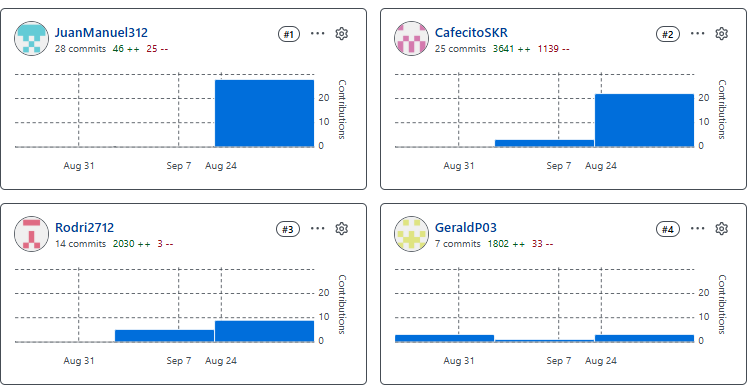

<a id="522-sprint-2"></a>
### 5.2.2. Sprint 2

<a id="5221-sprint-planning-2"></a>
#### 5.2.2.1. Sprint Planning 2.

El Sprint 2 tiene como propósito la primera versión desplegada de la Frontend Web Application, exigida para la entrega TB1. En la reunión de planificación, realizada por Google Meet, el equipo revisó lo alcanzado en el Sprint 1, identificó lo que faltaba para la entrega y acordó implementar los flujos que sostienen la propuesta de valor de FleetSafe: la inspección preoperacional del conductor, el registro y seguimiento de incidencias, el control de la documentación vehicular y la consulta de la flota. A partir de esa reunión, la coordinación continuó de forma asíncrona: cada integrante tomó un bounded context y la integración se acordó mediante Pull Requests en GitHub.

| Sprint 2 | Sprint 2 |
|---|---|
| **Sprint Planning Background** | |
| **Date** | 2026-10-07 |
| **Time** | 07:00 PM |
| **Location** | Reunión virtual por Google Meet |
| **Prepared By** | Espino Flores, Alejandro |
| **Attendees (to planning meeting)** | Espino Flores, Alejandro / Palacin Lazo, Gerardo Valentin / Aguilar Untiveros, Rodrigo Fabrizio / Santos Torres, Juan Manuel / Apaza Bocanegra, Elizabeth Noelia |
| **Sprint 1 Review Summary** | En el Sprint 1 se completaron los capítulos I a IV del informe y se publicó la primera versión del Landing Page en GitHub Pages. La revisión de la entrega señaló que el Product Backlog no permitía rastrear las User Stories ni su asignación a sprints, lo que se corrigió en la versión 0.9.3 del informe. |
| **Sprint 1 Retrospective Summary** | El equipo identificó como acierto la organización por bounded context, que permitió repartir el trabajo sin bloqueos entre integrantes. Como oportunidad de mejora, cada integrante había resuelto de forma distinta las mismas decisiones técnicas —tipo de identificador, configuración de entornos, simulación de la API y manejo de errores—, lo que impedía integrar las ramas. Se acordó adoptar como referencia común el proyecto `learning-center` del curso y acordar las decisiones compartidas antes de implementar cada contexto. |
| **Sprint Goal & User Stories** | |
| **Sprint 2 Goal** | **Our focus is on** que el conductor realice su inspección preoperacional desde la Web Application y que el supervisor de flota registre incidencias y controle el vencimiento de la documentación de sus vehículos. **We believe it delivers** un control preventivo verificable antes de cada salida **to** las empresas de transporte de carga, sus supervisores de flota y sus conductores. **This will be confirmed when** la Web Application esté desplegada y un conductor pueda iniciar una inspección sobre su vehículo asignado y registrar el estado de sus elementos, y un supervisor pueda registrar una incidencia y consultar los documentos próximos a vencer. |
| **Sprint 2 Velocity** | 31 |
| **Sum of Story Points** | 31 |

Las User Stories implementadas en el Sprint 2 son US13, US17, US18, US27, US28, US30, US32, US33 y US34. El Product Backlog de la sección 3.3 asignaba al Sprint 2 los epics de Identity and Access (EP02) y Fleet Management (EP03); el equipo priorizó los contextos del núcleo del dominio y dejó Identity and Access para el siguiente sprint, por lo que la columna *Sprint* de la sección 3.3 debe actualizarse en consecuencia.

<a id="5222-aspect-leaders-and-collaborators"></a>
#### 5.2.2.2. Aspect Leaders and Collaborators.

Los aspectos del Sprint 2 corresponden a los bounded contexts implementados en la Web Application, más dos aspectos transversales: la base compartida (`shared`), que todos los contextos utilizan, y el despliegue. Cada contexto tiene un líder responsable de su implementación, y la base compartida se alineó con el proyecto de referencia del curso antes de integrar los contextos.

| Team Member (Last Name, First Name) | GitHub Username | Pre-Operational Inspection Leader (L) / Collaborator (C) | Incident Management Leader (L) / Collaborator (C) | Fleet Management Leader (L) / Collaborator (C) | Vehicle Documentation Leader (L) / Collaborator (C) | Shared y Layout Leader (L) / Collaborator (C) | Deployment Leader (L) / Collaborator (C) |
|---|---|---|---|---|---|---|---|
| Espino Flores, Alejandro | CafecitoSKR | L | C | C | C | L | L |
| Apaza Bocanegra, Elizabeth Noelia | Elizabeth-Apaza | C | — | — | — | — | — |
| Aguilar Untiveros, Rodrigo Fabrizio | Rodri2712 | — | L | — | — | C | — |
| Palacin Lazo, Gerardo Valentin | GeraldP03 | — | — | L | — | C | — |
| Santos Torres, Juan Manuel | JuanManuel312 | — | — | — | L | — | — |

<a id="5223-sprint-backlog-2"></a>
#### 5.2.2.3. Sprint Backlog 2.

El objetivo del Sprint 2 es que la Web Application permita al conductor iniciar y registrar su inspección preoperacional, y al supervisor de flota gestionar incidencias, consultar la documentación vehicular y la flota, todo ello desplegado y accesible por una URL pública. El Sprint Backlog incluye las tareas derivadas de estas User Stories y las que no dependen de ninguna en particular, como la base compartida, la API simulada y el despliegue.

Las horas de cada tarea se estimaron a partir de la actividad registrada en sus commits: cada sesión de trabajo cuenta su duración más dos horas de trabajo previo a su primer commit, y una pausa de más de noventa minutos entre commits inicia una nueva sesión.

Tablero del Sprint 2: https://trello.com/b/UPVJLXVw/fleetsafe-sprint-2

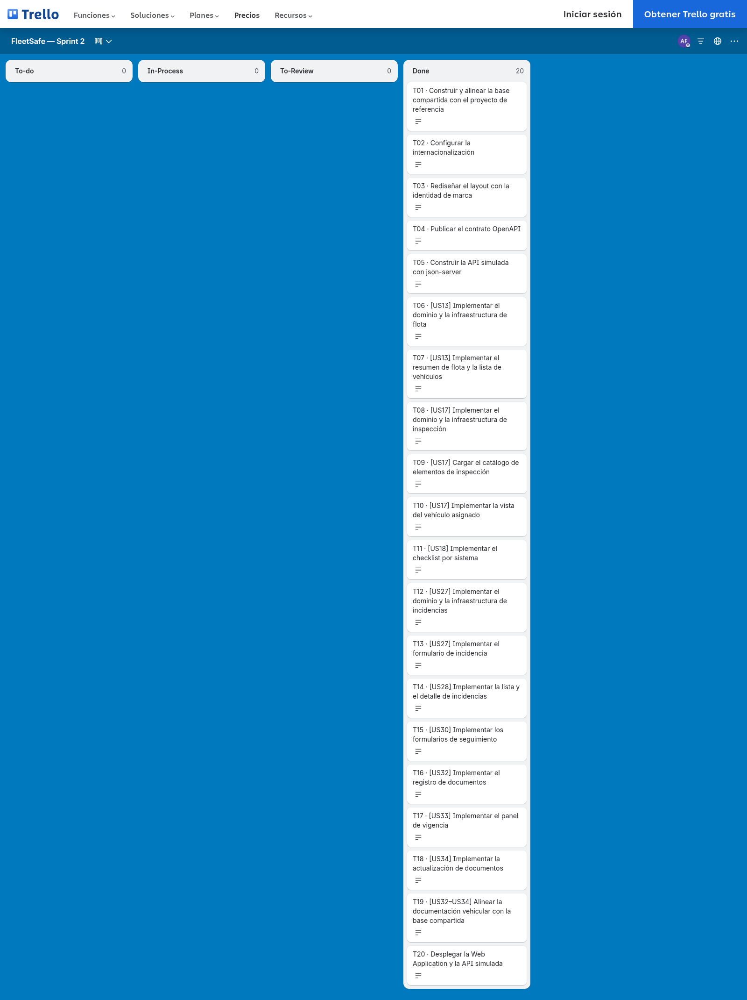

| Sprint # | Story Id | Story Title | Task Id | Task Title | Task Description | Estimation (Hours) | Assigned To | Status (To-do / In-Process / To-Review / Done) |
|---|---|---|---|---|---|---:|---|---|
| Sprint 2 | — | Base compartida | T01 | Construir y alinear la base compartida con el proyecto de referencia | Crear la estructura inicial de la aplicación e implementar `BaseEntity`, `BaseResource`, `BaseAssembler`, `BaseApiEndpoint`, `ErrorHandlingEnabledBaseType` y `BaseApi` según el proyecto `learning-center`. | 20 | Gerardo Palacin, Alejandro Espino | Done |
| Sprint 2 | — | Base compartida | T02 | Configurar la internacionalización | Cargar las traducciones `en-US` y `es-419` con `@ngx-translate/http-loader` y añadir el selector de idioma. | 6 | Alejandro Espino | Done |
| Sprint 2 | — | Base compartida | T03 | Rediseñar el layout con la identidad de marca | Implementar el menú lateral por categoría de bounded context, la barra superior y el pie de página, y adaptarlos a pantallas pequeñas. | 7 | Rodrigo Aguilar, Alejandro Espino | Done |
| Sprint 2 | — | API simulada | T04 | Publicar el contrato OpenAPI | Publicar en el repositorio Web Services el contrato de Identity and Access y de Pre-Operational Inspection. | 7 | Alejandro Espino | Done |
| Sprint 2 | — | API simulada | T05 | Construir la API simulada con json-server | Definir `server/db.json` y `server/routes.json` con los recursos de los cuatro contextos bajo el prefijo `/api/v1`. | 9 | Alejandro Espino | Done |
| Sprint 2 | US13 | Consultar listado de vehículos | T06 | Implementar el dominio y la infraestructura de flota | Implementar las entidades, assemblers y endpoints de empresas, flotas, vehículos, conductores y asignaciones. | 5 | Gerardo Palacin | Done |
| Sprint 2 | US13 | Consultar listado de vehículos | T07 | Implementar el resumen de flota y la lista de vehículos | Implementar la vista de resumen de flota y la tabla de vehículos con su estado. | 2 | Gerardo Palacin | Done |
| Sprint 2 | US17 | Iniciar inspección preoperacional | T08 | Implementar el dominio y la infraestructura de inspección | Implementar las entidades de inspección, el catálogo de 42 elementos SUTRAN agrupados por sistema y sus endpoints. | 7 | Alejandro Espino | Done |
| Sprint 2 | US17 | Iniciar inspección preoperacional | T09 | Cargar el catálogo de elementos de inspección | Construir el catálogo de elementos de inspección y sus textos a partir de la normativa SUTRAN. | 3 | Elizabeth Apaza | Done |
| Sprint 2 | US17 | Iniciar inspección preoperacional | T10 | Implementar la vista del vehículo asignado | Mostrar el vehículo asignado al conductor y solicitar el odómetro antes de iniciar la inspección. | 8 | Alejandro Espino | Done |
| Sprint 2 | US18 | Registrar estado de elementos de inspección | T11 | Implementar el checklist por sistema | Implementar el recorrido por sistema con el selector Conforme, Observado y Falla, el progreso y el guardado de cada respuesta. | 5 | Alejandro Espino | Done |
| Sprint 2 | US27 | Registrar incidencia | T12 | Implementar el dominio y la infraestructura de incidencias | Implementar el aggregate de incidencia, sus comandos y los endpoints de incidencias y tipos de incidencia. | 4 | Rodrigo Aguilar | Done |
| Sprint 2 | US27 | Registrar incidencia | T13 | Implementar el formulario de incidencia | Implementar el registro y la edición de una incidencia con su origen, severidad y tipo. | 2 | Rodrigo Aguilar | Done |
| Sprint 2 | US28 | Consultar incidencias registradas | T14 | Implementar la lista y el detalle de incidencias | Implementar la tabla paginada de incidencias y la vista de detalle con acciones, reparaciones y seguimientos. | 4 | Rodrigo Aguilar | Done |
| Sprint 2 | US30 | Registrar acción correctiva | T15 | Implementar los formularios de seguimiento | Implementar el registro de acciones correctivas, la programación de reparaciones y los seguimientos de una incidencia. | 2 | Rodrigo Aguilar | Done |
| Sprint 2 | US32 | Registrar documento vehicular | T16 | Implementar el registro de documentos | Implementar el formulario de registro con validación de fechas y del enlace al documento digital. | 2 | Juan Manuel Santos | Done |
| Sprint 2 | US33 | Consultar documentos próximos a vencer | T17 | Implementar el panel de vigencia | Implementar los contadores por estado, los filtros por vehículo y estado, y la lista de documentos próximos a vencer. | 2 | Juan Manuel Santos | Done |
| Sprint 2 | US34 | Actualizar documento vehicular | T18 | Implementar la actualización de documentos | Permitir actualizar un documento y recalcular su estado de vigencia. | 2 | Juan Manuel Santos | Done |
| Sprint 2 | US32–US34 | Documentación vehicular | T19 | Alinear la documentación vehicular con la base compartida | Reemplazar el servidor propio por los endpoints, assemblers y store de la base compartida. | 2 | Alejandro Espino | Done |
| Sprint 2 | — | Despliegue | T20 | Desplegar la Web Application y la API simulada | Configurar GitHub Pages con GitHub Actions y el servicio de Render, y publicar las versiones con su tag. | 7 | Alejandro Espino | Done |

<a id="5224-development-evidence-for-sprint-review"></a>
#### 5.2.2.4. Development Evidence for Sprint Review.

Durante el Sprint 2 se implementó la Frontend Web Application con cuatro bounded contexts —Pre-Operational Inspection, Incident Management, Fleet Management y Vehicle Documentation— sobre una base compartida alineada con el proyecto de referencia del curso, y se publicó en el repositorio Web Services el contrato OpenAPI que la Web Application consume. El Landing Page no recibió cambios en este sprint. Cada contexto se desarrolló en su propia rama `feature/*` y se integró en `develop` mediante Pull Request, conservando la autoría de cada commit; las correcciones posteriores al despliegue se integraron como ramas `fix/*` y `hotfix/*`, y cada versión publicada se preparó en una rama `release/*`.

La tabla recoge los commits del sprint, sin los commits de merge, en orden cronológico.

| Repository | Branch | Commit Id | Commit Message | Commit Message Body | Commited on (Date) |
|---|---|---|---|---|---|
| Frontend-Web-Application | develop | 42fe307 | chore: initialize angular project | — | 2026-09-29 |
| Frontend-Web-Application | develop | 4567bd1 | build: add angular material | — | 2026-09-29 |
| Frontend-Web-Application | feature/configuration | da1f405 | build(i18n): add ngx-translate with en-US and es-419 | — | 2026-09-29 |
| Frontend-Web-Application | feature/vehicle-documentation | 823a046 | chore: rename translation directories. | — | 2026-10-04 |
| Frontend-Web-Application | develop | 2e2ead2 | chore: rename translation directories. | — | 2026-10-04 |
| Frontend-Web-Application | feature/vehicle-documentation | 4ef3fbc | chore: initial commit. | — | 2026-10-04 |
| Frontend-Web-Application | develop | 32dea71 | chore: initial commit. | — | 2026-10-04 |
| Frontend-Web-Application | feature/vehicle-documentation | 2362104 | chore: implement server directory with db and routes.json | — | 2026-10-04 |
| Frontend-Web-Application | develop | 1eaec14 | chore: implement server directory with db and routes.json | — | 2026-10-04 |
| Frontend-Web-Application | feature/vehicle-documentation | 2a0fa71 | chore: implement enviroment for developers. | — | 2026-10-04 |
| Frontend-Web-Application | develop | f6c78ef | chore: implement enviroment for developers. | — | 2026-10-04 |
| Frontend-Web-Application | feature/vehicle-documentation | 156c084 | feat(shared): add base entity with numeric identifier. | — | 2026-10-04 |
| Frontend-Web-Application | develop | 05ae06d | feat(shared): add base entity with numeric identifier. | — | 2026-10-04 |
| Frontend-Web-Application | feature/vehicle-documentation | f1ba497 | feat(shared): add base response and resource. | — | 2026-10-04 |
| Frontend-Web-Application | develop | 1437aba | feat(shared): add base response and resource. | — | 2026-10-04 |
| Frontend-Web-Application | feature/vehicle-documentation | 06f562c | feat(shared): add base assembler | — | 2026-10-04 |
| Frontend-Web-Application | develop | ad52323 | feat(shared): add base assembler | — | 2026-10-04 |
| Frontend-Web-Application | feature/vehicle-documentation | 579b7fd | feat(shared): update translations for the web application | — | 2026-10-04 |
| Frontend-Web-Application | develop | df8ea9e | feat(shared): update translations for the web application | — | 2026-10-04 |
| Frontend-Web-Application | feature/vehicle-documentation | 83b4d23 | feat(shared): update visual material | — | 2026-10-04 |
| Frontend-Web-Application | develop | e17d76a | feat(shared): update visual material | — | 2026-10-04 |
| Frontend-Web-Application | feature/vehicle-documentation | 296f2be | feat(shared): update logic and redundant lines of coding from infrastructure layer | — | 2026-10-04 |
| Frontend-Web-Application | develop | 18d77f6 | feat(shared): update logic and redundant lines of coding from infrastructure layer | — | 2026-10-04 |
| Frontend-Web-Application | feature/vehicle-documentation | 103fde3 | feat(shared): correct placement for footer, language switcher and layout | — | 2026-10-04 |
| Frontend-Web-Application | develop | ce7f530 | feat(shared): correct placement for footer, language switcher and layout | — | 2026-10-04 |
| Frontend-Web-Application | feature/vehicle-documentation | 76719d9 | chore: update angular version | — | 2026-10-04 |
| Frontend-Web-Application | develop | e6aa255 | chore: update angular version | — | 2026-10-04 |
| Frontend-Web-Application | feature/vehicle-documentation | 3418d69 | chore: update files for shared directory new logic | — | 2026-10-04 |
| Frontend-Web-Application | develop | 55deb36 | chore: update files for shared directory new logic | — | 2026-10-04 |
| Frontend-Web-Application | feature/incident-management | 7c247b6 | feat(incident): add incident aggregate and value objects | — | 2026-10-05 |
| Frontend-Web-Application | feature/incident-management | 9abaf5a | feat(incident): add incident domain commands | — | 2026-10-05 |
| Frontend-Web-Application | feature/incident-management | 8ff79d6 | feat(incident): add incident and incident type rest endpoints | — | 2026-10-05 |
| Frontend-Web-Application | feature/incident-management | 7fd081e | feat(incident): add corrective action registration endpoint | — | 2026-10-05 |
| Frontend-Web-Application | feature/incident-management | b47f3b1 | feat(incident): add repair scheduling and completion endpoints | — | 2026-10-05 |
| Frontend-Web-Application | feature/incident-management | eb05659 | feat(incident): add follow-up and resolution endpoints | — | 2026-10-05 |
| Frontend-Web-Application | feature/incident-management | d30d945 | feat(incident): add incident endpoints to environment configuration | — | 2026-10-05 |
| Frontend-Web-Application | feature/incident-management | f1b0ded | feat(incident): add signal-based store for incident management | — | 2026-10-05 |
| Frontend-Web-Application | feature/incident-management | 54abaad | feat(incident): add incident list, form and detail views | — | 2026-10-05 |
| Frontend-Web-Application | feature/incident-management | 9b407fd | feat(incident): add corrective action, repair and follow-up forms with routes | — | 2026-10-05 |
| Frontend-Web-Application | feature/incident-management | 9dfd7a1 | feat(i18n): add incident management translations to es and en | — | 2026-10-05 |
| Frontend-Web-Application | feature/incident-management | dbf80c4 | fix(shared): update page-not-found to display current url on navigation | — | 2026-10-05 |
| Frontend-Web-Application | feature/incident-management | 809450b | feat(app): integrate incident routes, spanish locale and updated bundle budget | — | 2026-10-05 |
| Frontend-Web-Application | feature/layout-redesign | 028a94f | feat(shared): redesign sidebar, topbar and footer with brand identity | — | 2026-10-05 |
| Frontend-Web-Application | feature/layout-redesign | 7877f77 | feat(shared): restyle language switcher and add bilingual tagline | — | 2026-10-05 |
| Frontend-Web-Application | feature/vehicle-documentation | 63fc766 | feat(vehicle-documentation): define document models and date-based validity rules | — | 2026-10-06 |
| Frontend-Web-Application | feature/vehicle-documentation | 742d8f1 | feat(vehicle-documentation): add REST facade and configurable integration contract | — | 2026-10-06 |
| Frontend-Web-Application | feature/vehicle-documentation | 52895db | feat(vehicle-documentation): coordinate loading and document registration state | — | 2026-10-06 |
| Frontend-Web-Application | feature/vehicle-documentation | 5cb9ca3 | feat(vehicle-documentation): implement validated registration and update form | — | 2026-10-06 |
| Frontend-Web-Application | feature/vehicle-documentation | b3fddce | feat(vehicle-documentation): add validity dashboard filters and document actions | — | 2026-10-06 |
| Frontend-Web-Application | feature/vehicle-documentation | bf23f71 | feat(vehicle-documentation): integrate lazy routes and bilingual interface | — | 2026-10-06 |
| Frontend-Web-Application | feature/vehicle-documentation | dc6ce26 | feat(vehicle-documentation): provide persistent isolated demo REST server | — | 2026-10-06 |
| Frontend-Web-Application | feature/vehicle-documentation | 5b7d8fd | test(vehicle-documentation): cover validity boundaries and registration requirements | — | 2026-10-06 |
| Frontend-Web-Application | feature/vehicle-documentation | a5f106c | docs(vehicle-documentation): explain local setup requirements and team integration | — | 2026-10-06 |
| Frontend-Web-Application | feature/fleet-management | fabcb66 | feat(shared): update files for shared directory new logic | — | 2026-10-06 |
| Frontend-Web-Application | feature/fleet-management | fc8dabf | feat(fleet): update environment rules | — | 2026-10-06 |
| Frontend-Web-Application | feature/fleet-management | ae122d1 | feat(fleet): update initial project configuration. | — | 2026-10-06 |
| Frontend-Web-Application | feature/fleet-management | 353ed8b | feat(fleet): add company, driver, fleet, vehicle, vehicle-assignment entities in domain layer. | — | 2026-10-06 |
| Frontend-Web-Application | feature/fleet-management | dbc14c2 | feat(fleet): add company response, api endpoint and assembler in domain infrastructure. | — | 2026-10-06 |
| Frontend-Web-Application | feature/fleet-management | 5af7735 | feat(fleet): add drivers response, api endpoint and assembler in domain infrastructure. | — | 2026-10-06 |
| Frontend-Web-Application | feature/fleet-management | e096c4b | feat(fleet): add fleets response, api endpoint and assembler in domain infrastructure. | — | 2026-10-06 |
| Frontend-Web-Application | feature/fleet-management | 120b908 | feat(fleet): add vehicles response, api endpoint and assembler in domain infrastructure. | — | 2026-10-06 |
| Frontend-Web-Application | feature/fleet-management | c9510fd | feat(fleet): add vehicle assignments response, api endpoint and assembler in domain infrastructure. | — | 2026-10-06 |
| Frontend-Web-Application | feature/fleet-management | 54c50b0 | feat(fleet): add fleet api to manipulate endpoints in domain infrastructure. | — | 2026-10-06 |
| Frontend-Web-Application | feature/fleet-management | 703588a | feat(fleet): update translations. | — | 2026-10-06 |
| Frontend-Web-Application | feature/fleet-management | f3c1be8 | feat(fleet): add server files to test. | — | 2026-10-06 |
| Frontend-Web-Application | feature/fleet-management | 94ea3ac | feat(fleet): update entities in domain layer. | — | 2026-10-06 |
| Frontend-Web-Application | feature/fleet-management | f8b188c | feat(fleet): add fleet.store to application layer. | — | 2026-10-06 |
| Frontend-Web-Application | feature/fleet-management | 518c826 | feat(fleet): update content from fleet api, vehicle response and assembler in infrastructure layer. | — | 2026-10-06 |
| Frontend-Web-Application | develop | 2171ede | refactor(i18n): load translations per bounded context with en-US and es-419 | — | 2026-10-06 |
| Frontend-Web-Application | develop | 244509d | feat(shared): handle http errors globally and notify through snack bars | — | 2026-10-06 |
| Frontend-Web-Application | develop | a5a35fe | build: remove the unused ngx-translate http loader | — | 2026-10-06 |
| Frontend-Web-Application | feature/fleet-management | dfa79dc | build(i18n): update language switcher following i18n directives. | — | 2026-10-06 |
| Frontend-Web-Application | feature/fleet-management | 6c43fa6 | build: update materials. | — | 2026-10-06 |
| Frontend-Web-Application | feature/fleet-management | a99d979 | feat(fleet): add driver, fleet, vehicle assignment, vehicle directories for presentation layer | — | 2026-10-06 |
| Frontend-Web-Application | feature/fleet-management | d76d74f | feat(fleet): update fleet routes in presentation layer. | — | 2026-10-06 |
| Frontend-Web-Application | feature/fleet-management | 24aa14a | feat(fleet): integrate bounded context fleet management in app directory. | — | 2026-10-06 |
| Frontend-Web-Application | develop | a426aee | refactor(shared): identify entities with uuid strings | — | 2026-10-06 |
| Frontend-Web-Application | develop | 2c5bf74 | build: configure the api base url per environment | — | 2026-10-06 |
| Frontend-Web-Application | develop | 0c5951a | build: add the contract mock and the stateful mock | — | 2026-10-06 |
| Frontend-Web-Application | develop | 83fca4b | feat(shared): expose the current user through a port | — | 2026-10-06 |
| Frontend-Web-Application | develop | 5893ee1 | fix(shared): redirect the empty path to home | — | 2026-10-06 |
| Frontend-Web-Application | feature/pre-operational-inspection | 08a5067 | feat(inspection): model the inspection aggregate and its rules | — | 2026-10-06 |
| Frontend-Web-Application | develop | 63d21a0 | refactor(shared): model entities and auditable aggregate roots as abstract classes | — | 2026-10-06 |
| Frontend-Web-Application | feature/pre-operational-inspection | 645f954 | refactor(inspection): extend the shared domain base classes | — | 2026-10-06 |
| Frontend-Web-Application | feature/pre-operational-inspection | e513b08 | refactor(inspection): keep the entities to their state until use cases need behavior | — | 2026-10-06 |
| Frontend-Web-Application | feature/shared-api-client | 6c42a13 | feat(shared): compose api calls through a client that resolves the base url | — | 2026-10-06 |
| Frontend-Web-Application | feature/pre-operational-inspection | 016781e | feat(inspection): consume the inspection api needed to start an inspection | — | 2026-10-07 |
| Frontend-Web-Application | feature/pre-operational-inspection | df3d364 | fix(inspection): remove a stray character from the assigned vehicle assembler | — | 2026-10-07 |
| Frontend-Web-Application | feature/pre-operational-inspection | 10dd34a | feat(inspection): add the inspection store to start an inspection | — | 2026-10-07 |
| Frontend-Web-Application | feature/pre-operational-inspection | 734f80b | fix(inspection): mark the inspection as starting only when the request is sent | — | 2026-10-07 |
| Frontend-Web-Application | feature/shared-auth-interceptor | ca8a3d7 | feat(shared): send the access token with every api request | — | 2026-10-07 |
| Frontend-Web-Application | feature/pre-operational-inspection | 6c93479 | feat(shared): provide the material defaults of the application | — | 2026-10-07 |
| Frontend-Web-Application | feature/pre-operational-inspection | 3e68bea | feat(inspection): let the driver start an inspection from the assigned vehicle | — | 2026-10-07 |
| Frontend-Web-Application | feature/pre-operational-inspection | 9ce44fd | fix(inspection): keep the error state icon apart from the start error styles | — | 2026-10-07 |
| Frontend-Web-Application | feature/shared-theme | 7872bfa | build: disable angular cli analytics for the project | — | 2026-10-07 |
| Frontend-Web-Application | feature/shared-theme | 40ecb76 | feat(shared): theme angular material with the fleetsafe brand | — | 2026-10-07 |
| Frontend-Web-Application | feature/shared-theme | 97379cf | feat(shared): show notifications as toasts with a severity icon | — | 2026-10-07 |
| Frontend-Web-Application | feature/pre-operational-inspection | f121f2d | feat(inspection): populate SUTRAN inspection catalog items and mock inspection history | Added inspection items and inspection records to db.json for vehicle safety checks. | 2026-10-07 |
| Frontend-Web-Application | feature/pre-operational-inspection | 1c8e683 | feat(inspection): add inspection translation keys to es-419 dictionary | — | 2026-10-07 |
| Frontend-Web-Application | feature/pre-operational-inspection | b7b4d21 | feat(inspection): add inspection translation keys to en-US dictionary | — | 2026-10-07 |
| Frontend-Web-Application | feature/pre-operational-inspection | 6381317 | refactor(inspection): move the inspection translations to their bounded context | — | 2026-10-07 |
| Frontend-Web-Application | feature/pre-operational-inspection | fe97ba1 | build(inspection): shape the mock data after the inspection and fleet contracts | — | 2026-10-07 |
| Frontend-Web-Application | feature/pre-operational-inspection | 82ea8e4 | fix(inspection): surface unexpected errors when starting an inspection | — | 2026-10-07 |
| Frontend-Web-Application | feature/pre-operational-inspection | f598da3 | build: replace json-server and the installed prism with msw and prism on demand | — | 2026-10-07 |
| Frontend-Web-Application | feature/pre-operational-inspection | ac2c78d | feat(shared): start the mock api in development before the application | — | 2026-10-07 |
| Frontend-Web-Application | feature/pre-operational-inspection | 7e2df57 | feat(inspection): mock the inspection api with the sutran catalog | — | 2026-10-07 |
| Frontend-Web-Application | feature/pre-operational-inspection | 224b971 | feat(inspection): mock registering and correcting checklist results | — | 2026-10-07 |
| Frontend-Web-Application | feature/pre-operational-inspection | b4b9493 | build(inspection): assign each mock catalog item to its vehicle system | — | 2026-10-07 |
| Frontend-Web-Application | feature/pre-operational-inspection | ae52f1f | feat(inspection): add the checklist texts and the vehicle system names | — | 2026-10-07 |
| Frontend-Web-Application | feature/pre-operational-inspection | 95d4337 | feat(inspection): let the driver answer each item of the checklist | — | 2026-10-07 |
| Frontend-Web-Application | feature/pre-operational-inspection | bf690c2 | feat(inspection): walk the checklist one vehicle system at a time | — | 2026-10-07 |
| Frontend-Web-Application | refactor/shared-learning-center | d093188 | refactor(shared): rename the shared views folder as in the reference | — | 2026-10-07 |
| Frontend-Web-Application | refactor/shared-learning-center | 16d1879 | refactor(shared): align the shared kernel with the learning center reference | — | 2026-10-07 |
| Frontend-Web-Application | feature/pre-operational-inspection | a72d449 | build: return to json-server as the mock api of the reference | — | 2026-10-07 |
| Frontend-Web-Application | feature/pre-operational-inspection | 9f6b931 | refactor(inspection): keep the inspection texts in the single dictionary per language | — | 2026-10-07 |
| Frontend-Web-Application | feature/pre-operational-inspection | 2e11fa7 | build: lock the dependencies of the reference mock api | — | 2026-10-07 |
| Frontend-Web-Application | feature/pre-operational-inspection | b27d269 | refactor(inspection): model the inspection domain with private fields as in the reference | — | 2026-10-07 |
| Frontend-Web-Application | feature/pre-operational-inspection | 1b5ce47 | refactor(inspection): reach the api through reference endpoints and assemblers | — | 2026-10-07 |
| Frontend-Web-Application | feature/pre-operational-inspection | bd21a2f | refactor(inspection): manage the inspection state as the reference stores do | — | 2026-10-07 |
| Frontend-Web-Application | feature/pre-operational-inspection | 5af6f59 | refactor(inspection): drive the screens through the reference store and forms | — | 2026-10-07 |
| Frontend-Web-Application | feature/incident-management | 9dc462d | refactor(incident): identify incidents with string ids as the shared kernel does | — | 2026-10-07 |
| Frontend-Web-Application | feature/fleet-management | 1ab8f13 | refactor(fleet): reach the fleet api through the shared endpoint without an id type | — | 2026-10-07 |
| Frontend-Web-Application | release/0.2.0 | a6b895a | chore(release): prepare version 0.2.0 | — | 2026-10-07 |
| Frontend-Web-Application | feature/deployment | a3217e5 | ci: deploy the web application to github pages | — | 2026-10-08 |
| Frontend-Web-Application | feature/deployment | 7bb6bf0 | build: point the production environment to the deployed mock api | — | 2026-10-08 |
| Frontend-Web-Application | release/0.2.1 | 55160f3 | chore(release): prepare version 0.2.1 | — | 2026-10-08 |
| Frontend-Web-Application | hotfix/0.2.2 | d007744 | fix(shared): load the translations without the http interceptors | — | 2026-10-08 |
| Frontend-Web-Application | hotfix/0.2.2 | 5d98fbb | chore(release): prepare version 0.2.2 | — | 2026-10-08 |
| Frontend-Web-Application | hotfix/0.2.2 | 12f78cd | style(shared): format the translation loader configuration | — | 2026-10-08 |
| Frontend-Web-Application | fix/deployed-screens | 07d6906 | fix(shared): show every sidebar label over the brand color | — | 2026-10-08 |
| Frontend-Web-Application | fix/deployed-screens | 958d407 | fix(shared): show the released version in the sidebar | — | 2026-10-08 |
| Frontend-Web-Application | fix/deployed-screens | 6d82d65 | fix(incident): seed the mock api with incidents and their types | — | 2026-10-08 |
| Frontend-Web-Application | fix/deployed-screens | 0e3ce44 | refactor(vehicle-documentation): reach the shared mock api through the reference endpoints and store | — | 2026-10-08 |
| Frontend-Web-Application | release/0.2.3 | 4e8d7d6 | chore(release): prepare version 0.2.3 | — | 2026-10-08 |
| Frontend-Web-Application | hotfix/0.2.4 | 94571b9 | fix(shared): rewrite the mock api paths so requests by id reach their collection | — | 2026-10-08 |
| Frontend-Web-Application | hotfix/0.2.4 | 075aab6 | chore(release): prepare version 0.2.4 | — | 2026-10-08 |
| Frontend-Web-Application | fix/incident-i18n-translations | 3a1ad1d | fix(incident): return i18n error keys from store | — | 2026-10-08 |
| Frontend-Web-Application | fix/incident-i18n-translations | bc0d0fe | fix(incident): translate error message in list view | — | 2026-10-08 |
| Frontend-Web-Application | fix/incident-i18n-translations | 3ab4c67 | fix(incident): add loadFailed and notFound i18n keys | — | 2026-10-08 |
| Frontend-Web-Application | fix/incident-i18n-translations | b26dea9 | fix(incident): use origin and severity label keys in form | — | 2026-10-08 |
| Frontend-Web-Application | fix/incident-i18n-translations | e2e2e8f | fix(incident): use label keys for origin, severity and status in detail view | — | 2026-10-08 |
| Frontend-Web-Application | fix/incident-i18n-translations | 1bcfaae | fix(incident): add origin, severity and status label i18n keys | — | 2026-10-08 |
| Frontend-Web-Application | fix/mobile-layout | e16fee3 | fix(shared): collapse the sidebar behind a menu button on small screens | — | 2026-10-08 |
| Frontend-Web-Application | release/0.2.5 | 5d86b85 | chore(release): prepare version 0.2.5 | — | 2026-10-08 |
| Frontend-Web-Application | fix/result-selector-narrow | 463eac8 | fix(inspection): fit the result selector on narrow checklist cards | — | 2026-10-08 |
| Frontend-Web-Application | release/0.2.6 | fd94877 | chore(release): prepare version 0.2.6 | — | 2026-10-08 |
| Frontend-Web-Application | fix/incident-form-improvements | 0d3823f | fix(shared): point incident sidebar link to the real route | — | 2026-10-08 |
| Frontend-Web-Application | fix/incident-form-improvements | 8eadff4 | style(incident): center form layout and align action buttons | — | 2026-10-08 |
| Frontend-Web-Application | fix/incident-form-improvements | 155e819 | style(incident): use mat-flat-button for the primary form action | — | 2026-10-08 |
| Frontend-Web-Application | fix/incident-form-improvements | 878790e | style(shared): tune button hover, focus and pressed state opacities | — | 2026-10-08 |
| Frontend-Web-Application | fix/fleet-assignments-mock | 7645d69 | fix(fleet): serve the vehicle assignments under the path the fleet api requests | — | 2026-10-08 |
| Frontend-Web-Application | release/0.2.7 | cb4416f | chore(release): prepare version 0.2.7 | — | 2026-10-08 |
| Web-Services | develop | 38aec67 | chore: initialize repository | — | 2026-09-29 |
| Web-Services | feature/openapi-contracts | 7a49570 | feat(api): add the shared components and the root document of the contract | — | 2026-10-06 |
| Web-Services | feature/openapi-contracts | 3c0a8b0 | feat(iam): add the identity and access contract | — | 2026-10-06 |
| Web-Services | feature/openapi-contracts | 5b94c4c | feat(inspection): add the pre-operational inspection contract | — | 2026-10-06 |
| Web-Services | feature/openapi-contracts | 4289d3e | docs(api): describe the license and the tags of the contract | — | 2026-10-06 |
| Web-Services | fix/inspection-item-audit | a90bfff | fix(inspection): expose the audit timestamps of inspection items | — | 2026-10-06 |
| Web-Services | feature/driver-vehicle-assignment | 3c44080 | feat(fleet): expose the active vehicle assignment of the signed-in driver | — | 2026-10-06 |

<a id="5225-execution-evidence-for-sprint-review"></a>
#### 5.2.2.5. Execution Evidence for Sprint Review.

Al cierre del Sprint 2, la Web Application está desplegada en https://1asi0729-2620-16692-bitmeisters.github.io/Frontend-Web-Application/ en su versión 0.2.7. El conductor puede consultar su vehículo asignado, iniciar una inspección preoperacional registrando el odómetro y recorrer el checklist de 42 elementos agrupados en ocho sistemas, marcando cada uno como Conforme, Observado o Falla; la interfaz señala que los elementos no conformes requieren una observación, cuyo registro se implementa en el Sprint 3. El supervisor de flota puede registrar incidencias, consultar su detalle con las acciones correctivas, reparaciones y seguimientos, controlar la vigencia de la documentación vehicular y consultar el resumen de su flota. Toda la interfaz está disponible en inglés y en español, y se adapta a pantallas de escritorio y de teléfono.

**Flujo del conductor — inspección preoperacional (teléfono)**

| Vehículo asignado | Menú de navegación | Checklist al iniciar | Checklist con respuestas |
|:---:|:---:|:---:|:---:|
| 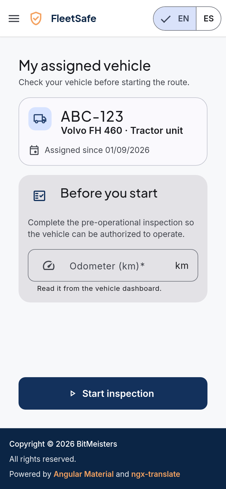 | 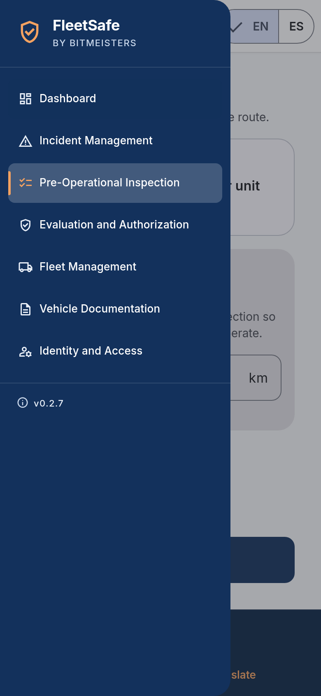 | 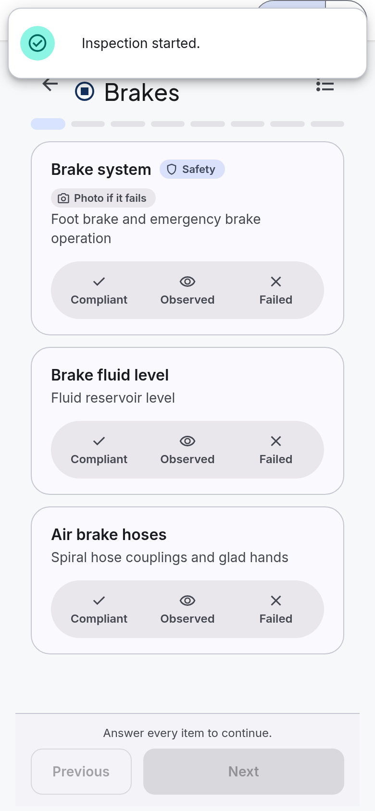 | 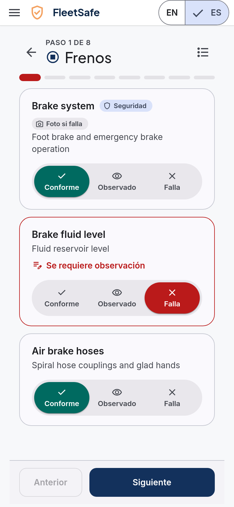 |

**Flujo del conductor — inspección preoperacional (escritorio)**

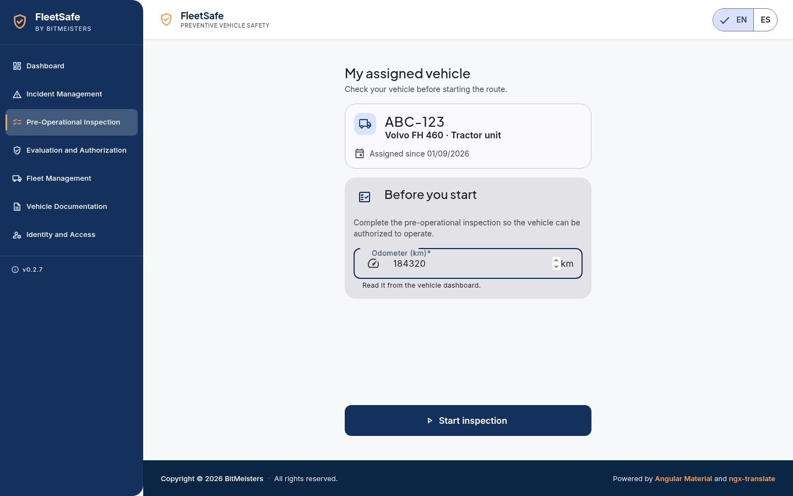

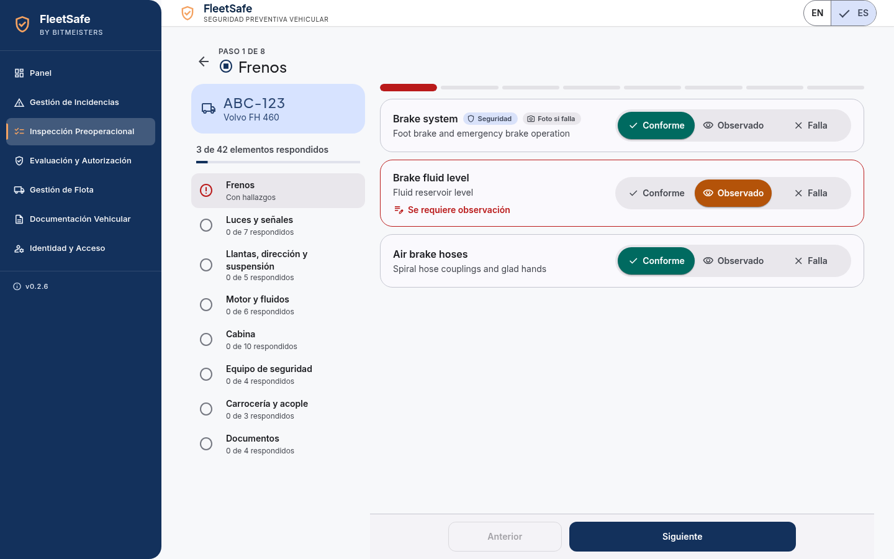

**Incident Management**

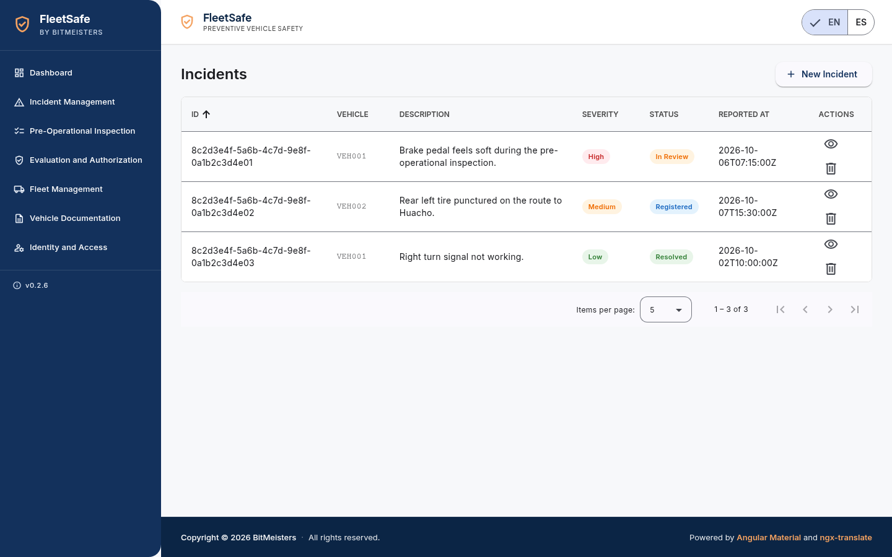

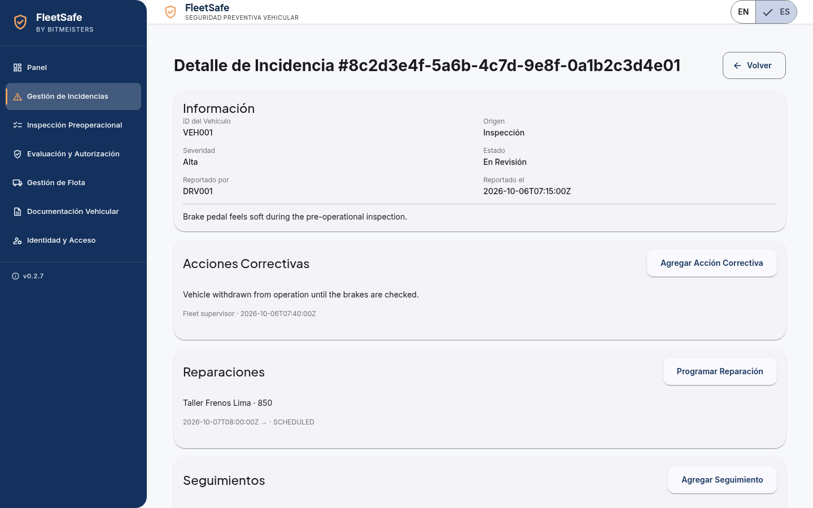

**Vehicle Documentation**

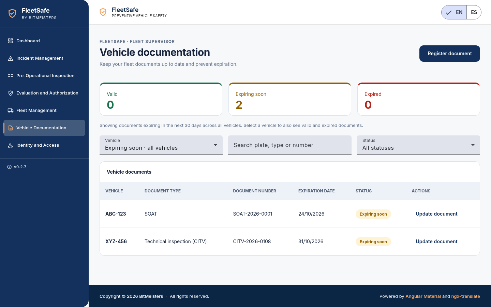

**Fleet Management**

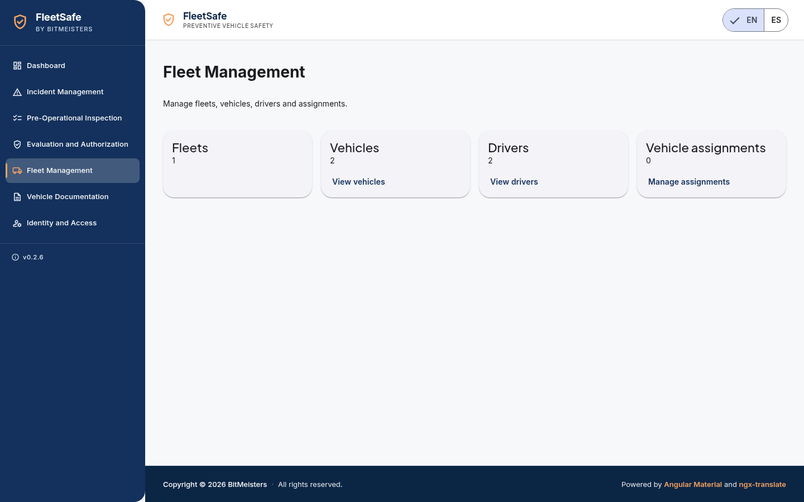

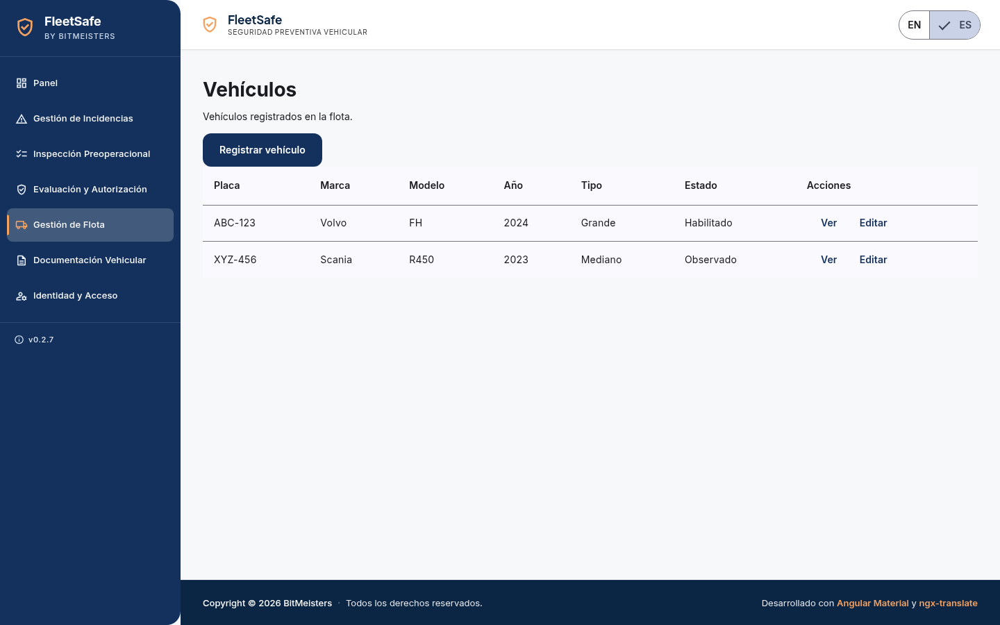

Video de la navegación lograda: https://youtu.be/xfpyuPoml0A?si=wCobu-tC12ya4j89

<a id="5226-services-documentation-evidence-for-sprint-review"></a>
#### 5.2.2.6. Services Documentation Evidence for Sprint Review.

El Backend RESTful API se implementa a partir del Sprint 3. En este sprint se publicó en el repositorio Web Services el contrato OpenAPI que lo especifica, para los contextos de Identity and Access y Pre-Operational Inspection, y la Web Application consume una API simulada con json-server que sirve los mismos recursos bajo el prefijo `/api/v1`. El contrato se valida con Redocly y puede servirse en local con Prism mediante `npm run mock:contract` en el repositorio de la Web Application.

- Contrato: https://github.com/1ASI0729-2620-16692-BitMeisters/Web-Services/blob/develop/openapi/openapi.yaml
- API simulada desplegada: https://fleetsafe-api.onrender.com/api/v1

| Endpoint | Acciones implementadas | Verbo HTTP | Sintaxis de llamada | Parámetros | Response |
|---|---|---|---|---|---|
| `/drivers/me/vehicle-assignment` | Consultar la asignación activa del conductor | GET | `GET /api/v1/drivers/me/vehicle-assignment` | — | `200` con la asignación y el vehículo: `{ "id", "driverId", "assignedFrom", "vehicle": { "id", "plate": "ABC-123", "brand": "Volvo", "model": "FH 460" } }`. `404` si el conductor no tiene vehículo asignado. |
| `/inspection-items` | Consultar el catálogo de elementos de inspección | GET | `GET /api/v1/inspection-items` | — | `200` con los 42 elementos: `[{ "id", "code": "SAF-01", "name": "Brake system", "system": "BRAKES", "isSafetyComponent": true, "requiresEvidence": true, "displayOrder": 1, "isActive": true }, …]` |
| `/inspections` | Iniciar una inspección | POST | `POST /api/v1/inspections` | Cuerpo: `id`, `vehicleId`, `driverId`, `status: "IN_PROGRESS"`, `odometer`, `startedAt`, `results: []` | `201` con la inspección creada. |
| `/inspections/{id}` | Consultar una inspección | GET | `GET /api/v1/inspections/{id}` | `id`: UUID de la inspección | `200` con la inspección y sus resultados; `404` si no existe. |
| `/inspections/{id}` | Registrar el estado de un elemento | PUT | `PUT /api/v1/inspections/{id}` | `id` y la inspección con el resultado añadido en `results` (`inspectionItemId`, `itemName`, `itemCategory`, `result`: `OK` · `OBSERVED` · `FAIL`) | `200` con la inspección actualizada. |
| `/incidents` | Registrar y consultar incidencias | GET · POST | `GET /api/v1/incidents` · `POST /api/v1/incidents` | Cuerpo de `POST`: `vehicleId`, `incidentTypeId`, `origin`, `description`, `severity`, `reportedBy` | `200` con la lista de incidencias, cada una con `correctiveActions`, `repairs` y `followUps`; `201` con la incidencia creada. |
| `/incident-types` | Consultar los tipos de incidencia | GET | `GET /api/v1/incident-types` | — | `200` con `[{ "id", "code": "MECHANICAL", "name": "Mechanical failure", "isActive": true }, …]` |
| `/vehicle-documents` | Registrar, consultar y actualizar documentos | GET · POST · PUT | `GET /api/v1/vehicle-documents` · `POST /api/v1/vehicle-documents` · `PUT /api/v1/vehicle-documents/{id}` | Cuerpo: `vehicleId`, `documentTypeId`, `number`, `issueDate`, `expirationDate`, `fileUrl` | `200` con la lista; `201` o `200` con el documento registrado o actualizado. |
| `/document-types` | Consultar los tipos de documento | GET | `GET /api/v1/document-types` | — | `200` con `[{ "id", "code": "SOAT", "name": "SOAT", "isRequired": true }, …]` |
| `/fleets` · `/vehicles` · `/drivers` | Consultar la flota, sus vehículos y conductores | GET | `GET /api/v1/fleets` · `GET /api/v1/vehicles` · `GET /api/v1/drivers` | — | `200` con la lista de cada recurso. |

Contrato publicado, visualizado con Swagger UI a partir del archivo `openapi.yaml` del repositorio:

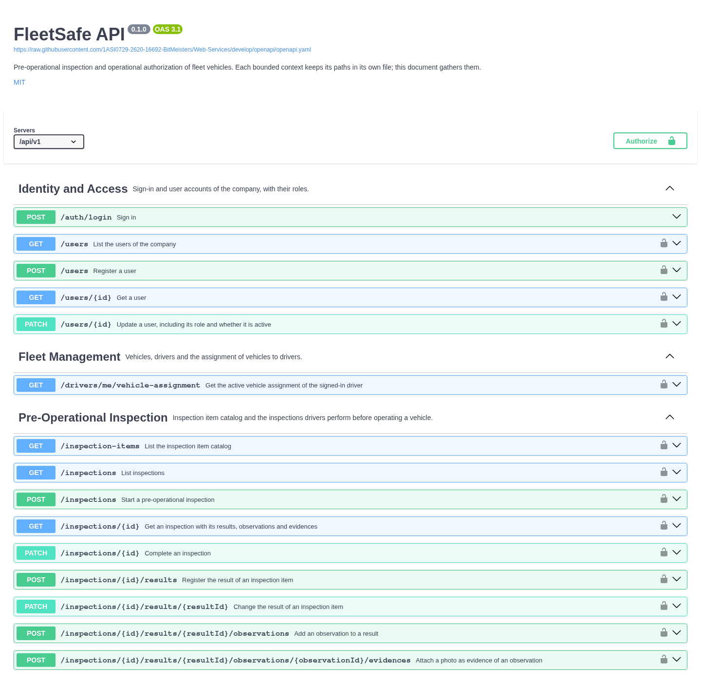

Operación de consulta del catálogo de elementos de inspección, con sus parámetros y el ejemplo de respuesta:

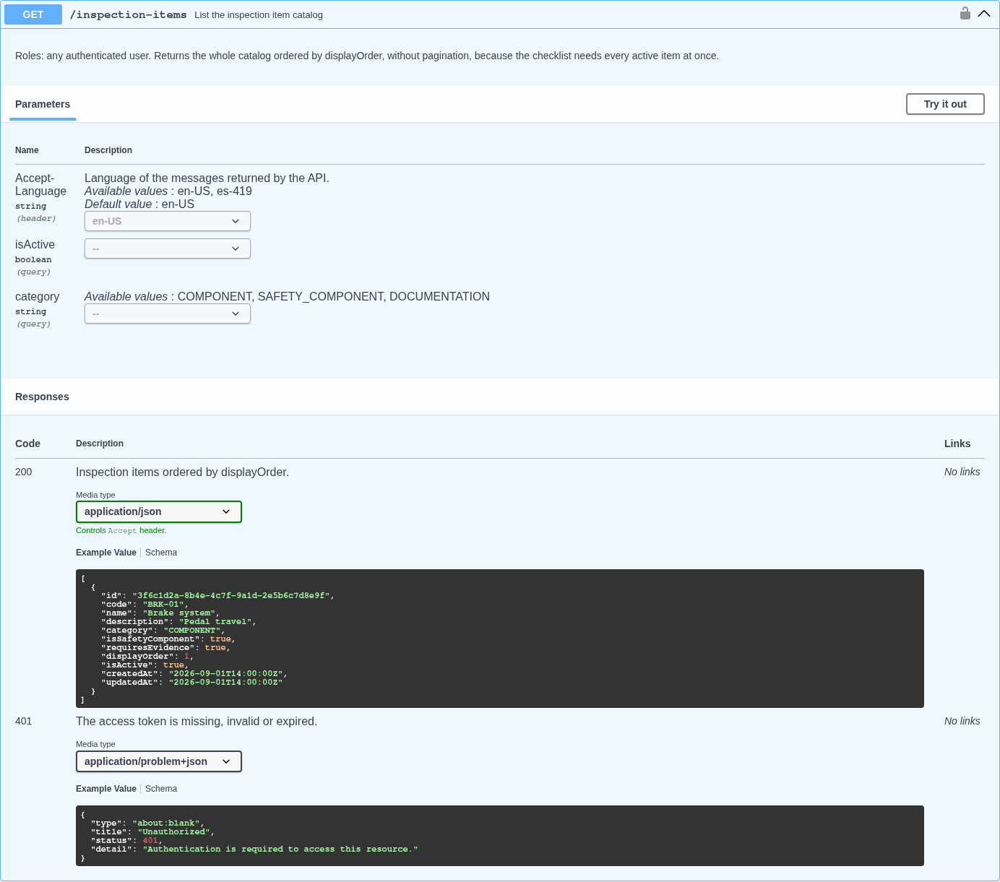

Operación para iniciar una inspección, con el cuerpo de la petición, la respuesta `201` y las respuestas de error con datos de muestra:

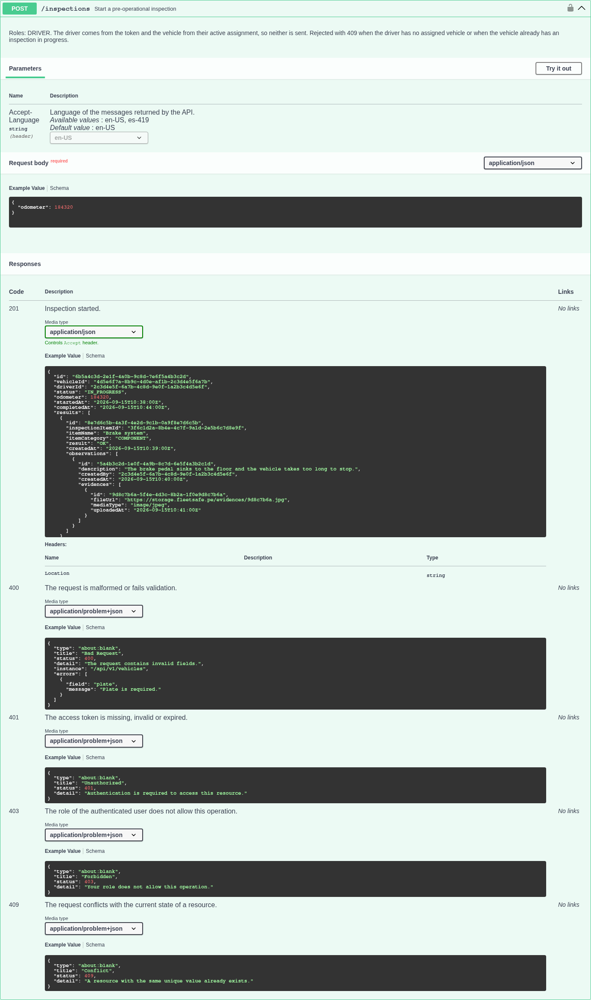

Operación de consulta de la asignación activa del conductor:

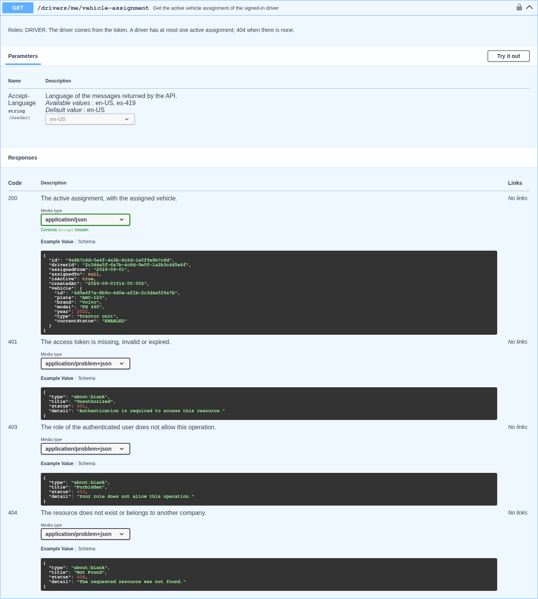

Respuesta de la API simulada desplegada al consultar el catálogo de elementos de inspección:

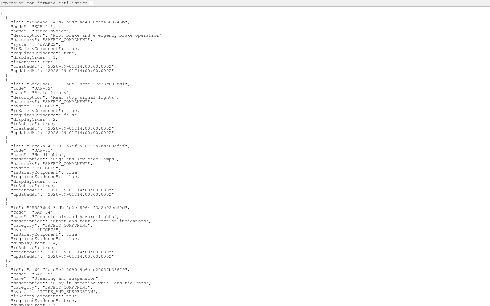

Commits del repositorio Web Services relacionados con la documentación de este sprint (https://github.com/1ASI0729-2620-16692-BitMeisters/Web-Services):

| Commit Id | Commit Message |
|---|---|
| 7a49570 | feat(api): add the shared components and the root document of the contract |
| 3c0a8b0 | feat(iam): add the identity and access contract |
| 5b94c4c | feat(inspection): add the pre-operational inspection contract |
| 4289d3e | docs(api): describe the license and the tags of the contract |
| a90bfff | fix(inspection): expose the audit timestamps of inspection items |
| 3c44080 | feat(fleet): expose the active vehicle assignment of the signed-in driver |

<a id="5227-software-deployment-evidence-for-sprint-review"></a>
#### 5.2.2.7. Software Deployment Evidence for Sprint Review.

En el Sprint 2 se desplegaron la Frontend Web Application y la API simulada que consume, siguiendo la configuración descrita en la sección 5.1.4. El Landing Page continúa publicado en GitHub Pages desde el Sprint 1.

| Producto | Repositorio | Plataforma | Estado | URL |
|---|---|---|---|---|
| Landing Page | https://github.com/1ASI0729-2620-16692-BitMeisters/Landing-Page | GitHub Pages | Desplegado (Sprint 1) | https://1asi0729-2620-16692-bitmeisters.github.io/Landing-Page/ |
| Frontend Web Application | https://github.com/1ASI0729-2620-16692-BitMeisters/Frontend-Web-Application | GitHub Pages con GitHub Actions | Desplegado, versión 0.2.7 | https://1asi0729-2620-16692-bitmeisters.github.io/Frontend-Web-Application/ |
| API simulada (json-server) | https://github.com/1ASI0729-2620-16692-BitMeisters/Frontend-Web-Application | Render | Desplegado | https://fleetsafe-api.onrender.com/api/v1 |
| Backend RESTful API | https://github.com/1ASI0729-2620-16692-BitMeisters/Web-Services | Azure Container Apps | Contrato publicado; despliegue en el Sprint 3 | — |

**1. Configuración de GitHub Pages.** En el repositorio de la Web Application se seleccionó como origen de publicación GitHub Actions, de modo que lo publicado es el resultado de la construcción de Angular y no el contenido de una rama.

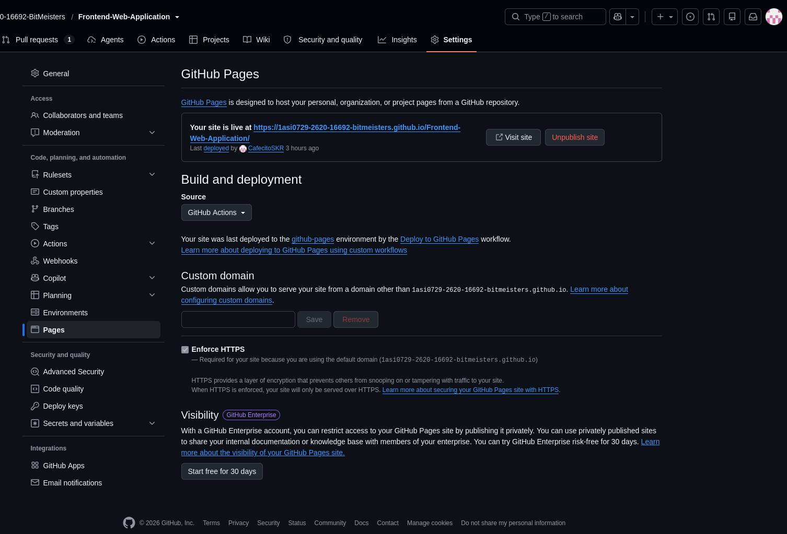

**2. Automatización del despliegue.** El flujo de trabajo `deploy.yml` se ejecuta con cada integración en `main`. Su trabajo `build` instala las dependencias y construye la aplicación con la subruta del repositorio, y su trabajo `deploy` la publica en el entorno `github-pages`.

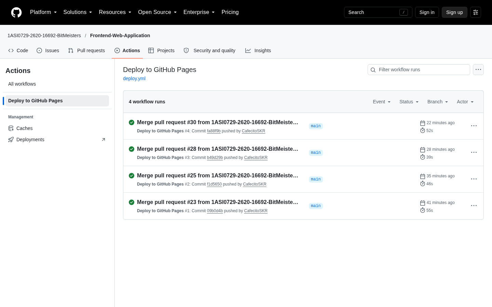

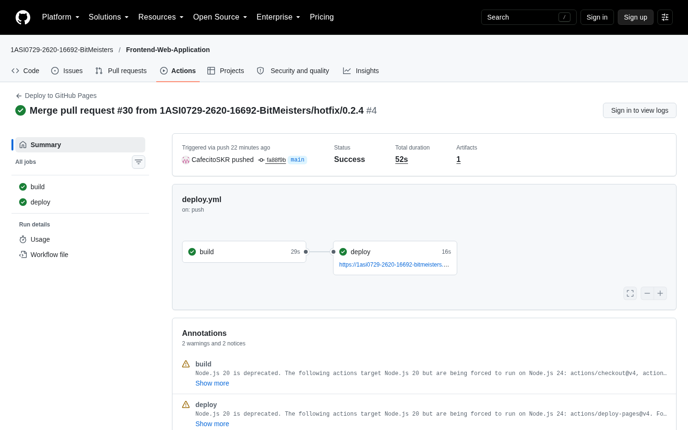

**3. Creación del servicio de la API simulada en Render.** Se creó un Web Service a partir del mismo repositorio, en la región de Virginia y con el plan gratuito.

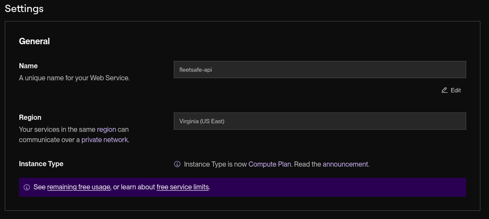

**4. Configuración de construcción y arranque.** Render instala las dependencias con `npm ci` desde la rama `main` y arranca json-server con los datos de `server/db.json` y las reglas de `server/routes.json`.

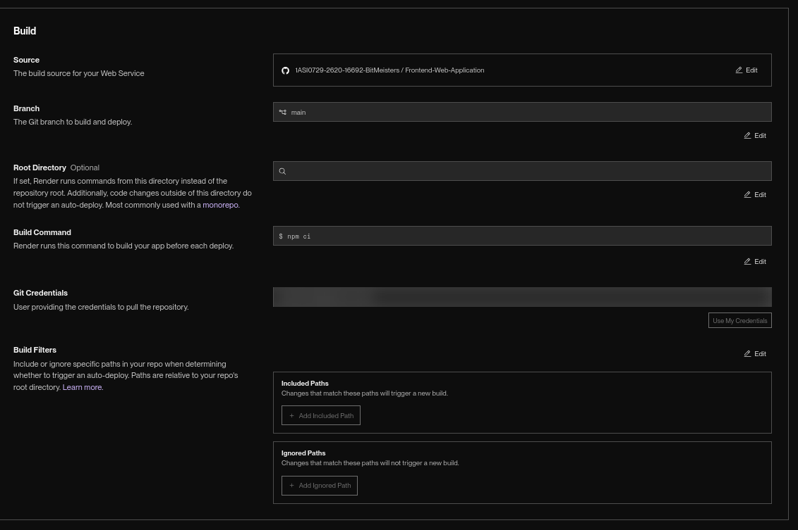

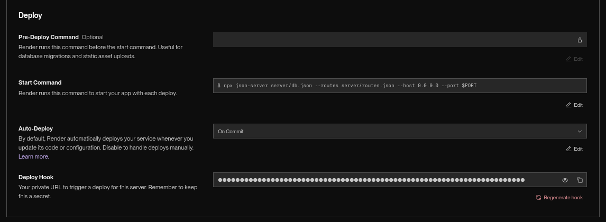

**5. Publicación de versiones.** Cada versión desplegada se preparó en una rama `release/*` o `hotfix/*`, se integró en `main` mediante Pull Request y se publicó como release de GitHub con su tag de Semantic Versioning y sus notas, tomadas del `CHANGELOG.md` del repositorio.

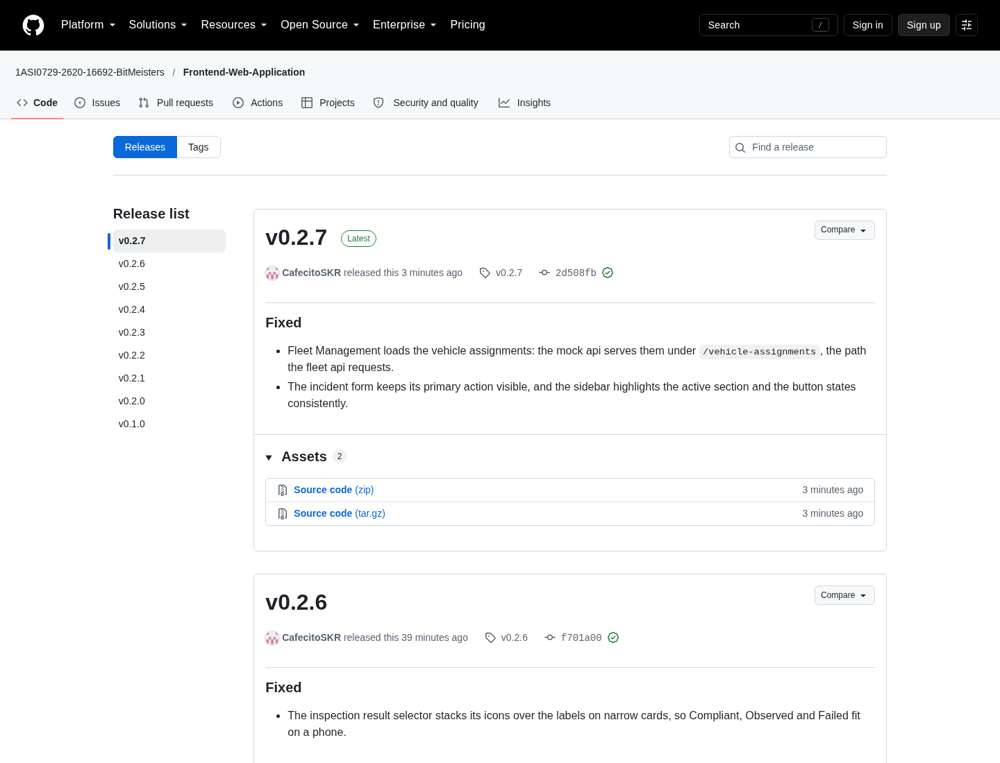

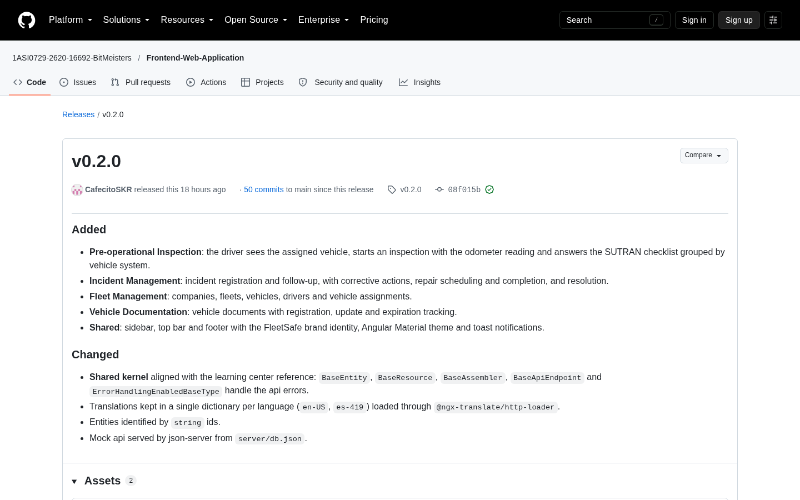

| Versión | Contenido |
|---|---|
| v0.1.0 | Base de la aplicación previa a la alineación con el proyecto de referencia. |
| v0.2.0 | Base compartida alineada con `learning-center` e integración de los cuatro bounded contexts. |
| v0.2.1 | Despliegue de la Web Application en GitHub Pages y de la API simulada en Render. |
| v0.2.2 | Carga de las traducciones en el entorno desplegado. |
| v0.2.3 | Menú lateral, versión visible, datos de incidencias y documentación vehicular sobre la API simulada. |
| v0.2.4 | Reescritura de rutas de la API simulada para las consultas por identificador. |
| v0.2.5 | Menú lateral en pantallas pequeñas y etiquetas de incidencias. |
| v0.2.6 | Selector de resultados de inspección en pantallas estrechas. |
| v0.2.7 | Asignaciones de vehículos en la API simulada, formulario de incidencias y estados de los botones. |

<a id="5228-team-collaboration-insights-during-sprint"></a>
#### 5.2.2.8. Team Collaboration Insights during Sprint.

Cada integrante desarrolló su bounded context en una rama propia a partir de `develop`. Antes de integrar los contextos, la base compartida se alineó con el proyecto de referencia del curso, y cada rama se integró después en `develop` mediante su Pull Request, conservando la autoría de cada commit. Durante el sprint se registraron 159 commits sin contar los de merge: 152 en el repositorio de la Web Application y 7 en el de Web Services.

| Integrante | GitHub Username | Commits en la Web Application | Aporte principal |
|---|---|---:|---|
| Espino Flores, Alejandro | CafecitoSKR | 69 | Base compartida, Pre-Operational Inspection, API simulada, despliegue y contrato OpenAPI |
| Palacin Lazo, Gerardo Valentin | GeraldP03 | 46 | Fleet Management |
| Aguilar Untiveros, Rodrigo Fabrizio | Rodri2712 | 25 | Incident Management y rediseño del layout |
| Santos Torres, Juan Manuel | JuanManuel312 | 9 | Vehicle Documentation |
| Apaza Bocanegra, Elizabeth Noelia | Elizabeth-Apaza | 3 | Catálogo de elementos de inspección |

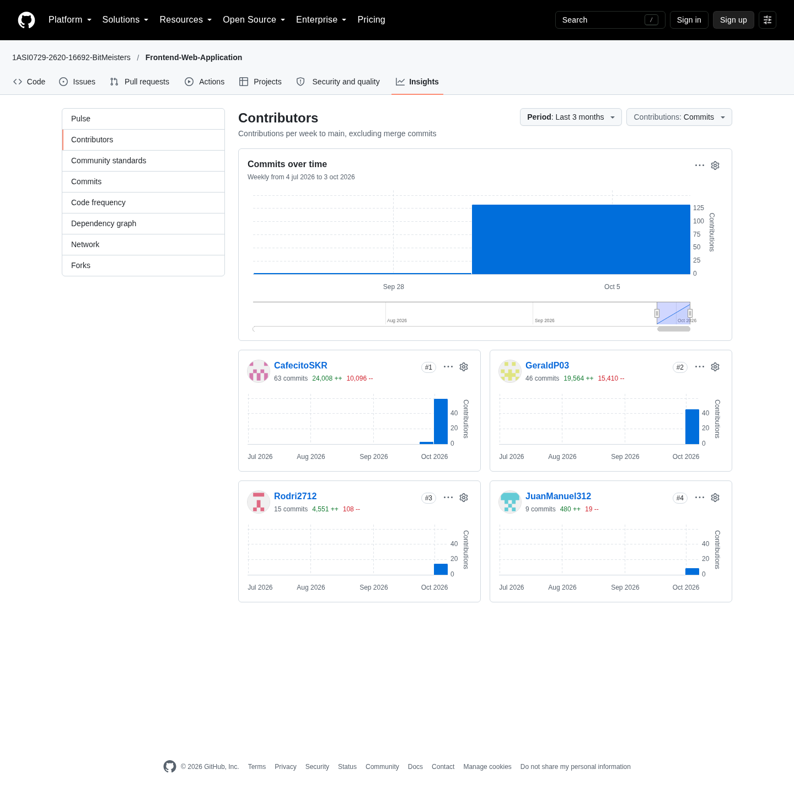

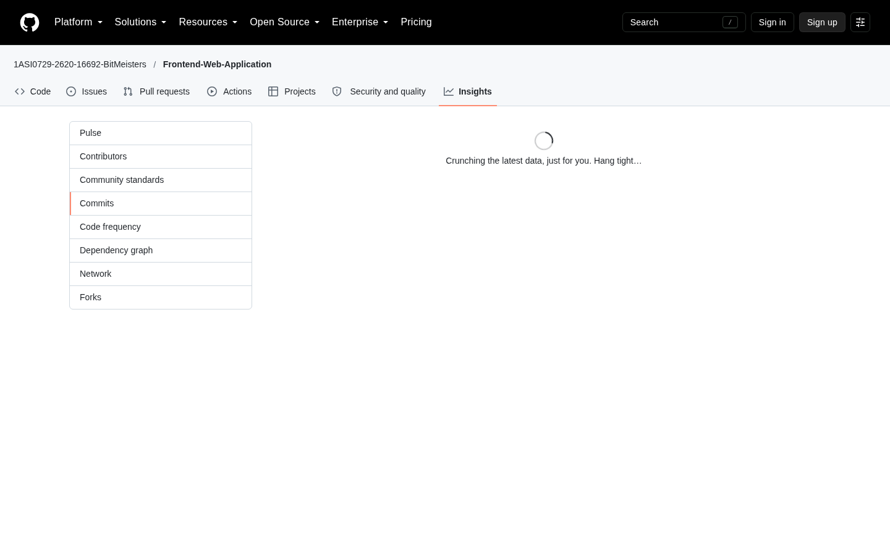

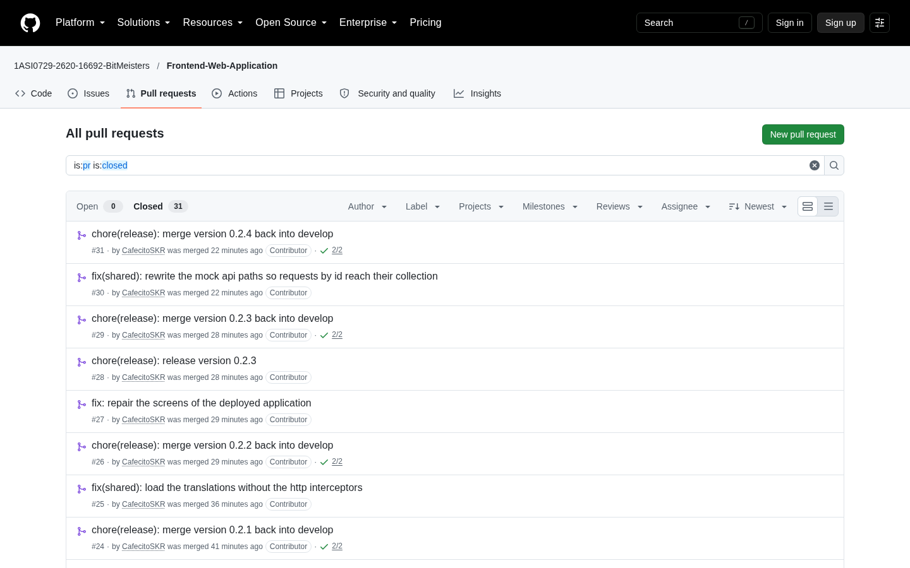

<a id="523-sprint-3"></a>
### 5.2.3. Sprint 3

<a id="5231-sprint-planning-3"></a>
#### 5.2.3.1. Sprint Planning 3.

El Sprint 3 tiene como propósito la primera versión del Backend RESTful API de FleetSafe, exigida para la entrega AV2. En la reunión de planificación, realizada por Google Meet, el equipo acordó que cada integrante implemente en el backend el bounded context que desarrolló en la Web Application, sobre una base común construida con los patrones del proyecto de referencia del curso, y que Alejandro Espino se encargue de Identity and Access y de Vehicle Documentation.

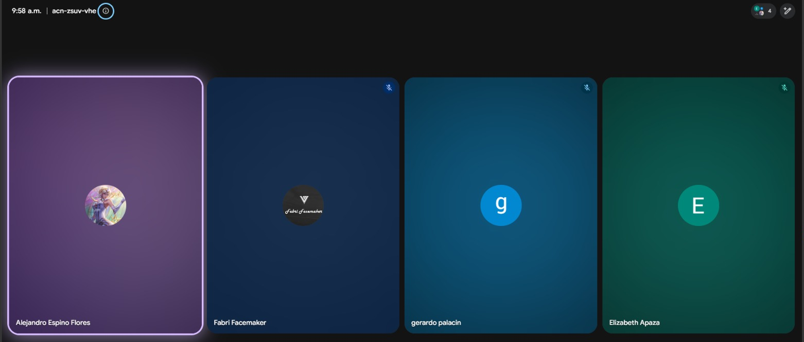

| Sprint 3 | Sprint 3 |
|---|---|
| **Sprint Planning Background** | |
| **Date** | 2026-10-23 |
| **Time** | 09:57 AM |
| **Location** | Reunión virtual por Google Meet |
| **Prepared By** | Espino Flores, Alejandro |
| **Attendees (to planning meeting)** | Espino Flores, Alejandro / Apaza Bocanegra, Elizabeth Noelia / Palacin Lazo, Gerardo Valentin / Aguilar Untiveros, Rodrigo Fabrizio |
| **Sprint 2 Review Summary** | En el Sprint 2 se desplegó la primera versión de la Web Application en GitHub Pages, con los bounded contexts de Pre-Operational Inspection, Incident Management, Fleet Management y Vehicle Documentation, alineados con el proyecto de referencia del curso, y una API simulada en Render. Se reorganizó el código del Landing Page y se documentó el sprint con evidencias de desarrollo, ejecución, servicios, despliegue y colaboración. |
| **Sprint 2 Retrospective Summary** | Como acierto, el equipo destacó que construir primero una base compartida permitió integrar las ramas de cada bounded context. Como oportunidades de mejora, identificó que cada integrante había resuelto de forma distinta las mismas decisiones técnicas antes de esa base, que los commits se concentraron al final del trabajo y que los Pull Requests se integraron sin revisión de otro integrante. Para el Sprint 3 se acordó partir de la base común del backend antes de implementar cada bounded context, registrar las horas de cada tarea durante el sprint y revisar los Pull Requests antes de integrarlos. |
| **Sprint Goal & User Stories** | |
| **Sprint 3 Goal** | **Our focus is on** que la Web Application de FleetSafe deje de depender de una API simulada y trabaje sobre su propio Backend RESTful API. **We believe it delivers** datos persistentes y una autenticación real **to** los supervisores de flota y los conductores de las empresas de transporte de carga. **This will be confirmed when** el Backend RESTful API esté desplegado y documentado con OpenAPI, un usuario pueda iniciar sesión, y las inspecciones, incidencias, vehículos y documentos vehiculares se registren y consulten a través de él. |
| **Sprint 3 Velocity** | 92 |
| **Sum of Story Points** | 92 |

El Sprint 3 compromete las Technical Stories del Backend RESTful API de cada bounded context y las User Stories de la Web Application que completan esos mismos contextos. Cada integrante asume las de su bounded context:

| Integrante | Bounded context | Backend RESTful API | Web Application | Story Points |
|---|---|---|---|---:|
| Espino Flores, Alejandro | Identity and Access · Evaluation and Authorization · Vehicle Documentation | US38, US42, US44 | US07 – US11, US23 – US25 | 51 |
| Palacin Lazo, Gerardo Valentin | Fleet Management | US40 | US12, US14 – US16 | 19 |
| Apaza Bocanegra, Elizabeth Noelia | Pre-Operational Inspection | US41 | US19 – US22 | 17 |
| Aguilar Untiveros, Rodrigo Fabrizio | Incident Management | US43 | — | 5 |

Las User Stories de Incident Management y Vehicle Documentation en la Web Application se entregaron en el Sprint 2, y US12, US14 – US16 de Fleet Management y US07 – US11 de Identity and Access pasan del Sprint 2 a este sprint.

<a id="5232-aspect-leaders-and-collaborators"></a>
#### 5.2.3.2. Aspect Leaders and Collaborators.

Los aspectos del Sprint 3 son los bounded contexts implementados en el Backend RESTful API y en la Web Application, y la base compartida del backend. Cada integrante lidera en el backend el bounded context que desarrolló en la Web Application, y Alejandro Espino lidera además Vehicle Documentation y la base compartida, sobre la que se construyen todos los demás.

| Team Member (Last Name, First Name) | GitHub Username | Identity and Access Leader (L) / Collaborator (C) | Evaluation and Authorization Leader (L) / Collaborator (C) | Pre-Operational Inspection Leader (L) / Collaborator (C) | Incident Management Leader (L) / Collaborator (C) | Fleet Management Leader (L) / Collaborator (C) | Vehicle Documentation Leader (L) / Collaborator (C) | Base compartida del backend Leader (L) / Collaborator (C) |
|---|---|---|---|---|---|---|---|---|
| Espino Flores, Alejandro | CafecitoSKR | L | L | C | C | C | L | L |
| Apaza Bocanegra, Elizabeth Noelia | Elizabeth-Apaza | — | — | L | — | — | — | C |
| Aguilar Untiveros, Rodrigo Fabrizio | Rodri2712 | — | — | — | L | — | — | C |
| Palacin Lazo, Gerardo Valentin | GeraldP03 | — | — | — | — | L | — | C |

<a id="5233-sprint-backlog-3"></a>
#### 5.2.3.3. Sprint Backlog 3.

El objetivo del Sprint 3 es que la Web Application de FleetSafe deje de depender de una API simulada y trabaje sobre su propio Backend RESTful API, desplegado y documentado. El Sprint Backlog incluye una tarea por cada User Story comprometida en la planificación y la base compartida del backend, sobre la que se construyen los bounded contexts.

Las horas de cada tarea terminada se estimaron con el mismo método del Sprint 2, a partir de la actividad registrada en sus commits: cada sesión de trabajo cuenta su duración más dos horas de trabajo previo a su primer commit, y una pausa de más de noventa minutos entre commits inicia una nueva sesión. Las tareas pendientes registran sus horas al terminar.

Tablero del Sprint 3: https://trello.com/b/6WgfBLcZ/fleetsafe-sprint-3

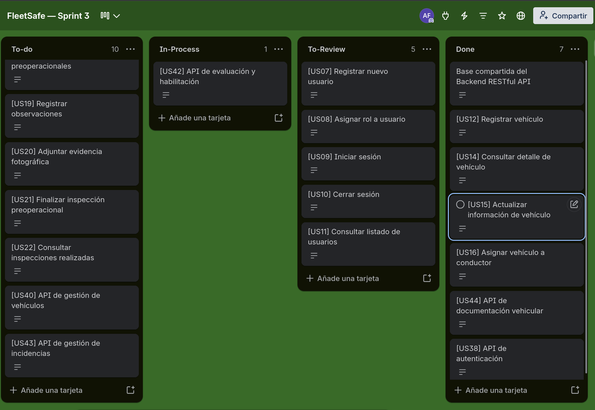

| Sprint # | Story Id | Story Title | Task Id | Task Title | Task Description | Estimation (Hours) | Assigned To | Status (To-do / In-Process / To-Review / Done) |
|---|---|---|---|---|---|---:|---|---|
| Sprint 3 | — | Base compartida | T01 | Construir la base compartida del Backend RESTful API | Proyecto Spring Boot sobre PostgreSQL con la estructura del proyecto de referencia del curso: patrón `Result`, nombres de tablas, manejo global de errores traducido, agregados sin dependencias de JPA, imagen Docker y entrega continua a GitHub Container Registry. | 8 | Alejandro Espino | Done |
| Sprint 3 | US38 | API de autenticación | T02 | Implementar la autenticación y la gestión de usuarios | Login con JWT, Spring Security con roles, administrador sembrado al arrancar y los endpoints `/auth/login` y `/users`. | 2 | Alejandro Espino | Done |
| Sprint 3 | US09 | Iniciar sesión | T03 | Implementar el inicio de sesión en la Web Application | Pantalla de inicio de sesión, sesión guardada hasta que caduca el token, interceptor que envía el token y guard en las rutas. | 1 | Alejandro Espino | To-Review |
| Sprint 3 | US10 | Cerrar sesión | T04 | Implementar el cierre de sesión | Nombre y rol del usuario en la barra superior y botón para cerrar sesión. | 1 | Alejandro Espino | To-Review |
| Sprint 3 | US07 | Registrar nuevo usuario | T05 | Implementar el alta de usuarios | Formulario de alta de usuario con su rol, solo para el administrador. | 1 | Alejandro Espino | To-Review |
| Sprint 3 | US08 | Asignar rol a usuario | T06 | Implementar el cambio de rol y de estado | Cambio de rol y activación o desactivación de cada usuario desde el listado. | 1 | Alejandro Espino | To-Review |
| Sprint 3 | US11 | Consultar listado de usuarios | T07 | Implementar el listado de usuarios | Listado paginado de los usuarios de la empresa con filtro por rol y estado. | 1 | Alejandro Espino | To-Review |
| Sprint 3 | US42 | API de evaluación y habilitación | T08 | Implementar la evaluación y la habilitación operativa | Reglas de evaluación, habilitación del vehículo, historial y levantamiento de bloqueos. Falta `POST /inspections/{id}/evaluate`, que depende del backend de inspecciones (US41). | 5 | Alejandro Espino | In-Process |
| Sprint 3 | US23 | Evaluar resultados de inspección | T09 | Mostrar el resultado de la evaluación de una inspección | Vista del resultado de la evaluación de una inspección completada. | — | Alejandro Espino | To-do |
| Sprint 3 | US24 | Determinar estado del vehículo | T10 | Mostrar el estado operativo del vehículo | Vista del estado habilitado, observado o no habilitado de cada vehículo. | — | Alejandro Espino | To-do |
| Sprint 3 | US25 | Consultar vehículos por estado | T11 | Implementar la consulta de vehículos por estado | Listado de vehículos filtrado por su estado operativo. | — | Alejandro Espino | To-do |
| Sprint 3 | US44 | API de documentación vehicular | T12 | Implementar la documentación vehicular | Tipos de documento, documentos de cada vehículo con su vigencia, documentos próximos a vencer y recálculo diario del estado. | 2 | Alejandro Espino | Done |
| Sprint 3 | US41 | API de inspecciones preoperacionales | T13 | Implementar las inspecciones preoperacionales | Registro, consulta y cierre de inspecciones preoperacionales. | — | Elizabeth Apaza | To-do |
| Sprint 3 | US19 | Registrar observaciones | T14 | Implementar el registro de observaciones | Registro de observaciones sobre un elemento de la inspección. | — | Elizabeth Apaza | To-do |
| Sprint 3 | US20 | Adjuntar evidencia fotográfica | T15 | Implementar la evidencia fotográfica | Adjuntar una foto como evidencia de una observación. | — | Elizabeth Apaza | To-do |
| Sprint 3 | US21 | Finalizar inspección preoperacional | T16 | Implementar el cierre de la inspección | Finalizar la inspección cuando todos los elementos tienen resultado. | — | Elizabeth Apaza | To-do |
| Sprint 3 | US22 | Consultar inspecciones realizadas | T17 | Implementar el historial de inspecciones | Listado de las inspecciones realizadas. | — | Elizabeth Apaza | To-do |
| Sprint 3 | US40 | API de gestión de vehículos | T18 | Implementar la gestión de vehículos | Registro, consulta y actualización de vehículos, flotas y asignaciones. | — | Gerardo Palacin | To-do |
| Sprint 3 | US12 | Registrar vehículo | T19 | Implementar el registro de vehículos | Formulario de registro de vehículo. | 1 | Gerardo Palacin | Done |
| Sprint 3 | US14 | Consultar detalle de vehículo | T20 | Implementar el detalle de vehículo | Vista de detalle de un vehículo. | 1 | Gerardo Palacin | Done |
| Sprint 3 | US15 | Actualizar información de vehículo | T21 | Implementar la edición de vehículos | Edición de la información de un vehículo. | 1 | Gerardo Palacin | Done |
| Sprint 3 | US16 | Asignar vehículo a conductor | T22 | Implementar la asignación de vehículos | Asignación de un vehículo a un conductor. | 1 | Gerardo Palacin | Done |
| Sprint 3 | US43 | API de gestión de incidencias | T23 | Implementar la gestión de incidencias | Registro, consulta y seguimiento de incidencias. | — | Rodrigo Aguilar | To-do |

<a id="5234-development-evidence-for-sprint-review"></a>
#### 5.2.3.4. Development Evidence for Sprint Review.

Durante el Sprint 3 se construyó la primera versión del Backend RESTful API en el repositorio Web Services: la base compartida alineada con el proyecto de referencia del curso, el bounded context de Identity and Access con autenticación por JWT y gestión de usuarios, el de Evaluation and Authorization con sus reglas, habilitaciones y levantamiento de bloqueos, y el de Vehicle Documentation con el control de vigencia de los documentos, además de la imagen Docker y el flujo de entrega continua que la publica. En la Web Application se completó el bounded context de Fleet Management, se incorporaron el inicio y cierre de sesión contra el backend y la gestión de usuarios, y se enlazaron los términos y la política de privacidad. El Landing Page pasó a traducirse por claves, con inglés por defecto, y se le añadieron las páginas legales.

La tabla recoge los commits del sprint integrados en los repositorios, sin los commits de merge, en orden cronológico. La columna *Branch* indica la rama del Pull Request con el que cada commit se integró en `develop`.

| Repository | Branch | Commit Id | Commit Message | Commit Message Body | Commited on (Date) |
|---|---|---|---|---|---|
| Web-Services | feature/platform-foundation | a06bb5b | build: set up the spring boot platform on postgresql | — | 2026-10-23 |
| Web-Services | feature/platform-foundation | de152bb | feat(shared): add the result pattern, the table naming strategy and the global exception handler | — | 2026-10-23 |
| Web-Services | feature/platform-foundation | 8316cb0 | docs: describe how to run and extend the platform | — | 2026-10-23 |
| Web-Services | feature/platform-foundation | c6548b3 | build: pin lombok to the release that supports java 27 | — | 2026-10-23 |
| Web-Services | chore/pom-developers | 0f636de | build: list the team members as developers of the platform | — | 2026-10-23 |
| Web-Services | feature/shared-auditable-base | fe3669f | feat(shared): add the auditable aggregate root and model with uuid identifiers | — | 2026-10-23 |
| Web-Services | feature/evaluation-rules | 705bef3 | feat(evaluation): define and deactivate the evaluation rules of the company | — | 2026-10-23 |
| Web-Services | chore/docker-compose | 462a67f | build: run postgresql 18 locally with docker compose | — | 2026-10-23 |
| Frontend-Web-Application | feature/fleet-management | 0e70c5d | feat(fleet-management): add policies, commands and enum values to domain layer | — | 2026-10-24 |
| Frontend-Web-Application | feature/fleet-management | 2e16bf6 | feat(fleet-management): update entities in domain layer | — | 2026-10-24 |
| Frontend-Web-Application | feature/fleet-management | 15c6463 | feat(fleet-management): add vehicle inspection, response and assembler in infrastructure layer | — | 2026-10-24 |
| Frontend-Web-Application | feature/fleet-management | 0d0f4d2 | feat(fleet-management): update fleet api and vehicle assigment in infrastructure layer | — | 2026-10-24 |
| Frontend-Web-Application | feature/fleet-management | e801796 | feat(fleet-management): update fleet internationalization terms | — | 2026-10-24 |
| Frontend-Web-Application | feature/fleet-management | 3c6f4f0 | feat(fleet-management): complete the fleet store with vehicle and assignment use cases | — | 2026-10-24 |
| Frontend-Web-Application | feature/fleet-management | 7a57caf | feat(fleet-management): add the vehicle status badge component | — | 2026-10-24 |
| Frontend-Web-Application | feature/fleet-management | 04d8004 | feat(fleet-management): show the fleet overview with vehicle counts by status | — | 2026-10-24 |
| Frontend-Web-Application | feature/fleet-management | 14b5d96 | feat(fleet-management): add search, status filter and pagination to the vehicle list | — | 2026-10-24 |
| Frontend-Web-Application | feature/fleet-management | 31daf1f | feat(fleet-management): add the vehicle form to register and update vehicles | — | 2026-10-24 |
| Frontend-Web-Application | feature/fleet-management | 7808b20 | feat(fleet-management): add the vehicle detail with assignment history | — | 2026-10-24 |
| Frontend-Web-Application | feature/fleet-management | 7945aed | feat(fleet-management): show license status and assigned vehicle in the driver list | — | 2026-10-24 |
| Frontend-Web-Application | feature/fleet-management | b7ba5e7 | feat(fleet-management): add the assignment form with history and end action | — | 2026-10-24 |
| Frontend-Web-Application | feature/fleet-management | 6bf160f | feat(fleet-management): add titles to the fleet routes | — | 2026-10-24 |
| Web-Services | feature/inspection-evaluation | eee3ddc | feat(evaluation): evaluate inspections and keep the operational status of each vehicle | — | 2026-10-26 |
| Web-Services | feature/lift-block | 6fbe634 | feat(evaluation): lift the block of a vehicle with a reason and a responsible user | — | 2026-10-26 |
| Web-Services | feature/evaluation-contract | aed9296 | docs(openapi): add the evaluation and authorization contract | — | 2026-10-26 |
| Web-Services | feature/missing-message-fallback | 5774c91 | fix(shared): answer with the message key when a translation is missing | — | 2026-10-26 |
| Web-Services | feature/docker-image | 52465ff | build: package the platform as a java 27 docker image | — | 2026-10-26 |
| Web-Services | feature/cors-and-openapi-info | 8bb8ebf | feat(shared): allow the web application origins and describe the api in swagger | — | 2026-10-26 |
| Web-Services | feature/container-delivery | a5614c6 | ci: test the platform and publish its image to the github container registry | — | 2026-10-26 |
| Web-Services | fix/microsecond-timestamps | 8a39e9b | fix(shared): generate timestamps at the precision postgresql stores | — | 2026-10-26 |
| Web-Services | feature/iam-users | 63af39d | feat(iam): model the users of the platform | — | 2026-10-26 |
| Web-Services | feature/iam-users | 6ca58a0 | feat(iam): sign in the users with a json web token | — | 2026-10-26 |
| Web-Services | feature/iam-users | 7584da5 | test(iam): translate the user errors and verify the user flow against postgresql | — | 2026-10-26 |
| Web-Services | feature/iam-users | d3bf99b | feat(iam): hash the passwords of the users with bcrypt | — | 2026-10-26 |
| Web-Services | feature/iam-users | fb7bda9 | feat(iam): persist and manage the users of each company | — | 2026-10-26 |
| Web-Services | refactor/evaluation-persistence | d40aa80 | refactor(evaluation): keep the evaluation rules free of persistence concerns | — | 2026-10-26 |
| Web-Services | refactor/evaluation-persistence | 528f656 | refactor(evaluation): keep evaluations and authorizations free of persistence concerns | — | 2026-10-26 |
| Web-Services | refactor/evaluation-persistence | dbecc1f | refactor(shared): drop the persistence-aware base classes of the domain | — | 2026-10-26 |
| Web-Services | feature/iam-endpoints | b016a51 | feat(iam): require a valid bearer token on every protected endpoint | — | 2026-10-26 |
| Web-Services | feature/iam-endpoints | f3840a6 | feat(iam): seed the first administrator at startup | — | 2026-10-26 |
| Web-Services | feature/iam-endpoints | 7336b6c | feat(iam): sign in through the authentication endpoint | — | 2026-10-26 |
| Web-Services | feature/iam-endpoints | 15c5b3d | docs: explain how to sign in and call the protected endpoints | — | 2026-10-26 |
| Web-Services | feature/iam-endpoints | 6d454a0 | feat(iam): manage the users of each company through the users endpoint | — | 2026-10-26 |
| Web-Services | feature/evaluation-endpoints | 065de85 | feat(evaluation): expose the evaluation rules endpoints | — | 2026-10-26 |
| Web-Services | feature/evaluation-endpoints | d82e805 | feat(evaluation): expose the operational status, history and block lifts of each vehicle | — | 2026-10-26 |
| Landing-Page | feature/i18n-by-keys | dbf32a8 | feat: translate the landing page by keys with english as the default language | — | 2026-10-26 |
| Landing-Page | feature/i18n-by-keys | 8e13e3a | feat: link the terms of use and the privacy policy from the footer | — | 2026-10-26 |
| Landing-Page | feature/i18n-by-keys | 8180446 | fix: darken the orange of buttons and small text to meet wcag aa contrast | — | 2026-10-26 |
| Frontend-Web-Application | feature/legal-footer-links | d34e227 | feat: link the terms of use and the privacy policy from the footer | — | 2026-10-26 |
| Frontend-Web-Application | release/0.3.0 | 9ebea94 | chore(release): prepare version 0.3.0 | — | 2026-10-26 |
| Web-Services | feature/vehicle-documentation | c46be97 | chore(config): set the vehicle documentation time zone and status recalculation schedule | — | 2026-10-28 |
| Web-Services | feature/vehicle-documentation | dddba3e | feat(documentation): register vehicle documents and list the ones about to expire | — | 2026-10-28 |
| Web-Services | feature/vehicle-documentation | fa053fb | docs(openapi): add the vehicle documentation contract | — | 2026-10-28 |
| Web-Services | feature/vehicle-documentation | 6ff56fd | refactor(documentation): keep the calendar out of the rest layer and cover the daily recalculation | — | 2026-10-28 |
| Web-Services | feature/vehicle-documentation | acf69e6 | docs(openapi): drop the days until expiration from the vehicle document | — | 2026-10-28 |
| Frontend-Web-Application | feature/iam-sign-in | de6ffb2 | chore(config): add the url of the platform backend | — | 2026-10-28 |
| Frontend-Web-Application | feature/iam-sign-in | 302c1eb | feat(iam): sign in with the platform account and protect the routes | — | 2026-10-28 |
| Frontend-Web-Application | feature/iam-sign-in | 35b222f | feat(iam): show the signed-in user and sign out from the top bar | — | 2026-10-28 |
| Frontend-Web-Application | feature/iam-users | 6cbdd01 | chore(config): point local development to the backend running on this machine | — | 2026-10-28 |
| Frontend-Web-Application | feature/iam-users | 9b159dd | chore(config): add the path of the users endpoint | — | 2026-10-28 |
| Frontend-Web-Application | feature/iam-users | d8e04bb | feat(iam): list the users of the company by role and status | — | 2026-10-28 |
| Frontend-Web-Application | feature/iam-users | 7eb02f3 | feat(iam): let the administrator open accounts in the company | — | 2026-10-28 |
| Frontend-Web-Application | feature/iam-users | 807ea00 | feat(iam): let the administrator change the role and status of an account | — | 2026-10-28 |
| Frontend-Web-Application | chore/mock-vehicle-uuids | a649948 | chore(server): identify the mock vehicles by uuid like the platform backend | — | 2026-10-28 |

<a id="5236-services-documentation-evidence-for-sprint-review"></a>
#### 5.2.3.6. Services Documentation Evidence for Sprint Review.

En el Sprint 3 el Backend RESTful API deja de ser un contrato y pasa a estar implementado. Springdoc genera su documentación OpenAPI a partir de los controladores y la publica con Swagger UI en el propio servicio desplegado; cada operación indica los roles que la pueden ejecutar y las respuestas de error, que siguen el formato Problem Details y se traducen según la cabecera `Accept-Language`. El contrato escrito a mano del repositorio se amplió con los bounded contexts implementados en este sprint.

- Documentación del servicio desplegado: https://fleetsafe-api.nicesky-02088f36.chilecentral.azurecontainerapps.io/swagger-ui/index.html
- Contrato: https://github.com/1ASI0729-2620-16692-BitMeisters/Web-Services/blob/develop/openapi/openapi.yaml

Todas las rutas cuelgan de `/api/v1`. Salvo `/auth/login`, todas exigen el token de acceso en la cabecera `Authorization: Bearer <token>`: sin él responden `401`, y con un rol que no tiene permiso, `403`.

| Endpoint | Acciones implementadas | Verbo HTTP | Sintaxis de llamada | Parámetros | Response |
|---|---|---|---|---|---|
| `/auth/login` | Iniciar sesión | POST | `POST /api/v1/auth/login` | Cuerpo: `email`, `password` | `200` con `accessToken`, `tokenType`, `expiresIn` y el usuario (`id`, `companyId`, `email`, `firstName`, `lastName`, `role`, `isActive`). `401` si el correo o la contraseña no son correctos, o la cuenta está inactiva. |
| `/users` | Consultar los usuarios de la empresa | GET | `GET /api/v1/users?role=DRIVER&isActive=true&page=0&size=20&sort=lastName,asc` | Opcionales: `role`, `isActive`, `page`, `size` (1–100), `sort` (`lastName`, `email` o `createdAt`) | `200` con `content` (los usuarios) y `page` (`number`, `size`, `totalElements`, `totalPages`). Solo `ADMINISTRATOR`. |
| `/users` | Registrar un usuario en la empresa del administrador | POST | `POST /api/v1/users` | Cuerpo: `email`, `password` (8–72 caracteres), `firstName`, `lastName`, `role` (`ADMINISTRATOR` · `FLEET_SUPERVISOR` · `DRIVER`) | `201` con el usuario creado; `400` si los datos no son válidos; `409` si el correo ya está registrado. Solo `ADMINISTRATOR`. |
| `/users/{id}` | Consultar un usuario | GET | `GET /api/v1/users/{id}` | `id`: UUID del usuario | `200` con el usuario; `403` si no es la propia cuenta ni la consulta un administrador; `404` si no existe en la empresa. |
| `/users/{id}` | Cambiar el nombre, el rol o el estado de un usuario | PATCH | `PATCH /api/v1/users/{id}` | `id`; cuerpo con al menos uno de `firstName`, `lastName`, `role`, `isActive` | `200` con el usuario actualizado; `400` si el cuerpo está vacío o no es válido; `404` si no existe. Solo `ADMINISTRATOR`. |
| `/evaluation-rules` | Consultar las reglas de evaluación activas | GET | `GET /api/v1/evaluation-rules` | — | `200` con `[{ "id", "inspectionItemId", "name", "foundResult", "resultingImpact", "description", "isActive" }, …]`. `FLEET_SUPERVISOR` y `ADMINISTRATOR`. |
| `/evaluation-rules` | Definir una regla de evaluación | POST | `POST /api/v1/evaluation-rules` | Cuerpo: `inspectionItemId`, `name`, `foundResult` (`OK` · `OBSERVED` · `FAIL`), `resultingImpact` (`NONE` · `OBSERVED` · `BLOCKING`), `description` | `201` con la regla; `409` si ya hay una regla activa para ese elemento y resultado. Solo `ADMINISTRATOR`. |
| `/evaluation-rules/{id}` | Consultar una regla | GET | `GET /api/v1/evaluation-rules/{id}` | `id`: UUID de la regla | `200` con la regla; `404` si no existe. |
| `/evaluation-rules/{id}/deactivation` | Desactivar una regla | POST | `POST /api/v1/evaluation-rules/{id}/deactivation` | `id` | `200` con la regla inactiva; `404` si no existe; `409` si ya estaba inactiva. Solo `ADMINISTRATOR`. |
| `/vehicles/{id}/status` | Consultar si un vehículo puede operar | GET | `GET /api/v1/vehicles/{id}/status` | `id`: UUID del vehículo | `200` con la habilitación vigente: `status` (`ENABLED` · `OBSERVED` · `NOT_ENABLED`), `isOverride`, `authorizedAt`…; `404` si el vehículo aún no tiene habilitación. |
| `/vehicles/{id}/authorizations` | Consultar el historial de habilitaciones | GET | `GET /api/v1/vehicles/{id}/authorizations` | `id` | `200` con las habilitaciones del vehículo, de la más reciente a la más antigua. `FLEET_SUPERVISOR` y `ADMINISTRATOR`. |
| `/vehicles/{id}/block-lifts` | Levantar el bloqueo de un vehículo no habilitado | POST | `POST /api/v1/vehicles/{id}/block-lifts` | `id`; cuerpo: `reason` | `201` con la nueva habilitación, marcada como excepción y con el usuario del token como responsable; `404` si no tiene habilitación; `409` si no está bloqueado. |
| `/operational-authorizations/overrides` | Consultar los bloqueos levantados en un periodo | GET | `GET /api/v1/operational-authorizations/overrides?from=2026-10-01T00:00:00Z&to=2026-10-31T23:59:59Z` | `from`, `to` en ISO-8601 | `200` con las excepciones del periodo; `400` si el periodo no es válido. |
| `/document-types` | Consultar y registrar tipos de documento | GET · POST | `GET /api/v1/document-types` · `POST /api/v1/document-types` | Cuerpo de `POST`: `code`, `name`, `description`, `isRequired` | `200` con el catálogo; `201` con el tipo creado; `409` si el código ya existe. `POST` solo `ADMINISTRATOR`. |
| `/vehicles/{vehicleId}/documents` | Registrar y consultar los documentos de un vehículo | POST · GET | `POST /api/v1/vehicles/{vehicleId}/documents` · `GET /api/v1/vehicles/{vehicleId}/documents` | `vehicleId`; cuerpo de `POST`: `documentTypeId`, `number`, `issueDate`, `expirationDate`, `fileUrl` | `201` con el documento y su `status` (`VALID` · `EXPIRING` · `EXPIRED`), calculado a partir del vencimiento; `200` con los documentos ordenados por vencimiento; `422` si el tipo de documento no existe. |
| `/vehicles/{vehicleId}/documents/{documentId}` | Actualizar un documento | PUT | `PUT /api/v1/vehicles/{vehicleId}/documents/{documentId}` | `vehicleId`, `documentId`; el mismo cuerpo que al registrar | `200` con el documento y su estado recalculado; `404` si el vehículo no tiene ese documento. |
| `/documents` | Consultar los documentos de todos los vehículos | GET | `GET /api/v1/documents` | — | `200` con los documentos ordenados por vencimiento. `FLEET_SUPERVISOR` y `ADMINISTRATOR`. |
| `/documents/expiring` | Consultar los documentos próximos a vencer | GET | `GET /api/v1/documents/expiring?days=30` | Opcional: `days` (0–365, por defecto 30) | `200` con los documentos que vencen entre hoy y ese número de días; `400` si `days` está fuera de rango. |

Commits del repositorio Web Services relacionados con la documentación de este sprint (https://github.com/1ASI0729-2620-16692-BitMeisters/Web-Services):

| Commit Id | Commit Message |
|---|---|
| 8316cb0 | docs: describe how to run and extend the platform |
| aed9296 | docs(openapi): add the evaluation and authorization contract |
| 8bb8ebf | feat(shared): allow the web application origins and describe the api in swagger |
| fa053fb | docs(openapi): add the vehicle documentation contract |
| acf69e6 | docs(openapi): drop the days until expiration from the vehicle document |

<a id="5237-software-deployment-evidence-for-sprint-review"></a>
#### 5.2.3.7. Software Deployment Evidence for Sprint Review.

En el Sprint 3 se desplegó la primera versión del Backend RESTful API en Azure, siguiendo la configuración descrita en la sección 5.1.4. La imagen del servicio se construye y se publica desde el repositorio `Web-Services`, y se ejecuta en Azure Container Apps sobre una base Azure Database for PostgreSQL. El Landing Page y la Web Application continúan publicados en GitHub Pages.

| Producto | Repositorio | Plataforma | Estado | URL |
|---|---|---|---|---|
| Landing Page | https://github.com/1ASI0729-2620-16692-BitMeisters/Landing-Page | GitHub Pages | Desplegado | https://1asi0729-2620-16692-bitmeisters.github.io/Landing-Page/ |
| Frontend Web Application | https://github.com/1ASI0729-2620-16692-BitMeisters/Frontend-Web-Application | GitHub Pages con GitHub Actions | Desplegado | https://1asi0729-2620-16692-bitmeisters.github.io/Frontend-Web-Application/ |
| Backend RESTful API | https://github.com/1ASI0729-2620-16692-BitMeisters/Web-Services | Azure Container Apps, con la imagen en GitHub Container Registry | Desplegado desde `develop` | https://fleetsafe-api.nicesky-02088f36.chilecentral.azurecontainerapps.io/swagger-ui/index.html |
| Base de datos | — | Azure Database for PostgreSQL – Flexible Server | Desplegada | `fleet-safe-db.postgres.database.azure.com` |

**1. Registro de los proveedores de recursos.** Antes de crear los recursos se comprobó que la suscripción Azure for Students tiene registrados los proveedores que necesitan: `Microsoft.DBforPostgreSQL` para la base de datos, `Microsoft.App` para Azure Container Apps y `Microsoft.OperationalInsights` para los registros.

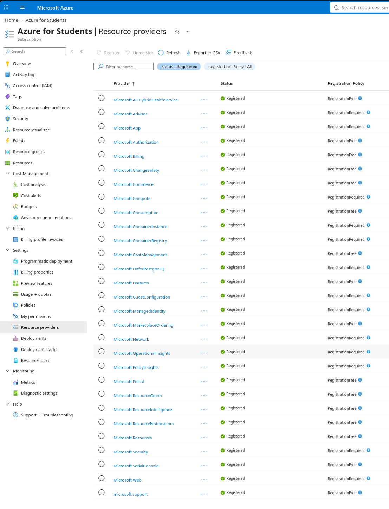

**2. Configuración del servidor de base de datos.** Se creó el servidor `fleet-safe-db` con PostgreSQL 18 en el grupo de recursos `rg-fleetsafe`, región `Chile Central`. Se eligió el nivel *Burstable* `Standard_B1ms` con 32 GiB de almacenamiento, que entran en la capa gratuita, sin alta disponibilidad, y la autenticación con usuario y contraseña de PostgreSQL, que es la que utiliza el servicio.

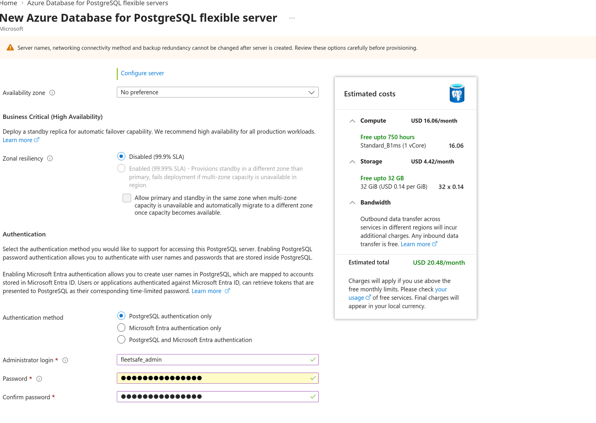

**3. Configuración de red.** El servidor admite conexiones desde los servicios de Azure, que es como lo alcanza Azure Container Apps, sin abrirlo a cualquier dirección de internet.

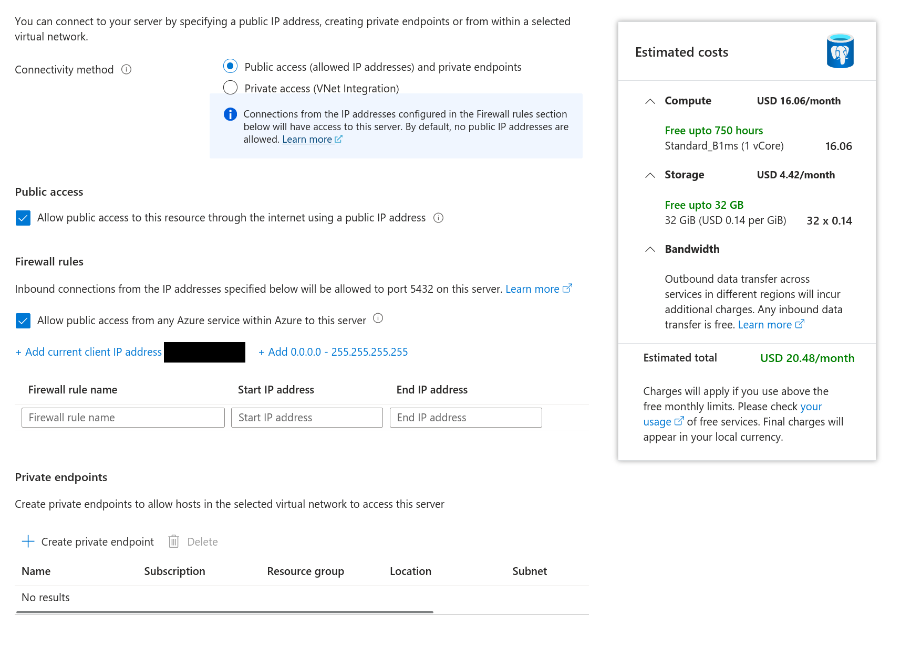

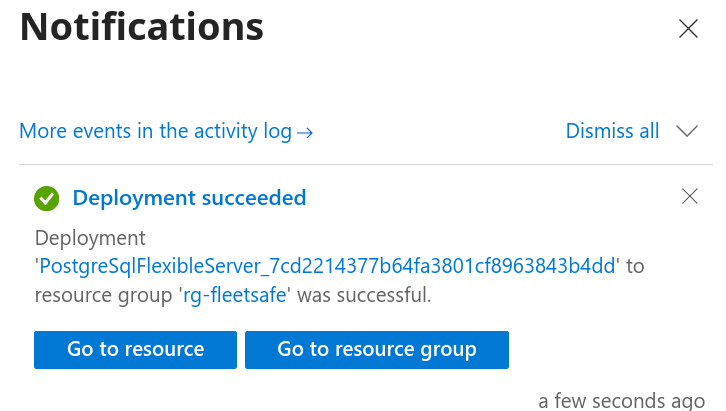

**4. Creación de la base de datos.** Sobre el servidor se creó la base `fleetsafe`, cuyas tablas genera Spring Data JPA al arrancar el servicio.

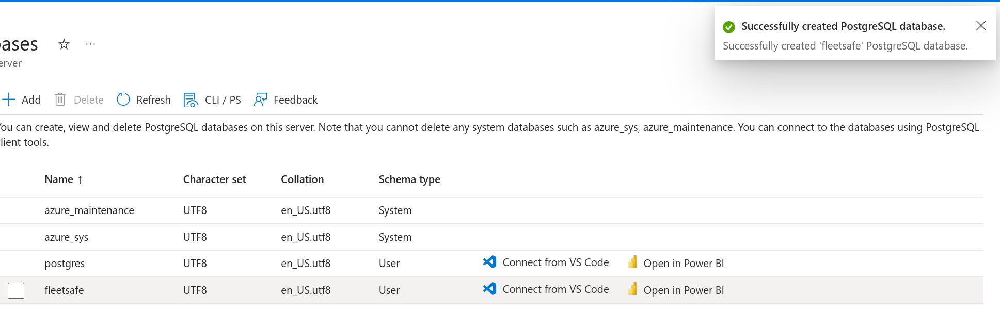

**5. Construcción y publicación de la imagen.** El flujo de trabajo `Delivery` de GitHub Actions ejecuta las pruebas del servicio contra una base PostgreSQL 18 temporal en cada Pull Request y, al integrar en `develop`, construye la imagen y la publica en GitHub Container Registry.

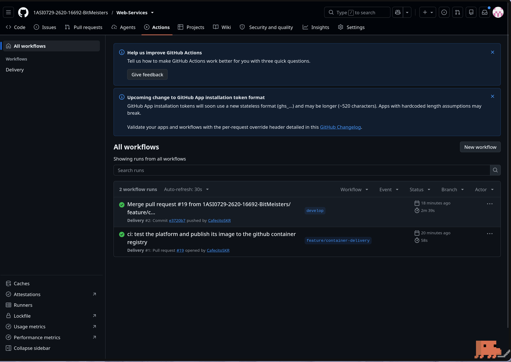

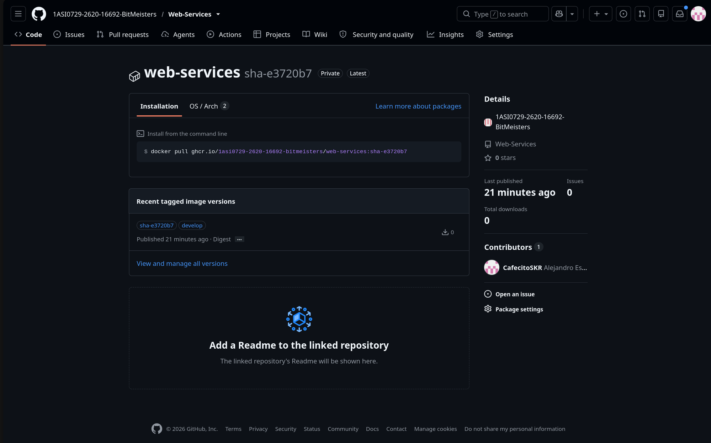

**6. Visibilidad de la imagen.** El paquete se hizo público para que Azure Container Apps descargue la imagen sin credenciales. La imagen solo contiene el código compilado, que ya es público en el repositorio; las credenciales de la base se entregan como secreto en tiempo de ejecución.

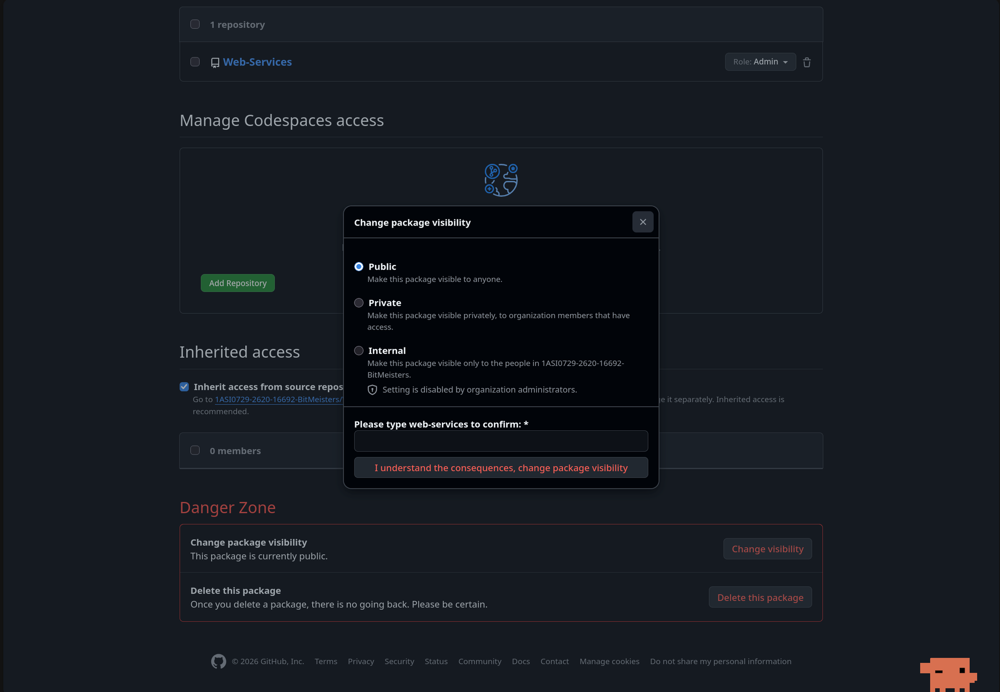

**7. Creación del entorno de Azure Container Apps.** El entorno `cae-fleetsafe` se creó con Azure CLI en la misma región que la base de datos, y generó su espacio de trabajo de Log Analytics para los registros.

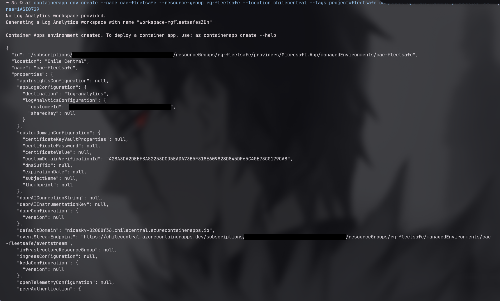

**8. Creación de la aplicación.** La aplicación `fleetsafe-api` se creó con Azure CLI a partir de la imagen `develop`, con ingreso externo al puerto 8080, entre cero y una réplica, y la contraseña de la base como secreto. El primer intento falló porque la variable con la contraseña estaba vacía en la terminal y el secreto no llegó a crearse; tras leerla de nuevo, la aplicación se creó y devolvió su dirección pública.

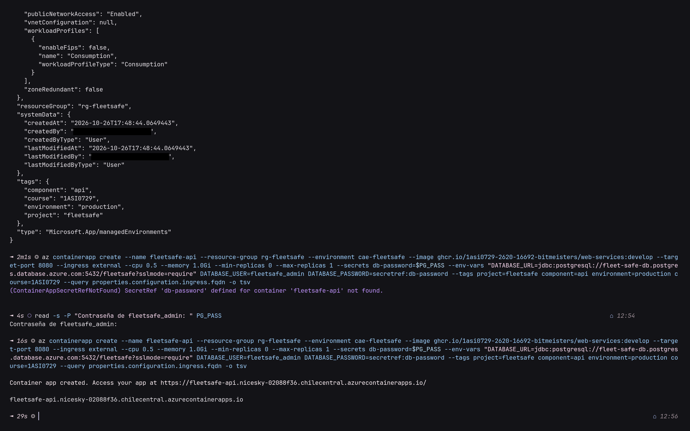

**9. Verificación del servicio.** La documentación OpenAPI responde en la dirección pública con el nombre, la versión y la descripción del servicio. Todavía no muestra operaciones, porque los controladores REST se incorporan en este mismo sprint.

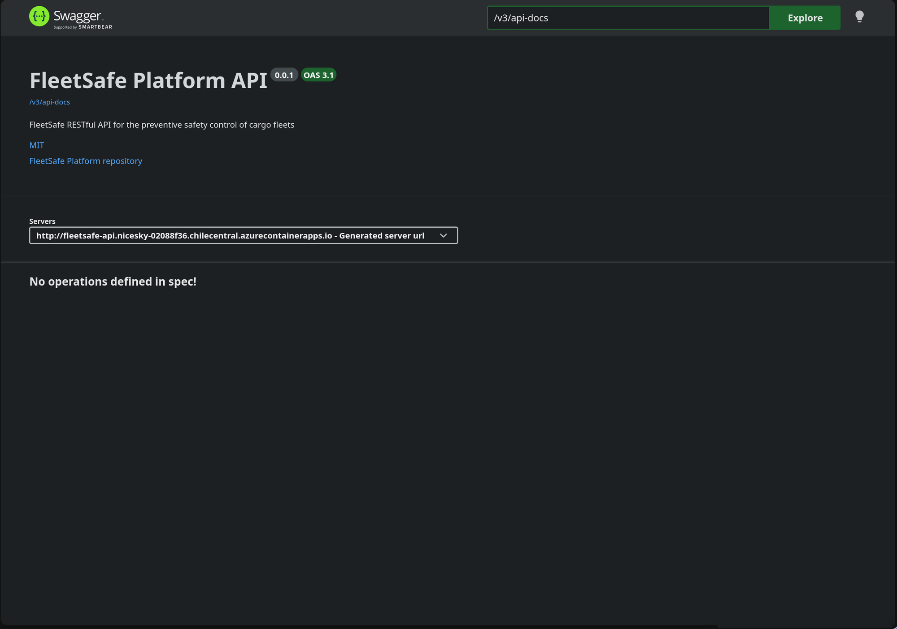

**10. Recursos desplegados.** El grupo de recursos `rg-fleetsafe` reúne el servidor de base de datos, el entorno y la aplicación de Azure Container Apps, y el espacio de trabajo de Log Analytics.

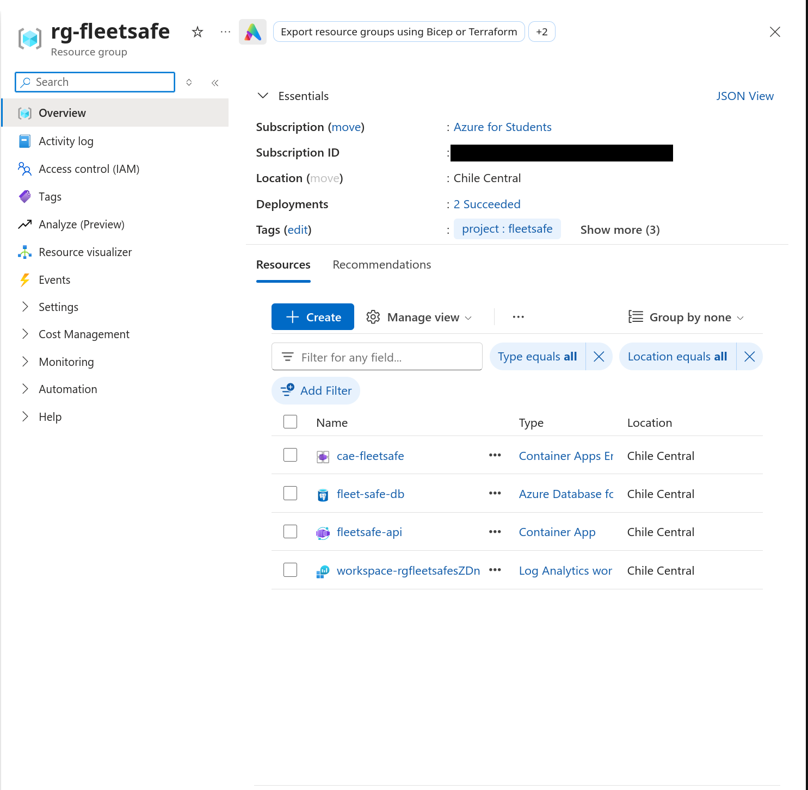

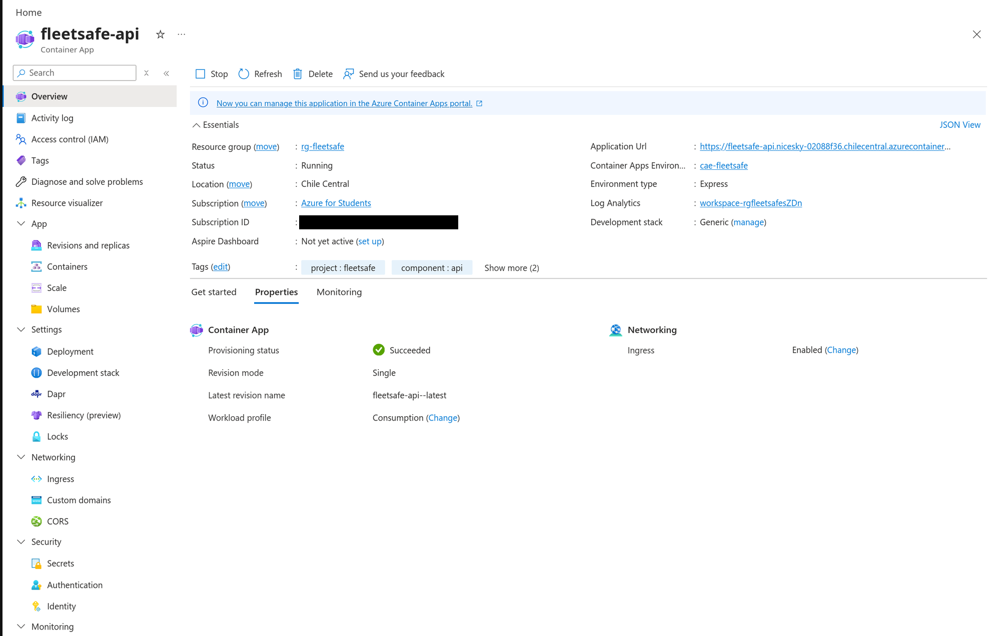

**11. Configuración de la aplicación.** Las variables `DATABASE_URL` y `DATABASE_USER` se registraron como valores, y `DATABASE_PASSWORD` como referencia al secreto `db-password`, de modo que la contraseña no aparece en la configuración.

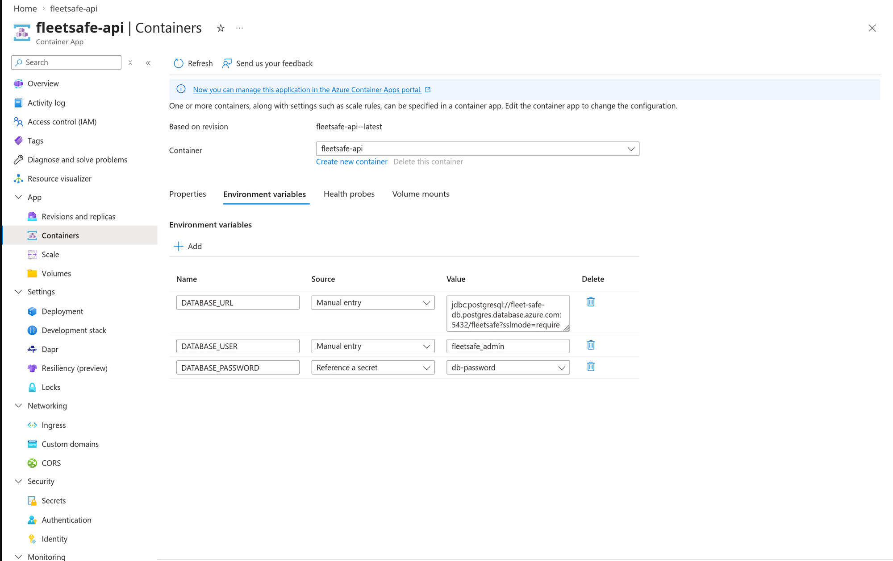

**12. Registros del arranque.** El registro en tiempo real muestra que el servicio se conectó a la base `fleetsafe`, levantó Tomcat en el puerto 8080 y terminó de arrancar.

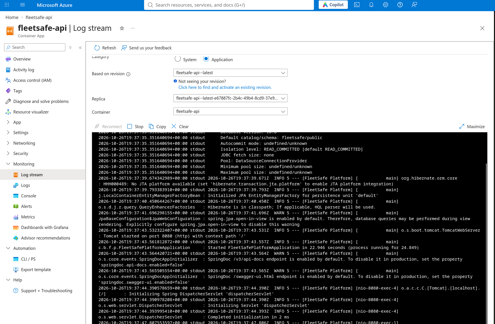

<a id="53-validation-interviews"></a>
## 5.3. Validation Interviews.

<a id="531-diseno-de-entrevistas"></a>
### 5.3.1. Diseño de Entrevistas.

<a id="532-registro-de-entrevistas"></a>
### 5.3.2. Registro de Entrevistas.

<a id="533-evaluaciones-segun-heuristicas"></a>
### 5.3.3. Evaluaciones según heurísticas.


<a id="54-video-about-the-product"></a>
## 5.4. Video About-the-Product.
<hr>

---

[← Capítulo IV](capitulo-4.md) · [Contenido](README.md#contenido) · [Conclusiones →](conclusiones.md)
